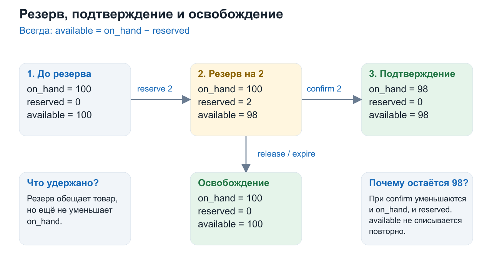
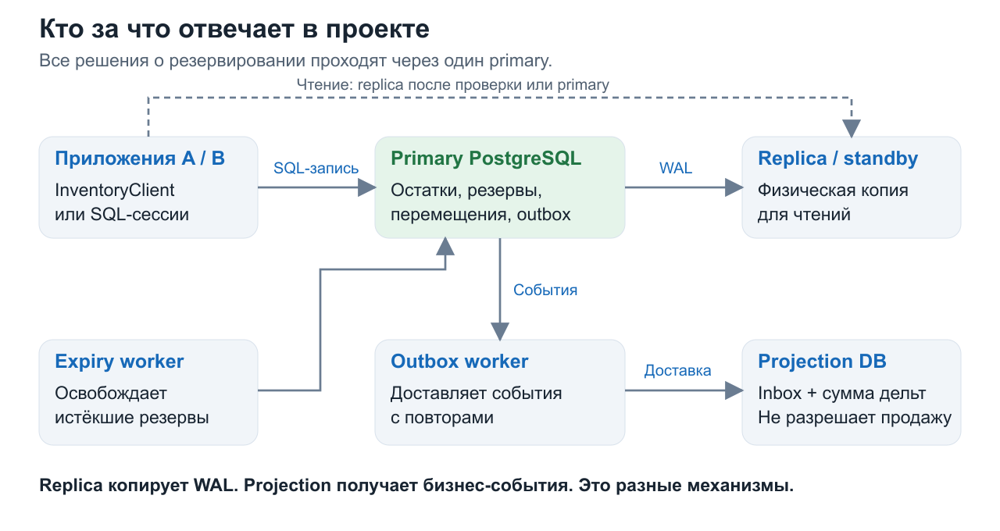
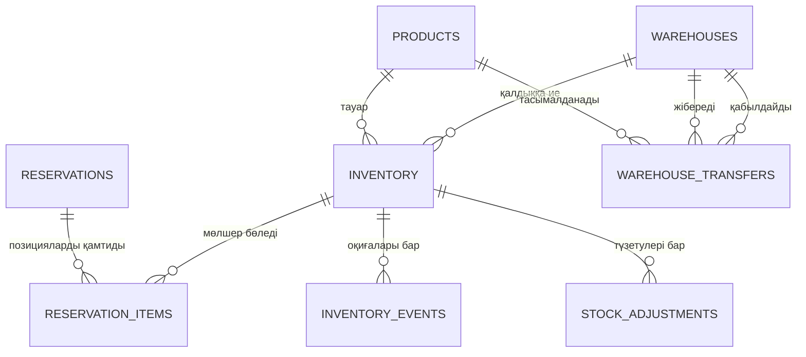
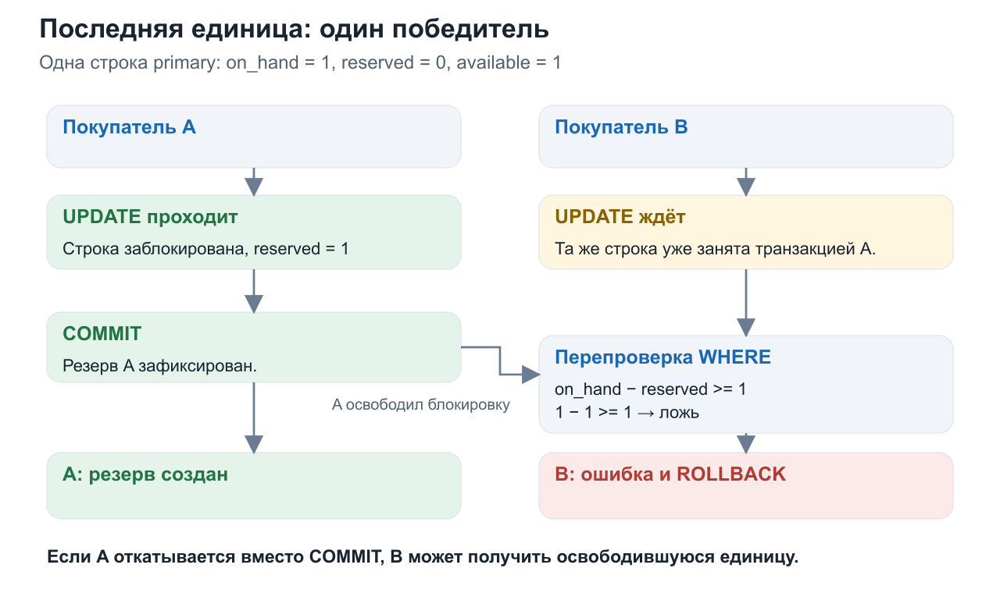
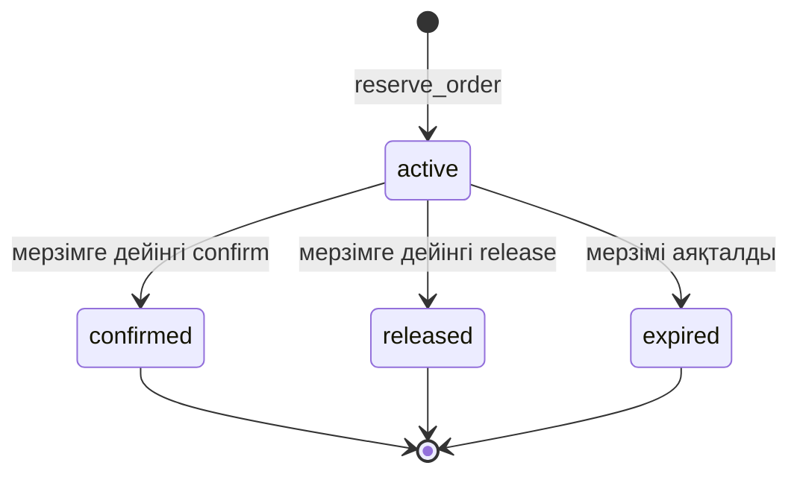
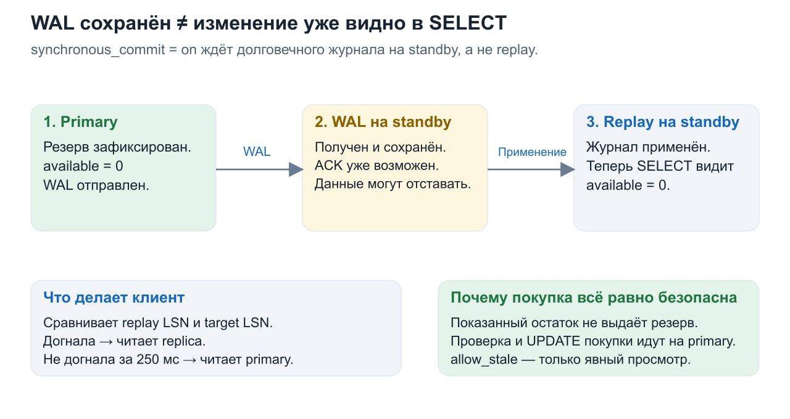
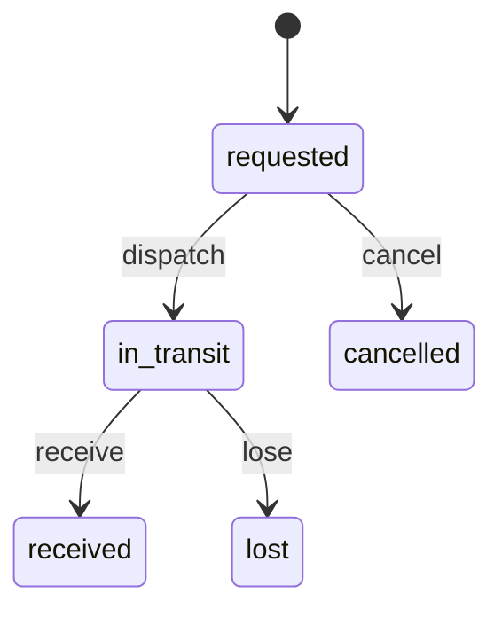
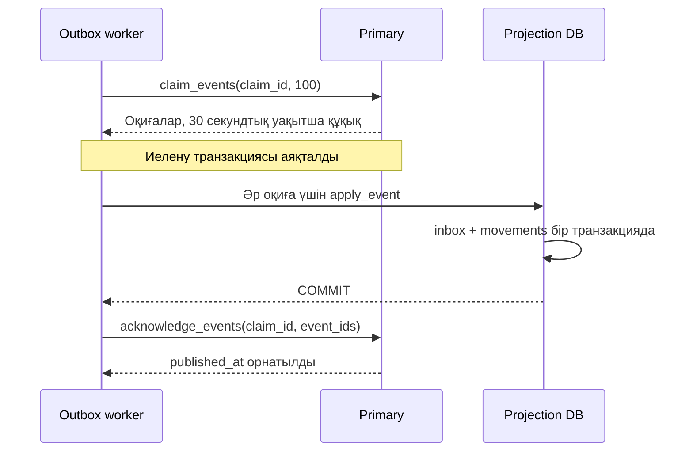

# Менің Inventory Management жобам қалай жұмыс істейді: нөлден бастап түсіндіру

Бұл — **сенің нақты жобаңа** арналған оқу құралы. Ол осы қалтадағы кодты түсіндіріп, оны 5, 6 және 7-дәрістермен байланыстырады. Алдымен қарапайым мысал, содан кейін бағдарламадағы механизм, соңында қорғау кезінде айтуға болатын тұжырым беріледі.

Түсіндірме SQL-ге, Python клиентіне, өңдегіштерге, Docker Compose-қа және сақталған тексеру нәтижелеріне негізделген. Осы файлды дайындау кезінде жоба коды өзгертілмеді. Төмендегі тест пен жүктеме нәтижелері сақталған файлдардан алынды; түсіндірме жазу үшін бұл тәжірибелер қайта іске қосылған жоқ.

## Қалай оқу керек

Барлық атауды бірден жаттауға тырыспа. Алдымен 1–10-бөлімдерді ретімен оқы: бұл — негізгі білім. Содан кейін репликацияны, деректерді бөлуді және ақауларды қарастыр. Соңында жаттығулар, қорғауға арналған жауаптар және презентация слайдтарымен байланыс берілген.

1. [Біз нақты не жасадық](#1-біз-нақты-не-жасадық)
2. [Деректердің ең маңызды жолы](#2-деректердің-ең-маңызды-жолы)
3. [Қандай бағдарламалар іске қосылады](#3-қандай-бағдарламалар-іске-қосылады)
4. [Кестелер сызбасын қалай оқу керек](#4-кестелер-сызбасын-қалай-оқу-керек)
5. [Бір сатып алудың басынан аяғына дейінгі жолы](#5-бір-сатып-алудың-басынан-аяғына-дейінгі-жолы)
6. [Біздің мысалдағы транзакция деген не](#6-біздің-мысалдағы-транзакция-деген-не)
7. [Екі сатып алушы және соңғы дана](#7-екі-сатып-алушы-және-соңғы-дана)
8. [Сұрауды қайталау тауарды неге екі рет есептен шығармайды](#8-сұрауды-қайталау-тауарды-неге-екі-рет-есептен-шығармайды)
9. [Резервті растау, босату және мерзімінің аяқталуы](#9-резервті-растау-босату-және-мерзімінің-аяқталуы)
10. [Python клиенті не істейді](#10-python-клиенті-не-істейді)
11. [Репликация мен оқу қалай ұйымдастырылған](#11-репликация-мен-оқу-қалай-ұйымдастырылған)
12. [Партициялар не үшін қажет](#12-партициялар-не-үшін-қажет)
13. [Тауарды қабылдау және қалдықты түзету](#13-тауарды-қабылдау-және-қалдықты-түзету)
14. [Тауар қоймалар арасында қалай тасымалданады](#14-тауар-қоймалар-арасында-қалай-тасымалданады)
15. [Оқиғалар, outbox, inbox және проекция](#15-оқиғалар-outbox-inbox-және-проекция)
16. [7-дәрістегі ACID, оқшаулау және бұғаттаулар](#16-7-дәрістегі-acid-оқшаулау-және-бұғаттаулар)
17. [Ақаулар және қалпына келтіру](#17-ақаулар-және-қалпына-келтіру)
18. [Нақты шардтау кезінде не өзгереді](#18-нақты-шардтау-кезінде-не-өзгереді)
19. [Тесттер мен жүктеме нені дәлелдеді](#19-тесттер-мен-жүктеме-нені-дәлелдеді)
20. [Жобаның жұмысын өзің қалай көре аласың](#20-жобаның-жұмысын-өзің-қалай-көре-аласың)
21. [Жоба мен үш дәрістің байланысы](#21-жоба-мен-үш-дәрістің-байланысы)
22. [Қорғау кезінде слайдтарды қалай түсіндіру керек](#22-қорғау-кезінде-слайдтарды-қалай-түсіндіру-керек)
23. [Тапсырманың сегіз сұрағы және challenge](#23-тапсырманың-сегіз-сұрағы-және-challenge)
24. [Өзіңді тексер](#24-өзіңді-тексер)
25. [Сөздік және файлдар картасы](#25-сөздік-және-файлдар-картасы)

---

## 1. Біз нақты не жасадық

Алматыда, Астанада және Шымкентте қоймалары бар дүкенді елестет. Ол бірдей iPhone сатады, бірақ әр қоймадағы телефон саны әртүрлі.

| Тауар | Алматы | Астана | Шымкент |
| --- | ---: | ---: | ---: |
| iPhone 17 | 100 | 50 | 25 |

Екі түрлі сұраққа жауап беру керек:

1. **Қарау:** қазір қанша тауар қолжетімді?
2. **Өзгерту:** нақты сатып алушыға нақты мөлшердегі тауарды беруге уәде ете аламыз ба?

Бірінші сұрақ каталогты көрсетуге көмектеседі. Екіншісі сатып алушы алдындағы міндеттемеге байланысты. Қолданба «1 дана» деп көрсеткенімен, батырма басылардан бір секунд бұрын оны басқа адам сатып алса, сатып алудан бас тарту керек. Сондықтан тауар санын көрсету мен резерв алу — екі бөлек әрекет.

Жобаның басты ережесі: **сәтті резервтер мен сатылымдар есепте бар тауардан артық мөлшерге уәде бермеуі керек.** Қалдықтан артық сатуды **overselling** деп атайды.

### Жобаға не кіреді

Бізде PostgreSQL, қойма операцияларына арналған SQL функциялары, Python клиенті, физикалық реплика, мерзімі өткен резервтерді өңдегіш және оқиғаларды бөлек ДҚ-ға жеткізу механизмі бар.

HTTP сервері, төлем интерфейсі және курьерлік жүйесі бар толыққанды интернет-дүкен мұнда жоқ. Мысалдарда олардың орнын `InventoryClient` шақыратын сатып алушы немесе SQL сессиясы басады. Сыртқы тапсырыс жүйесі `order_id` береді; біздің жоба қойма бөлігіне жауап береді.

Презентациядағы Kaspi стилі безендіруге қатысты. Жоба Kaspi-дің ішкі құрылымын сипаттамайды.

**Қорғауға арналған тұжырым:** «Біз қойма дерекқорын іске асырдық: әр қоймаға тәуелсіз қалдықтар, атомарлық резервтер, қатар орындалатын сатылымдардан қорғау, репликация және ақауларды өңдеу».

## 2. Деректердің ең маңызды жолы

Жобаның орталығында `inventory` кестесі орналасқан. Бір жол **бір қоймадағы бір тауарды** сипаттайды, бүкіл ел бойынша тауарды емес.

```text
warehouse_id = 1       Алматы қоймасы
product_id   = 17      iPhone 17
on_hand      = 100     резервтерді шегергенге дейінгі қойма есебіндегі тауар саны
reserved     = 3       оның белсенді резервтерге уәде етілген бөлігі
available    = 97      әлі резервтеуге болатын мөлшер
```

Формула:

```text
available = on_hand − reserved
```

### Үш сан не үшін керек

Сатып алушы тапсырысын әлі рәсімдеп жатса, телефон физикалық түрде жоғалған жоқ. Бірақ оны басқа адамға уәде етуге болмайды. Сондықтан резерв құру бірден `on_hand` мәнін емес, `reserved` мәнін өзгертеді.

| Екі телефонға қатысты әрекет | on_hand | reserved | available |
| --- | ---: | ---: | ---: |
| Бастапқы күй | 100 | 0 | 100 |
| 2 дана резервтелді | 100 | 2 | 98 |
| Сол 2 дана расталды | 98 | 0 | 98 |

Басқа нәтиже: резервті растаудың орнына оны босатсақ, `100 / 0 / 100` аламыз.



Назар аудар: **растау кезінде available қайта азаймайды**. Бұл екі дана резервтеу кезеңінде-ақ қолжетімсіз болды. Енді `on_hand` пен `reserved` қатар азаяды.

### Біздің модельдегі маңызды жеңілдету

Жобада расталған тапсырыс `on_hand` мәнін бірден азайтады. Мұнда бұл «тауар енді сатылатын қалдыққа кірмейді» дегенді білдіреді. Бұл курьер қорапты алып кетті деген дәлел емес. Жинақтау мен жөнелтуді егжей-тегжейлі есепке алу үшін `allocated`, `picked`, `shipped` сияқты қосымша күйлер қажет болар еді.

### Инвариант деген не

**Инвариант** — әр дұрыс операциядан кейін сақталуы тиіс ереже:

```text
on_hand ≥ 0
0 ≤ reserved ≤ on_hand
```

Телефон саны минус бес бола алмайды. Бар болғаны 10 дана тұрғанда 12 дананы резервтеуге болмайды.

[sql/01_schema.sql](sql/01_schema.sql) файлында бұл ДҚ деңгейінде бекітілген:

```sql
available bigint GENERATED ALWAYS AS
    (on_hand - reserved) STORED,
CHECK (on_hand >= 0),
CHECK (reserved >= 0 AND reserved <= on_hand)
```

`GENERATED ... STORED` дегеніміз: PostgreSQL `available` мәнін өзі есептеп, сақтайды. Код үшінші санды қолмен жаңартпайды, сондықтан оны жаңартуды ұмытып кетпейді.

Алайда `CHECK` жеке жолды ғана тексереді. Ол `reserved` мәнінің барлық белсенді тапсырыс позицияларының қосындысына тең екенін өздігінен тексермейді. Бұл байланысты транзакциялық функциялар сақтайды; бөлек салыстырып тексеру бұзушылықтарды анықтауға көмектеседі. Толығырақ — 16-бөлімде.

## 3. Қандай бағдарламалар іске қосылады



Барлығын [docker-compose.yml](docker-compose.yml) іске қосады. **Контейнер** — өз ортасы бар бөлек іске қосылған процесс. Бір компьютердегі бірнеше контейнер бәрібір сол компьютерге тәуелді.

| Компонент | Не істейді | Біздің компьютерден қолжетімді мекенжайы |
| --- | --- | --- |
| `db` | Негізгі PostgreSQL, қойма өзгерістерін қабылдайды | `127.0.0.1:55434` |
| `replica` | Негізгі PostgreSQL көшірмесі, оқу сұрауларына қызмет көрсетеді | `127.0.0.1:55435` |
| `projection` | Жеткізілген оқиғаларды өңдеуге арналған бөлек ДҚ | `127.0.0.1:55436` |
| `expiry-worker` | Мерзімі өткен резервтерді тауып, босатады | Фонда жұмыс істейді |
| `outbox-worker` | Негізгі ДҚ-дағы оқиғаларды проекцияға жеткізеді | Фонда жұмыс істейді |
| `sync-ready` | Іске қосылғанда синхронды репликацияны баптап, тексереді | Тексеру сәтті аяқталған соң тоқтайды |
| `InventoryClient` | SQL функцияларын шақырып, оқу түйінін таңдайтын Python коды | Шақырушы код іске қосады |

`recovery` профилінде `replacement` те бар: бұл — қалпына келтіру сценарийіне арналған жаңа реплика, үнемі жұмыс істейтін қосымша primary емес.

### Үш ДҚ-ны шатастыруға болмайды

**Primary** — «тауарды резервтеуге бола ма?» деген шешім қабылданатын орын.

**Replica** — primary өзгерістер журналын алатын физикалық көшірме. Оған қойма деректерін жазуға болмайды.

**Projection database** — `inbox` және `movements` кестелері бар дербес ДҚ. Ол бизнес оқиғаларды Python өңдегіші арқылы алады. Бұл primary-дің физикалық көшірмесі де, сату туралы шешім қабылдайтын орын да емес.

### Деректер қайда сақталады

`primary_data`, `replica_data`, `projection_data` атаулы Docker томдары контейнерлерді әдеттегідей тоқтатқанда деректерді сақтайды. `docker compose down` бұл томдарды жоймайды. `-v` параметрі бар команда оларды жояды, сондықтан әдеттегі тоқтатуға жарамайды.

Бастапқы SQL файлдары бос томда жаңа ДҚ құрылғанда орындалады. Дискідегі SQL файлын өзгерту бұрын инициализацияланған ДҚ-ны өздігінен жаңартпайды.

**Дәрістермен байланысы:** Lecture 5, PDF-тің 3–8-беттері leader/follower моделін және репликацияны түсіндіреді. Біздегі leader рөлі `primary`, follower рөлі `standby` немесе `replica` деп аталады.

## 4. Кестелер сызбасын қалай оқу керек

Алдымен үш белгілеу:

- **PK, primary key:** жолдың бірегей мекенжайы. Бірдей PK бар екі жол бола алмайды.
- **FK, foreign key:** басқа кестеде бар жолға сілтеме.
- **1:N:** бір ата-аналық жолдың көптеген еншілес жолы болуы мүмкін. Мысалы, бір тауардың бірнеше қоймадағы қалдығы.

### Сегіз негізгі кесте

| Кесте | Қарапайым түсіндірме | Негізгі кілт |
| --- | --- | --- |
| `products` | Анықтамалық: қандай тауарлар бар | `product_id` |
| `warehouses` | Анықтамалық: қандай қоймалар бар | `warehouse_id` |
| `inventory` | Бір қоймаға тиесілі бір тауардың мөлшері | `(warehouse_id, product_id)` |
| `reservations` | Резервтің бас жазбасы: идентификаторы, мерзімі және күйі | `order_id` |
| `reservation_items` | Резервке қандай қоймалардан қанша тауар кіретіні | `(order_id, warehouse_id, product_id)` |
| `inventory_events` | Қалдықтардың қандай өзгерістері болғаны; сонымен бірге outbox | `event_id` |
| `stock_adjustments` | Қандай қабылдаулар мен түзетулер қолданылғаны | `operation_id` |
| `warehouse_transfers` | Тауарды физикалық тасымалдауға арналған өтінімдер | `transfer_id` |

Толық SQL [sql/01_schema.sql](sql/01_schema.sql) файлында орналасқан. [sql/07_workers.sql](sql/07_workers.sql) файлы оқиғаларға жеткізуге арналған уақытша құқық өрістерін қосады.



Бұл сызбадағы байланыс еселігі FK рұқсат ететін сілтемелерді сипаттайды. Бизнес функция резервті кемінде бір позициямен құрады; әкімші қолмен араласқанда, бір FK-дің өзі позициясыз бас жазбаға тыйым салмайды.

### Резервтің бас жазбасы мен позициялары неге бөлек

Бір тапсырыс мыналарды қамтуы мүмкін:

```text
order_id = O1
  ├─ Алматы қоймасы, 17-тауар, саны 2
  └─ Астана қоймасы, 17-тауар, саны 1
```

`reservations` кестесі `O1` тапсырысының ортақ қасиеттерін сақтайды: `active`, мерзімінің аяқталуы және бастапқы сұрау. `reservation_items` мөлшерлері көрсетілген екі жолды сақтайды.

Бас жазбадағы `request_items` — сұраудың JSON пішіміндегі қалыпқа келтірілген көшірмесі. Ол қайталанған сұраудың шынымен сол тапсырыс екенін, ескі ID астында басқа тауарлар жиыны берілмегенін тексеру үшін қажет.

### Төменгі үш кесте неге әртүрлі байланысқан

`inventory_events` және `stock_adjustments` кестелері `inventory` ішіндегі нақты «қойма + тауар» жұбына сілтейді.

`warehouse_transfers` құрылымы басқа: бір тауар, жіберуші қойма және қабылдаушы қойма. Сондықтан оның `products` кестесіне FK-і және **`warehouses` кестесіне екі бөлек FK-і** бар. Кодта бұл кестеден `inventory` кестесіне тікелей FK жоқ. Есептен шығару мен қабылдауды тасымалдау SQL функциясы орындайды.

`inventory_events` ішіндегі `operation_id` барлық операцияға ортақ бір кестеге сілтейтін FK емес. Ол тапсырысты, түзетуді немесе тасымалдауды білдіруі мүмкін. Өрістердің атауы бірдей болғаны үшін жоқ байланысты сызбаға қосуға болмайды.

### Каталогтағы тауар және қоймадағы тауар

`products` кестесінде жолдың болуы барлық 100 қойма осы тауарды сақтайды дегенді білдірмейді. Егер жұп `inventory` ішінде жоқ болса, қоймада бұл тауарға арналған жол әлі ашылмаған. Әдеттегі түзету бұрыннан бар жолды күтеді. Тасымалданған тауарды қабылдау қабылдаушыда жетіспейтін жолды құра алады.

## 5. Бір сатып алудың басынан аяғына дейінгі жолы

Сатып алушы Алматыдан екі iPhone, Астанадан бір iPhone алғысы келеді. Бастапқы күй: `100 / 50 / 25`, резервтер жоқ.

### 1-қадам. Сыртқы қолданба идентификатор жасайды

Мысалы:

```text
order_id = 00000000-0000-0000-0000-000000000001
```

Бұл — UUID, сұраудың іс жүзінде бірегей идентификаторы. Ол тапсырыс жасау әрекетіне бір рет жасалып, желілік қайталаулар кезінде сақталады.

Қолданба нақты қоймаларды да таңдайды. Біздің кодта ең жақын қойманы іздейтін автоматты оңтайландырғыш жоқ. Кіріс сұрауында қоймалар бойынша бөлу алдын ала көрсетілген.

### 2-қадам. Python клиенті шақырылады

Шақырудың мағынасы:

```python
result = client.reserve_order(order_id, [
    {'warehouse_id': 1, 'product_id': 17, 'quantity': 2},
    {'warehouse_id': 2, 'product_id': 17, 'quantity': 1},
])
```

Клиент primary-ге параметрленген сұрау жібереді:

```sql
SELECT inventory_app.reserve_order(%s, %s::jsonb);
```

`%s` — SQL мәнінің бөлігі емес, параметрге арналған орын. `jsonb` — PostgreSQL өңдей алатын құрылымдалған JSON.

### 3-қадам. SQL функциясы сұрауды тексереді

[reserve_order](sql/02_operations.sql) ішінде мыналар тексеріледі:

1. Бос емес JSON массиві берілген.
2. Онда «қойма + тауар» жұптарының саны 100-ден аспайды.
3. Барлық позицияда идентификаторлар және оң мөлшер көрсетілген.
4. Бірдей «қойма + тауар» жұбы екі рет кездеспейді.

Содан кейін позициялар `warehouse_id, product_id` бойынша сұрыпталады. Сұрыптау қайталанған сұрауларды тұрақты салыстыру және бұғаттауларды бірдей ретпен алу үшін қажет.

### 4-қадам. Бас жазба құрылып, бұғатталады

```sql
INSERT INTO reservations (order_id, request_items, expires_at)
VALUES (p_order_id, v_items, clock_timestamp() + interval '15 minutes')
ON CONFLICT (order_id) DO NOTHING;
```

Егер ID бұрыннан бар болса, екінші жол құрылмайды. Келесі `SELECT ... FOR UPDATE` бар бас жазбаны бұғаттайды: екі сұрау оның өмірлік циклін бір уақытта өзгерте алмайды.

Ескі ID басқа тауарлармен берілсе, қате шығады. Ескі ID дәл сол тауарлармен берілсе, бұрын жазылған күй қайтарылады — қайта резервтеу орындалмайды.

### 5-қадам. Әр позиция үшін шартты UPDATE орындалады

Төменде функцияның нақты негізгі үзіндісі берілген:

```sql
UPDATE inventory
SET reserved = reserved + v_row.quantity,
    version = version + 1,
    updated_at = clock_timestamp()
WHERE warehouse_id = v_row.warehouse_id
  AND product_id = v_row.product_id
  AND on_hand - reserved >= v_row.quantity
RETURNING version INTO v_version;
```

Оны бір сөйлем ретінде оқы:

> «Керекті қойма мен тауар үшін reserved мәнін арттыр, **бірақ бос мөлшер жеткілікті болса ғана**, содан кейін жолдың жаңа нұсқасын қайтар».

Сәйкес жол болмаса немесе бос мөлшер жеткіліксіз болса, `UPDATE` ештеңені өзгертпейді. Функция `IF NOT FOUND` шартын тексеріп, ерекше жағдай туғызады.

### 6-қадам. Позициялар мен оқиғалар құрылады

Жол сәтті өзгергеннен кейін функция мыналарды кірістіреді:

- `reservation_items` жазбасы: қайдан және қанша бөлінді;
- `inventory_events` жазбасы: мысалы, `event_type = 'reserved'`, `on_hand_delta = 0`, `reserved_delta = 2`.

Барлығы бір транзакция ішінде орындалады. Сәйкес позицияны немесе оқиғаны ұмытып, тек есептегішті ғана сәтті бекітуге болмайды.

### 7-қадам. Транзакция бекітіледі

Жаңа резерв құрудың соңында мерзім қайта қойылады: позициялар өңделгеннен кейінгі ағымдағы уақыттан бастап 15 минут. Содан соң SQL функциясы `active` қайтарады.

Бірақ Python клиенті үшін жұмыс әлі аяқталған жоқ: ол `COMMIT` орындайды, қажетті синхронды растауды күтеді, содан кейін ғана WAL токені бар сәтті жауапты құрады.

Резервтеу нәтижесі:

| Қойма | on_hand | reserved | available |
| --- | ---: | ---: | ---: |
| Алматы | 100 | 2 | 98 |
| Астана | 50 | 1 | 49 |
| Шымкент | 25 | 0 | 25 |

### 8-қадам. Тапсырыс расталады немесе резерв босатылады

Растау:

```python
client.finish_reservation(order_id, 'confirm')
```

Нәтиже:

| Қойма | on_hand | reserved | available |
| --- | ---: | ---: | ---: |
| Алматы | 98 | 0 | 98 |
| Астана | 49 | 0 | 49 |
| Шымкент | 25 | 0 | 25 |

Растаудың орнына `'release'` беруге болады, сонда екі қоймадағы қолжетімді тауар саны бастапқы мәніне қайтады. Сыртқы төлем 15 минут бойы ашық тұрған транзакцияның ішінде емес, **қысқа транзакциялар арасында** орындалады.

## 6. Біздің мысалдағы транзакция деген не

**Транзакция** ДҚ-дағы бірнеше әрекетті біртұтас операцияға біріктіреді:

```text
BEGIN
  бас жазбаны құру
  Алматыдағы reserved мәнін арттыру
  Алматының позициясы мен оқиғасын жазу
  Астанадағы reserved мәнін арттыру
  Астананың позициясы мен оқиғасын жазу
COMMIT
```

`COMMIT` нәтижені бекітеді. `ROLLBACK` осы транзакцияның әрекеттерін кері қайтарады.

### Астанада тауар жетпесе ше?

Алматы өңделіп болды делік, бірақ Астанаға арналған сұрау қолжетімді 50 телефонның орнына 1 000 телефонды талап етеді.

```text
Алматы: UPDATE транзакция ішінде уақытша орындалды
Астана: UPDATE жеткілікті қалдық таппады
Функция: RAISE EXCEPTION
Нәтиже: бүкіл сұрау кері қайтарылды
```

Дерекқорда Алматының жартылай резерві де, сәтсіз тапсырыстың бас жазбасы да, оның позициялары мен оқиғалары да қалмайды.

Бұл — **atomicity**, Lecture 7 PDF-інің 2–5 және 9–12-беттеріндегі атомарлық қасиет. Дәрістегі банк аударымы есептен шығару мен шотқа қосуды біріктіреді; біздің тапсырыс бірнеше қоймадан тауар бөлуді біріктіреді.

### Python ішінде транзакция нақты қай жерде басталады

[inventory_client.py](inventory_client.py) файлындағы `_write_once` әдісі:

```python
connection.autocommit = False
with connection:
    # SET LOCAL synchronous_commit = on
    # primary рөлін тексеру
    # SQL функциясын шақыру
    ...
# қалыпты шығу кезінде осы жерде COMMIT орындалып қойған
```

`psycopg2` кітапханасындағы `with connection` контексті сәтті аяқталғанда транзакцияны бекітеді, ал ерекше жағдай болса, кері қайтарады.

SQL функциясы циклдің ортасында өздігінен `COMMIT` орындамайды. Ол шақырушы сессияның транзакциясында жұмыс істейді. Оны `psql` ішінен айқын `BEGIN`-сіз шақырса, `psql` әдеттегі режимде операторды жеке транзакцияда орындайды.

Егер қате айқын `BEGIN` ішінде пайда болса, сессия `ROLLBACK` орындалғанша сәтсіз транзакция күйінде қалады. B демонстрациясында мұны қолмен орындау керек.

## 7. Екі сатып алушы және соңғы дана

Бұл — тапсырманың негізгі challenge-і және Lecture 7 PDF-інің 14-бетіндегі соңғы орын мысалы.

Қойма мен тауардың **бір жұбы** үшін бастапқы күй:

```text
on_hand = 1, reserved = 0, available = 1
```

A сатып алушысы A қолданбасы арқылы жұмыс істейді. B сатып алушысы басқа B қолданбасы арқылы жұмыс істейді. Олар әртүрлі `order_id` мәндерімен бір уақытта `reserve_order` шақырады.



| Сәт | A | B |
| --- | --- | --- |
| 1 | `UPDATE` операторына бірінші жетеді | Сол жолды өзгертуге тырысады |
| 2 | Жолды бұғаттап, `reserved = 1` орнатады | Бұғаттаудың босауын күтеді |
| 3 | `COMMIT` орындайды | Жұмысты жалғастыру мүмкіндігін алады |
| 4 | Бекітілген белсенді резерві бар | PostgreSQL `WHERE` шартын қайта тексереді |
| 5 | Жеңді | `1 − 1 >= 1` — жалған; өзгерген жол жоқ, ерекше жағдай және кері қайтару |

Егер A `COMMIT` орнына `ROLLBACK` орындаса, оның өзгерісі жойылып, B тауарды сәтті резервтей алады. Егер B бірінші келсе, рөлдер ауысады. Нақты бір клиенттің жеңуі емес, бір ғана жеңімпаз болуы кепілденеді.

### Бұғаттауды кім ұстайды

Python процесі емес, **PostgreSQL**. Сондықтан қолданбаның әртүрлі даналары, контейнерлер мен компьютерлер бір негізгі primary-ге жүгінсе, механизм олардың арасында да жұмыс істейді.

A қолданбасындағы қарапайым `threading.Lock` B қолданбасынан қорғамайды. Клиентте қосылымдар пулын қауіпсіз басқаруға арналған Python бұғаттауы бар, бірақ ол қойма қалдығын қорғамайды.

### Алдымен жай SELECT, содан кейін UPDATE жасау неге болмайды

Қате тәсіл:

```text
A available = 1 мәнін оқыды
B available = 1 мәнін оқыды
A «маған болады» деп шешті
B «маған да болады» деп шешті
```

Екеуі де сол сәттегі дұрыс мәнді оқыды, бірақ оқу тауарды сатып алушыға бекітпеді. Қарапайым `READ COMMITTED` мұндай логиканы өздігінен қауіпсіз резервке айналдырмайды.

Бізде мөлшерді тексеру **reserved мәнін өзгертетін UPDATE операторының өзінде** орналасқан. Тағы бір жарамды тәсіл — алдымен қажетті жолды `SELECT ... FOR UPDATE` арқылы бұғаттау, содан кейін сол қысқа транзакцияда тексеріп, өзгерту. Біздің резервтеу функциясы шартты `UPDATE` қолданады; резервті аяқтау қосымша айқын бұғаттауларды пайдаланады.

### A әлі COMMIT жасамағанда үшінші оқырман не көреді

Қарапайым `SELECT` кезінде ол қолжетімді бір данасы бар, бұрын бекітілген жол нұсқасын көруі мүмкін. PostgreSQL MVCC пайдаланып, оған A-ның аяқталмаған жазбасын көрсетпейді. Қарау үшін бұл қалыпты; резерв алу әрекеті бәрібір primary-дегі бұғаттау мен тексеруге тап болады.

Егер **әртүрлі** қоймаларда бір-бір телефоннан болса, екі сатып алу да өтуі мүмкін: бұлар — екі бөлек нақты дана және `inventory` кестесіндегі екі бөлек жол.

**Қорғауға арналған тұжырым:** «Екі қолданба да бір қойма жолына келеді. Шартты UPDATE оны бұғаттайды; жеңімпаздан кейін екінші UPDATE WHERE шартын қайта тексеріп, енді қолжетімсіз дананы резервтемейді».

## 8. Сұрауды қайталау тауарды неге екі рет есептен шығармайды

ДҚ телефонды резервтеп, `COMMIT` орындап қойды, бірақ жауап желіде жоғалды деп елестет. Қолданба нәтижені білмей, сұрауды қайталайды.

Транзакция «ДҚ-да бәрі орындалады немесе ештеңе орындалмайды» деген мәселені шешті. Бірақ ол желідегі жауап сатып алушыға жеткеніне кепілдік бере алмайды. Бұл — екі бөлек мәселе.

### Идемпотенттілік

Мұндағы **идемпотенттілік** бір команданы қайталау қойма өзгерісін екінші рет қолданбайды дегенді білдіреді.

```text
Алғашқы сұрау:   ID = O1, Алматы, 17-тауар, саны 2
                → reserved 2-ге артты

Сұрауды қайталау: ID = O1, дәл сол позициялар
                 → сақталған күйді қайтару
                 → reserved мәнін қайта арттырмау
```

Қорғаныс `order_id` бойынша PK-ден, `ON CONFLICT` операторынан, бас жазбаны бұғаттаудан және `request_items` салыстыруынан тұрады.

Сұрауды сұрыптау позициялар ретін маңызды етпейді: «алдымен Алматы, содан кейін Астана» және «алдымен Астана, содан кейін Алматы» бір ретке келтіріледі.

### Қайталаудың үш түрі

| Жағдай | Әрекет |
| --- | --- |
| Ескі ID, дәл сол тауарлар | Сақталған күй қайтарылады |
| Ескі ID, басқа мөлшер немесе қойма | Қате: ID мағынасын өзгертуге болмайды |
| Жаңа ID, дәл сол тауарлар | Бұл — қосымша тауарды резервтей алатын бөлек операция |

Сондықтан әр желілік қайталауда жаңа UUID жасауға болмайды.

Мерзімі өткен ескі резервті қайталау `expired` қайтарады; бұл **жаңа сәтті резерв емес**. Мерзім өткеннен кейін қайта сатып алуға әрекеттену үшін жаңа ID керек. Шақырушы код қайтарылған күйді міндетті түрде тексеруі тиіс.

Алғашқы әрекет тауар жетіспегендіктен толық кері қайтарылса, оның бас жазбасы да кері қайтарылады. Бұл модельде қабылданбаған сұрау туралы тұрақты жазба қалмайды, сондықтан ID-ді, мысалы, тауар толықтырылғаннан кейін қайталауға болады.

Ұқсас қорғаныс түзетулерде (`operation_id`) және тасымалдауларда (`transfer_id`) де бар. Резервті аяқтау соңғы күйді қайта оқып, өзгерісті екінші рет қолданбайды.

## 9. Резервті растау, босату және мерзімінің аяқталуы

[finish_reservation](sql/02_operations.sql) ішінде `confirm`, `release`, `expire` әрекеттеріне рұқсат етілген.



Соңғы күйлерден `active` күйіне қайту болмайды.

### finish_reservation жұмыс реті

1. Әрекеттің рұқсат етілгенін тексеру.
2. Бас жазбаны тауып, `FOR UPDATE` бұғаттауын алу.
3. Күйі соңғы болса, оны қайтару.
4. Байланысты барлық `inventory` жолдарын қойма мен тауар ретімен бұғаттау.
5. **Бұғаттаулар алынғаннан кейін** ДҚ-ның ағымдағы уақытын `expires_at` мәнімен салыстыру.
6. Соңғы күйді таңдап, есептегіштерді өзгерту.
7. Оқиғаларды, күйді және `completed_at` мәнін бір транзакцияда жазу.

| Соңғы нәтиже | on_hand өзгерісі | reserved өзгерісі |
| --- | ---: | ---: |
| `confirmed` | `−quantity` | `−quantity` |
| `released` | 0 | `−quantity` |
| `expired` | 0 | `−quantity` |

### Confirm және expiry бір уақытта келсе

Екеуі де бір бас жазбаны бұғаттауға тырысады. Біреуі бірінші өтеді, екіншісі күтеді. Күткеннен кейін екіншісі соңғы күйді көріп, қайта босатпайды және есептен қайта шығармайды.

Мерзім өтіп кетсе, тіпті `confirm` әрекеті де `expired` күйіне айналып, тауар босатылады. Сатып алушы телефонының сағаты емес, ДҚ серверінің уақыты тексеріледі.

Мерзім шекарасы — бұғаттаулар алынғаннан кейінгі тексеру сәті. Мерзімге дейін рұқсат етілген растаудың `COMMIT` әрекеті сәл кейінірек аяқталуы мүмкін; бұл уақыт бекітілгеннен кейін тексерілді дегенді білдірмейді.

### expiry-worker не үшін керек

Онсыз ұмытылған резерв біреу оны аяқтауды шақырғанша `reserved` есептегішінде қала алады. Өңдегіш мерзімі өткен белсенді резервтерді үздіксіз табады.

[sql/07_workers.sql](sql/07_workers.sql) ішіндегі негізгі SQL:

```sql
SELECT order_id INTO v_order FROM reservations
WHERE status = 'active' AND expires_at <= statement_timestamp()
ORDER BY expires_at, order_id
FOR UPDATE SKIP LOCKED LIMIT 1;
```

`SKIP LOCKED` «басқа өңдегіш алған резервті күтпе; келесісін ал» дегенді білдіреді. Бұл фондық тапсырмалар кезегіне ыңғайлы. «Жалпы тауар саны нақты қанша?» деген жауапқа мұндай тәсілді қолдануға болмайды: ол бос емес жолдарды әдейі өткізіп жібереді.

Таңдаудан кейін `expire_one()` сол оператордың/транзакцияның ішінде `finish_reservation(..., 'expire')` шақырады. Сондықтан алынған резерв жартылай өңделген күйде қалмайды.

Python циклі [workers.py](workers.py) файлында орналасқан. Жұмыс болмаса, ол 0,25 секунд күтеді; өңделетін қатеден кейін келесі әрекетке дейін бір секунд күтеді. TTL аяқталған миллисекундта дәл босатуға кепілдік берілмейді. Worker кідірісі тауардың қолжетімділігін уақытша азайтуы мүмкін, бірақ мерзімі өткен тапсырыстың кешігіп келген `confirm` әрекетіне жол бермейді.

## 10. Python клиенті не істейді

[inventory_client.py](inventory_client.py) — ДҚ операцияларына ыңғайлы кіру нүктесі. Қалдықтардың бизнес ережелері SQL-де орналасқан, ал клиент қосылымдарды, транзакцияларды, қайталауларды және оқу бағытын басқарады.

### Бір жазу операциясы

```text
reserve_order / finish_reservation / adjust_stock / ...
    → _write
        → _write_once
            → primary-ге қосылу
            → READ COMMITTED, BEGIN
            → synchronous_commit = on
            → түйіннің standby емес екенін тексеру
            → SQL функциясын шақыру
            → COMMIT
            → WAL токенін алу
            → status + token қайтару
```

Токен бекітуден кейін құрылады. Егер аралықта басқа жазулар аяқталса, ол WAL-дың кейінірек орналасқан позициясын да көрсетуі мүмкін; «менің жазбамнан ерте емес» кепілдігі үшін бұл жарамды.

### Қосылымдар пулы

PostgreSQL-ге жаңа қосылым орнату бұрын ашылғанын қайта пайдаланудан қымбатырақ. Сондықтан клиент `ThreadedConnectionPool` және шектеуші семафор қолданады.

Әдепкі шек — бүкіл әлемдегі барлық қолданбаға 8 қосылым емес, **клиент данасындағы қосылу параметрлерінің әр жиынына 8 қосылым**. Primary мен replica пулдары бөлек болуы мүмкін. Фондық workers үшін кодта `pool_size=2` берілген.

Барлық орын бос болмаса, бос орынды күту екі секундпен шектеледі. Жабылған немесе зақымдалған қосылымдар пулдан шығарылады. Бұл — ресурстарды басқару; overselling-ден 7-бөлімдегі SQL механизмі қорғайды.

### Уақытша қателерден кейін қайталау

`_write` алғашқы әрекетті қоса есептегенде ең көбі үш рет әрекеттенеді. Қайталаулар арасында біртіндеп өсетін кідіріс және аздаған кездейсоқ ауытқу бар — **backoff + jitter**. Бұл барлық клиенттің бір уақытта қайта сұрау жіберуін азайтады.

Код сериализацияның, deadlock-тың, бұғаттауды күтудің, оператордың тоқтатылуының және қосылымның кейбір қателерінен кейін сұрауды қайталайды. Сұрау сол параметрлермен және сол ID-мен қайталанады. `Insufficient stock` қатесі бизнес қатесі болып саналады және әдеттегі автоматты қайталау тармағына кірмейді.

Әрекеттер саны таусылса, шақырушы код қате алады. Бұл `COMMIT` болмағанын әрдайым дәлелдемейді: қосылым сәтті жазудан кейін үзілуі мүмкін. Сондықтан ID-ді ұмытып, жаңасына ауыстыруға болмайды.

### Таймауттар жалпы жауап беру мерзіміне тең емес

Клиентте `connect_timeout=2`, `statement_timeout=2000`, `lock_timeout=1000` және пулды күту шегі бар. Бұл баптаулар әртүрлі кезеңге жауап береді.

«Бүкіл сатып алу әрдайым екі секундта аяқталады» деп уәде етуге болмайды: міндетті реплика қолжетімсіз болса, синхронды `COMMIT` күту ұзағырақ созылуы мүмкін. Жауаптың болмауы бастапқы ID нәтижесін анықтау керектігін білдіреді.

### Қолданбаның құқықтары

[sql/08_access.sql](sql/08_access.sql) файлы `inventory_service` рөлін құрады. Оған оқу және арнайы функцияларды шақыру рұқсат етілген, бірақ тікелей `UPDATE inventory` орындауға рұқсат жоқ.

Функциялар бекітілген `search_path` мәнімен `SECURITY DEFINER` ретінде жұмыс істейді. Қарапайым тілмен айтқанда: қолданбаға барлық кестені еркін өзгерту емес, қажетті құқықтары бар нақты тексерілген рәсімді орындау рұқсаты беріледі.

Workers осы рөлге бапталған. Жергілікті демонстрация үшін клиенттің әдепкі конфигурациясында `postgres` әкімшісі көрсетілген; қолданба рөлі орта параметрлері арқылы таңдалады. Сондықтан рөл шектеулері жұмыс жолын қорғайды, бірақ ДҚ иесінің деректерді қолмен бұзуына тыйым салмайды.

## 11. Репликация мен оқу қалай ұйымдастырылған

**Репликация** — бір деректерді басқа түйінге көшіру. Бұл Lecture 5 тақырыбы.

### 11.1. Реплика қалай құрылады

[docker/replica-entrypoint.sh](docker/replica-entrypoint.sh) ішінде `pg_basebackup` іске қосылады: primary-дің келісілген бастапқы көшірмесі жасалады. Ол журналдағы позицияға байланыстырылған. Содан кейін standby кейінгі өзгерістерді ағындық физикалық репликация арқылы алады.

Бұл Lecture 5 PDF-інің 7-бетіне сәйкес келеді: snapshot, журналдың нақты позициясы, өзгерістерді қуып жету, әрі қарай үздіксіз жеткізу.

Replication slot primary-ге репликаға қажет WAL-ды сақтап тұруға көмектеседі. Стендте сақтау `max_slot_wal_keep_size=1GB` мәнімен шектелген. Артта қалған реплика жойылып кеткен WAL-ға қол жеткізе алмаса, жаңа базалық көшірме қажет болуы мүмкін. Slot шексіз тегін сақтау бермейді.

### 11.2. WAL деген не

**Write-ahead log** — PostgreSQL өзгерістерді қалпына келтіруге қажет мәліметтерді тіркейтін журнал. Алдымен журналдың қажетті жазбалары сенімді сақталуы тиіс, ал кестелердің жаңартылған беттері өз файлдарына кейінірек жазыла алады. Ақаудан кейін PostgreSQL қалпына келтіру үшін WAL пайдаланады.

Бұл жобада standby физикалық WAL алады. Python кестелерді replica-ға жол-жолымен көшірмейді және онда `reserve_order` функциясын қайта шақырмайды.

### 11.3. Нақты не синхронды орындалады

`sync-ready` мынаны орнатады:

```text
synchronous_standby_names = FIRST 1 (inventory_replica)
```

Ал клиент жазу үшін мынаны орнатады:

```sql
SET LOCAL synchronous_commit = on;
```

Клиентке сәтті расталған жазу үшін бұл мынаны білдіреді: WAL primary-де бекітілген және таңдалған синхронды standby-де тұрақты сақталған. Міндетті standby жоғалса, жаңа жазулар қауіпсіз емес сәтті растау алмауы керек.

Бірақ **журналды сақтау және оны оқылатын деректерге қолдану — екі бөлек кезең**.



```text
Primary: соңғы дананы резервтеді
Standby: WAL-ды алып, сақтады → sync ACK үшін жеткілікті
Standby: WAL-ды әлі қолданған жоқ → SELECT әзірге ескі дананы көрсетуі мүмкін
```

Сондықтан «бізде синхронды реплика бар» деген сөз replay lag өңдеуді қажетсіз етпейді. `synchronous_commit=remote_apply` нұсқасы қолданылуын да күтер еді, бірақ қазіргі код `on` пайдаланады.

### 11.4. LSN — журналдағы позиция

**LSN, log sequence number** — WAL ішіндегі мекенжай/позиция, мысалы, `0/16B6C50`. Бұл тауар саны да, миллисекундпен өлшенетін уақыт та емес.

Қарапайым ұқсастық: primary журналды 120-бетке дейін жазып қойды, ал replica тек 118-бетке дейін оқып, қолданды. Қажетті жазбаны көру үшін қолдану позициясы жеткілікті болғанша күту керек.

Код primary-де `pg_current_wal_flush_lsn()` мәнін алады, ал replica-да `pg_last_wal_replay_lsn()` мәнін тексереді.

### 11.5. Әдеттегі өзекті деректерді оқу

`read_inventory` әдісі әдепкіде:

1. Primary-ге жүгініп, WAL-дың мақсатты тұрақты позициясын алады.
2. Түйіннің шынымен primary екенін тексереді.
3. Replica-ға қосылып, оның рөлін, `system_id`, `timeline`, replay LSN мәндерін тексереді.
4. Replica WAL-ды кемінде мақсатты позицияға дейін қолданса, қалдықты содан оқиды.
5. Артта қалса, әдепкіде 250 мс-қа дейін күтеді.
6. Күтіп үлгермесе, replica қолжетімсіз болса немесе сәйкестендіру деректері басқа болса, primary-ден оқиды.

Жауапта `source`, `reason`, `lag_bytes` және `stock` көрсетіледі. `lag_bytes` — WAL позициясы бойынша артта қалу; жоғалған оқиғалар саны да, деректердің нақты жасы да емес.

Әдеттегі өзекті оқу режимі бәрібір метадеректер үшін primary-ге жүгінеді. Ол қойма деректерін оқудың өзін жеңілдетеді, бірақ primary-ді толықтай қажетсіз етпейді.

### 11.6. Read-after-write және токен

Жазудан кейін клиент мынаны қайтарады:

```text
status: active
token:
  system_id: PostgreSQL кластерінің идентификаторы
  timeline: WAL тарихының тармағы
  lsn: COMMIT-тен кейінгі тұрақты позиция
```

Келесі оқуға `after=result['token']` беріп, оны бұрын орындалған жазумен байланыстыруға болады. Бұл — Lecture 5 PDF-інің 11–12-беттеріндегі **read-your-writes / read-after-write** идеясы.

`system_id` және `timeline` не үшін керек? Басқа кластерге қосылсақ немесе failover-ден кейін тарих басқа тармақпен жалғасса, LSN сандарының үлкендігін жай салыстыру жеткіліксіз. Код мұндай токендерді қабылдамайды. Ол ескі токенді жаңа тарихқа автоматты түрде аудармайды: тапсырыстың нәтижесі жаңа primary-де бастапқы ID бойынша анықталады.

Деректердің өзектілігі «тексерілген WAL позициясынан ерте емес» дегенді білдіреді. Бұл позиция таңдалғаннан кейін біреу аяқтап үлгерген кез келген жазуды көруге уәде бермейді. Алынған қалдық оқудан кейін бірден өзгеруі мүмкін; соңғы шешімді жаңа шартты UPDATE қабылдайды.

### 11.7. Екі арнайы режим

| Шақыру | Әрекет |
| --- | --- |
| `authoritative=True` | Бірден негізгі түйіннен оқиды |
| `allow_stale=True` | Primary-ге жүгінбей replica-дан оқиды; `freshness: not_guaranteed` деп айқын көрсетеді |

`allow_stale` primary істен шыққанда да шамамен каталог көрсетуге пайдалы. Оны `after` немесе `authoritative=True` параметрлерімен біріктіруге болмайды. Ол ескірген қалдыққа сүйеніп тауар сатуға рұқсат бермейді.

### 11.8. Неге multi-leader және leaderless таңдалмады

Lecture 5 бірнеше лидерді, кворумдарды, қайшылықтарды шешуді және last-write-wins тәсілін қарастырады. Мұнда бір primary таңдалған, өйткені соңғы дана үшін өзгерістердің бір негізгі реті қажет.

Екі тәуелсіз лидер де соңғы дананы уәде етіп, өзгерістермен кейін ғана алмасса, жай біріктіру сатып алушыларға берілген екі уәдені жоймайды. Last-write-wins бір жазбаны алып тастай алады, бірақ бизнес мәселесін шешпейді.

Бізде клиенттің `w+r>n` кворум протоколы, version vectors, read repair немесе CRDT жоқ. Бір `inventory.version` саны version vector болып саналмайды. Бұлар — дәрістегі балама идеялар, оларды іске асырылған компоненттер деп көрсетуге болмайды.

## 12. Партициялар не үшін қажет

**Partitioning** — бір деректер жиынын бөліктерге бөлу. **Replication** — деректер көшірмелерін жасау. Lecture 6 PDF-інің 4-бетінде оларды біріктіруге болатыны көрсетілген: деректердің әртүрлі бөліктері және әр бөліктің көшірмелері.

Кодта:

```sql
PRIMARY KEY (warehouse_id, product_id)
) PARTITION BY HASH (warehouse_id);
```

Цикл `inventory_p0` … `inventory_p15` бөліктерін құрады.

```text
inventory логикалық кестесі
  ├─ inventory_p0
  ├─ inventory_p1
  ├─ ...
  └─ inventory_p15

Қазір осы бөліктердің бәрі бір PostgreSQL primary ішінде орналасқан.
Standby оларды физикалық ДҚ-ның қалған бөлігімен бірге көшіреді.
```

### Бөлік қалай таңдалады

`warehouse_id` хеші қолданылады. Мағынасы: «кілттің хеші мәндерді 16 себетке бөледі». PostgreSQL жай ғана `warehouse_id % 16` есептейді деп айтуға болмайды: нақты хеш функциясы күрделірек.

Бір қойма әрдайым бір партицияға түседі. Бірақ бір партицияда бірнеше қойма болуы мүмкін. **100 қойма дегеніміз 100 партиция емес.**

### Неге қойма бойынша бөлінеді

Өйткені қабылдау, есептен шығару және қойма операцияларының басым бөлігі `warehouse_id` мәнін алдын ала біледі. Ол қалдықтың тәуелсіз иесін де анықтайды.

Егер сұрауда мына шарт болса:

```sql
WHERE warehouse_id = 1 AND product_id = 17
```

PostgreSQL қажетсіз бөліктерді қарастырмауы мүмкін — бұл **partition pruning** деп аталады. Құрама PK қажетті бөліктің ішінен жолды табуға мүмкіндік береді.

Сұрау тек `product_id = 17` шартын қамтып, тауарды бүкіл желіден іздесе, шарт бір қойма партициясын анықтамайды. Бірнеше бөлікті қарап, нәтижелерін біріктіруге тура келеді. Нақты қашықтағы шардтарда ұқсас тәсіл **scatter/gather** деп аталады.

### product_id бойынша бөлсек ше

Бір тауарды барлық қоймадан іздеу ыңғайлырақ болады. Бірақ бір қойманың тауарлары әртүрлі бөліктерге түседі. Физикалық тарату кезінде жергілікті қойма операциялары күрделенеді.

Lecture 6 PDF-інің 5–10-беттерінде түсіндірілгендей, таңдау сұрауларға байланысты. `warehouse_id` — кез келген дүкенге әмбебап ең жақсы кілт емес, негізделген ымыралы шешім.

### Біздің PostgreSQL партициялауы және дәрістегі шардтау

Дәріс негізінен **әртүрлі машиналардағы** бөліктерді қарастырады. Біз бірінші кезеңді іске асырдық: бір сервер ішіндегі декларативті бөліктер.

Сондықтан 16 партиция:

- 16 тәуелсіз CPU мен диск бермейді;
- жазуға болатын 16 серверді білдірмейді;
- олардың арасындағы тапсырыс үшін таратылған `COMMIT` талап етпейді;
- машиналар арасында автоматты теңгерімдеуді қамтамасыз етпейді.

Индекстер сәйкес бөліктерде орналасқан; жобада бөлек таратылған global index, ZooKeeper арқылы маршруттау каталогы, consistent-hash ring және автоматты rebalancing жоқ.

Физикалық кеңейтуді және оның құнын 18-бөлімде қарастырамыз.

## 13. Тауарды қабылдау және қалдықты түзету

Әр өзгеріс сатып алу емес. Мысалы, жеткізуші 10 телефон әкелді немесе түгендеу кезінде бүлінген тауар табылды.

Ол үшін [sql/02_operations.sql](sql/02_operations.sql) ішінде `adjust_stock` бар:

```text
operation_id: осы түзетудің бірегей идентификаторы
warehouse_id: қойма
product_id: тауар
delta: өзгеріс, мысалы +10 немесе −1
reason: себеп
```

Әрекеттер реті:

1. ID бұрын кездеспесе, команданы `stock_adjustments` кестесіне жазу.
2. Қайталау кезінде қойманы, тауарды, delta мен себепті салыстыру.
3. Жаңа команда үшін `on_hand` мәнін өзгертіп, `version` арттыру және оқиға жазу.
4. Барлығын бірге бекіту.

Мысал: сатып алу расталғаннан кейін Алматыда `98 / 0 / 98` болды. `+10` жеткізілімі `108 / 0 / 108` береді. Сол жеткізілімді қайталау 118 телефон емес, `already_applied` қайтарады.

Теріс түзету кезінде мына шарт тексеріледі:

```sql
AND on_hand + p_delta >= reserved
```

Егер `on_hand=10`, `reserved=8` болса, 2 дананы есептен шығаруға болады, бірақ 5 дананы үнсіз есептен шығаруға болмайды: әйтпесе уәде етілген телефондар қалған тауардан көп болады. Түгендеудегі нақты сәйкессіздік бизнес шешімін талап етеді: тексеру жүргізу, әсер еткен резервтерді жою немесе қайта бөлу.

Python ішіндегі `adjust_stocks` осындай 1–100 операцияны бір транзакцияға біріктіріп, сұрыптайды. Біреуі дұрыс болмаса, осы топтамадағы алдыңғы операциялар кері қайтарылады. Бұл — тексерулерді өшіру емес, топтамалық режим.

## 14. Тауар қоймалар арасында қалай тасымалданады

«Қоймаларды синхрондау» барлық қаладағы тауар санын теңестіру дегенді білдірмейді. Физикалық жөнелту мен қабылдауды дұрыс есепке алу қажет.

[sql/06_transfers.sql](sql/06_transfers.sql) ішінде екі функция бар:

- `request_transfer` `transfer_id` арқылы өтінім құрады;
- `advance_transfer` оны `dispatch`, `receive`, `cancel`, `lose` әрекеттерімен келесі кезеңге өткізеді.



### Мысал: Алматыдан Астанаға 10 дана тасымалдаймыз

| Күй | Алматы on_hand | Астана on_hand | Жолда | Есептегі жалпы дана саны |
| --- | ---: | ---: | ---: | ---: |
| Жөнелтуге дейін / `requested` | 100 | 50 | 0 | 150 |
| `dispatch` кейін / `in_transit` | 90 | 50 | 10 | 150 |
| `receive` кейін / `received` | 90 | 60 | 0 | 150 |

Мысалдағы «Жолда» мәні `in_transit` күйіндегі өтінімдердің тауар мөлшерінен есептеледі; бөлек `inventory.in_transit` бағаны жоқ.

`request_transfer` тауарды өздігінен резервтемейді және есептен шығармайды. Қолжетімділік `dispatch` кезінде тексеріледі. Сатып алушы мен жөнелту `inventory` кестесіндегі бір бастапқы жол үшін бәсекелеседі: екеуі бір соңғы қолжетімді дананы қатар пайдалана алмайды.

Қабылдаушы өсімді тек `receive` кейін көреді. Қабылдаушының жолы әлі болмаса, функция оны құрып, қалдықты атомарлық түрде арттырады. Ағымдағы кезеңнің күйі, қалдық өзгерісі және оқиғасы бірге бекітіледі.

Қайталанған `receive` тағы 10 қоспайды. Екі бір мезгілдегі әрекет `warehouse_transfers` жолының бұғаттауы арқылы кезектестіріледі. Ескі `transfer_id` астындағы басқа өтінім қабылданбайды.

Жөнелтуге дейін `cancel` рұқсат етіледі. Жөнелтілгеннен кейін өтінімді жай ғана жойып, 10 дананы бастапқы қоймаға автоматты түрде қайтаруға болмайды: қораптар кетіп қалды. Жоғалуды `lose` тіркейді; онда тауар жіберушіден есептен шығарылған күйде қалып, қабылдаушыға түспейді. Жалпы мөлшердің сақталуын салыстырып тексергенде жоғалтуларды да ескеру керек.

### Неге бүкіл жол уақытына бір транзакция қолданылмайды

Көлік бірнеше сағат жүруі мүмкін. Осы уақыттың бәрінде SQL транзакциясы мен бұғаттауларды ашық ұстауға болмайды. Сондықтан әр кезең — қысқа транзакция, ал жолдағы күй кестеде тұрақты сақталады.

Бұл Lecture 7-дегі банк аударымынан өзгеше: онда екі жазуды бірден біріктіруге болады. Мұнда нақты сыртқы процесс бөлек аралық күйді талап етеді.

## 15. Оқиғалар, outbox, inbox және проекция

Бұл бөлім «Қойма жаңартылып қойса, бұл туралы басқа сервиске қалай сенімді хабарлауға болады?» деген сұраққа жауап береді.

### 15.1. Неге жай хабарлама жіберу жеткіліксіз

Қарапайым тәсіл:

```text
1. Қалдықты өзгертіп, COMMIT орындау.
2. Басқа сервиске хабарлама жіберу.
```

Қолданба қадамдардың арасында істен шықса, қалдық өзгерді, бірақ хабарлама жоқ.

Кері рет те дұрыс емес: хабарлама кетті, ал қалдық транзакциясы кері қайтарылды. Басқа сервис болмаған оқиға туралы хабар алды.

### 15.2. Transactional outbox

Біздің жобада `inventory_events` әрі оқиғалар журналы, әрі ДҚ ішіндегі шығыс кезегі — **outbox** ретінде қызмет етеді.

```text
Primary-дегі бір транзакция:
  inventory өзгерту
  резервті / түзетуді / тасымалдауды өзгерту
  inventory_events жазбасын кірістіру
COMMIT
```

Commit орындалса, оқиға ұмытылмайды: ол сол дерекқордың ішінде тұр. `published_at IS NULL` болғанша, жеткізу әлі расталмаған.

**Оқиға** дельталарды — өзгеріс шамаларын қамтиды:

| quantity=2 үшін оқиға | on_hand_delta | reserved_delta |
| --- | ---: | ---: |
| `reserved` | 0 | +2 |
| `confirmed` | −2 | −2 |
| `released` немесе `expired` | 0 | −2 |

Әр қойма жолының `version` мәні өседі; оқиға оны `inventory_version` ретінде сақтайды. Бұл — барлық тапсырыстың жаһандық нөмірі емес, нақты қойма мен тауар жұбы өзгерісінің нұсқасы.

### 15.3. Relay оқиғаны қалай жеткізеді

[workers.py](workers.py) ішіндегі `deliver_once` үш бөлек кезең орындайды:



`claim_events` қолжетімді оқиғаларды `SKIP LOCKED` арқылы қысқа уақытқа бұғаттап, `delivery_claim`, `delivery_until` орнатады. Бұл — **lease**, уақытша иелену құқығы: өңдегіш жоғалса, 30 секундтан кейін оқиғаларды басқасы ала алады.

Желі арқылы жіберу кезінде қойма қалдықтарын бұғаттаған транзакция ашық ұсталмайды. Projection қолжетімсіз болса, primary-дегі сатылым оның қалпына келуін күтуге міндетті емес: оқиғалар outbox ішінде жиналады.

### 15.4. Inbox деген не

Бөлек [sql/projection.sql](sql/projection.sql) ішінде мына кілті бар `inbox` кестесі орналасқан:

```text
(source, operation_id, warehouse_id, product_id, event_type)
```

Кілт «Осы тұтынушы дәл осы оқиғаны бұрын қолданды ма?» деген сұраққа жауап береді.

`apply_event` кілтті `inbox` ішіне кірістіреді. Ол жаңа болса, сол транзакцияда дельталарды `movements` мәндеріне қосады. Мұндай кілт бұрыннан болса, мазмұнын салыстырып, дельталарды қайта қолданбайды. Бірдей сәйкестендіру кілтімен өзгертілген деректер келсе, қате туындайды.

### 15.5. Ең көрнекі ақау

```text
1. Projection оқиғаны қолданып, COMMIT орындады.
2. Worker primary-де acknowledge_events орындамай тұрып істен шықты.
3. Primary жеткізуді әлі расталмаған деп есептейді.
4. Уақытша құқықтың мерзімі аяқталып, оқиға қайта жеткізіледі.
5. Inbox бұрын қолданылған кілтті табады.
6. movements екінші рет өзгермейді.
```

Бұл — **at-least-once delivery + idempotent effect**: жеткізу қайталануы мүмкін, пайдалы әсер қайталанбайды. Желіні «exactly once» деп атаудың қажеті жоқ.

### 15.6. Неге movements ағымдағы қойма қалдығы емес

Бастапқы қалдық 100 болуы мүмкін. Оқиғалар: резерв `reserved +2`, растау `on_hand −2, reserved −2`.

`movements` ішінде жиынтық нәтиже мынадай болады:

```text
on_hand_change = −2
reserved_change = 0
```

Бұл — `on_hand=−2` емес, бастапқы күйден бергі өзгеріс. Абсолютті 98 мәнін қалпына келтіру үшін бастапқы 100-ді білу керек. Қазіргі проекция бастапқы snapshot жүктемейді және сатып алуға рұқсат беретін дереккөз емес.

### 15.7. Оқиғалар ретсіз келсе ше

Дельталар қосындысы үшін барлық бірегей қосылғыш маңызды: `+10` және `−2` кез келген ретпен `+8` береді. Сондықтан код әрбір бірегей дельтаны оның нұсқасы бұрын көрілгеннен кіші болса да қолданады.

`highest_version` — диагностикалық ең үлкен мән. Код ескірек бірегей дельтаны **алып тастамайды**. Әйтпесе 7-нұсқа 6-нұсқадан бұрын жеткізілсе, өзгеріс жоғалуы мүмкін.

«Соңғы баланс» абсолютті кэші басқа логиканы талап етер еді: snapshot, өткізіп алынған оқиғаларды бақылау немесе реттелген replay. Әзірге бұл жоба дәл дельталарды жинақтауды іске асырады.

## 16. 7-дәрістегі ACID, оқшаулау және бұғаттаулар

### 16.1. Төрт әріптің нақты әрекеттердегі мағынасы

| Қасиет | Мағынасы | Жобада қай жерде |
| --- | --- | --- |
| **A — Atomicity** | Байланысты өзгерістер бірге бекітіледі | Бір тапсырыстың есептегіштері, позициялары, бас жазбасы және оқиғасы |
| **C — Consistency** | Деректер ережелері сақталады | CHECK, PK, FK, UPDATE шарттары және күй ауысулары |
| **I — Isolation** | Қатар жұмыс істейтін операциялар бұл ережелерді бұзбайды | READ COMMITTED, жол бұғаттаулары, шарттарды қайта тексеру |
| **D — Durability** | Расталған деректер алдын ала белгіленген ақаудан кейін сақталады | WAL, тұрақты сақтау, синхронды standby |

Lecture 7 PDF-інің 11-беті мынаны атап көрсетеді: тек ACID деген сөздің болуы келісімділікті қамтамасыз етпейді. Қолданба ережелерді дұрыс тұжырымдауы керек. Біздің ДҚ резервтің қашан мерзімі өткен деп саналатынын немесе жолда жоғалған қораппен не істеу керектігін өздігінен біле алмайды.

**Consistency** сөзінің екі тақырыптағы мағынасы сәл өзгеше. ACID ішінде бұл — деректер ережелерінің сақталуы, мысалы, `reserved <= on_hand`. Репликация туралы айтқанда, бұл көшірмелерден оқудың жазулар тарихымен қаншалықты келісілгенін де білдіреді. Реплика ескі, бірақ ішкі ережелерге сай жолды көрсетуі мүмкін: CHECK бұзылмаған, бірақ деректер әлі өзекті емес.

### 16.2. READ COMMITTED неге таңдалды

Әдеттегі оқу басқаның аяқталмаған өзгерістерін көрмейді. Әр жаңа SQL операторы бекітілген деректердің жаңа snapshot-ын алады. Бір жолға қатар жазулар бұғаттаулармен үйлестіріледі.

Бізге белгілі қойма жолдары үшін бұл шартты UPDATE және өмірлік циклдің дұрыс бұғаттауларымен **бірге қолданылғанда** жеткілікті. Бұл протоколсыз жалғыз `READ COMMITTED` атауы кез келген бизнес логиканы қорғамайды.

### 16.3. Дәрісте қандай мәселелер қарастырылады

| Термин | Мысал | Біз үшін маңыздысы |
| --- | --- | --- |
| Dirty read | B A-ның аяқталмаған резервін оқыды, ал A кейін кері қайтарды | READ COMMITTED мұндай жазбаны көрсетпейді |
| Dirty write | Бір клиент екіншісінің әлі аяқталмаған өзгерісін үстінен жазады | Қайшы жазулар бұғаттаудың босауын күтеді |
| Lost update | A мен B 100-ді оқып, екеуі де 99 есептеп, 99 жазды, ал жалпы нәтиже 98 болуы керек еді | Код есептегішті Python-нан алынған ескі мәнмен емес, UPDATE ішіндегі өрнекпен өзгертеді |
| Non-repeatable read | Бір транзакциядағы бір жолдың екі SELECT сұрауы әртүрлі мән берді | READ COMMITTED кезінде бұл рұқсат етіледі; келісілген есептілікке ортақ snapshot пайдалы |
| Phantom read | Шарт бойынша сұрау қайталанғанда жаңа сәйкес нысан пайда болды | Жолдар жиынына қатысты ережелер үшін маңызды; белгілі бір жолды бұғаттау бәрін шешпейді |
| Write skew | Екі операция әртүрлі жолдарды өзгертіп, бірге ортақ ережені бұзады | Қосындыға/предикатқа қатысты жаңа ережелер қосымша қорғанысты қажет етеді |

Write skew мысалы: «екі қойманың кемінде біреуі төтенше жағдайға арналған бір дананы сақтауы тиіс» деген ереже. A мен B екі қойманы да қарап, әрқайсысы екіншісінде қор барын көреді де, өзіндегі тауарды есептен шығарады. Олар әртүрлі жолдарды өзгертеді, сондықтан жеке `on_hand >= 0` шектеулері бұл жаңа ортақ ережені сақтамайды. Оны арнайы қорғау қажет: ережеге ортақ жиынды/нысанды бұғаттау немесе қайталаулары бар тиісті SERIALIZABLE транзакциясын қолдану.

### 16.4. MVCC және оқшаулау деңгейлері

**MVCC** оқу тиісті snapshot-пен жұмыс істеуі үшін жол нұсқаларын сақтайды. Басқа клиенттің UPDATE операторы жаңа аяқталмаған нұсқаны ұстап тұрғанда, жай SELECT-тің ескі бекітілген жолды оқи алуы осымен түсіндіріледі.

| PostgreSQL деңгейі | Оны қалай түсінуге болады |
| --- | --- |
| READ UNCOMMITTED | Іс жүзінде READ COMMITTED сияқты әрекет етеді |
| READ COMMITTED | Әр операторға жаңа snapshot; клиентте осы деңгей таңдалған |
| REPEATABLE READ | Транзакцияның тұрақты snapshot-ы; қайшы жаңартулар қайталауды талап етуі мүмкін |
| SERIALIZABLE | Сәтті транзакциялар белгілі бір тізбекті ретке баламалы; кері қайтарулар мен қайталаулар болуы мүмкін |

Жоғарырақ деңгей міндетті түрде «бағдарлама ешқашан қате алмайды» дегенді білдірмейді. Кейде қауіпсіздікке ДҚБЖ-ның қайшы транзакцияны кері қайтарып, оны қайталауды талап етуі арқылы қол жеткізіледі.

### 16.5. Пессимистік және оптимистік бұғаттау

**Пессимистік тәсіл:** өзгерісті бұғаттау арқылы алдын ала үйлестіру. `FOR UPDATE` ағымдағы транзакцияда қажетті жолды өзгерту құқығын бекітеді. UPDATE те жазу бұғаттауын алады. Қайшы резервтер үшін дәл осы тәсіл қолданылады.

**Оптимистік тәсіл:** нұсқаны оқып, тек ол өзгермеген жағдайда ғана жаңартуға әрекеттену. Төмендегі мысал түсіндіру үшін берілген, `reserve_order` қолданатын протокол емес:

```sql
UPDATE inventory_app.inventory
SET reserved = reserved + 1,
    version = version + 1
WHERE warehouse_id = 1
  AND product_id = 17
  AND version = :expected_version
  AND on_hand - reserved >= 1;
```

Мұндағы `:expected_version` — дайын `psql` командасы емес, түсіндірменің шартты параметрі. Жол жаңартылмаса, нұсқа өзгерген болуы мүмкін: қайта оқып, операцияны қайталау керектігін шешу қажет.

Екі нұсқа да жазудың өзінде ДҚ-ның ішкі бұғаттауларын пайдаланады. «Оптимистік» бұғаттаулар мүлде жоқ дегенді білдірмейді. Бізде `version` арттыру оқиғалар үшін пайдалы, бірақ күтілетін нұсқа предикаты болмаса, ол резервтеуді optimistic locking-ке айналдырмайды.

### 16.6. Deadlock

A Алматы жолын иеленіп, Астананы күтіп тұрса, ал B Астана жолын иеленіп, Алматыны күтсе, тұйық күту — **deadlock** пайда болады.

`(warehouse_id, product_id)` бойынша сұрыптау операцияларды қойма жолдарын бірдей ретпен алуға мәжбүрлеп, тәуекелді азайтады. Бірақ ол болашақ сұраулардың кез келген үйлесімінде deadlock мүмкін емес деп мәлімдеуге негіз бермейді. PostgreSQL deadlock-ты анықтап, бір транзакцияны кері қайтарады, ал клиент оны бастапқы ID-мен толықтай шектеулі рет қайталайды.

### 16.7. 2PL мен 2PC-ді шатастырма

- Lecture 7 PDF-інің 29–30-беттеріндегі **2PL, two-phase locking** — бұғаттауларды алу және босату кезеңдері арқылы оқшаулау тәсілі. Біздің бүкіл READ COMMITTED режимін классикалық қатаң 2PL деп атауға болмайды: әдеттегі оқулар MVCC арқылы жұмыс істейді және әр оқылған жолға мұндай shared locks алмайды.
- **2PC, two-phase commit** — таратылған транзакцияның бірнеше қатысушысы арасында бекітуді үйлестіру. Біздің стендте мұндай үйлестіруші іске қосылмаған.

Ұқсас екі қысқарту екі түрлі сұраққа жауап береді: «қатар қол жеткізуді қалай үйлестіру керек» және «бірнеше ДҚ-ны қалай бірге бекіту керек».

### 16.8. Есептегіштер мен позицияларды салыстырып тексеру

Пайдалы ереже:

```text
inventory.reserved = барлық ACTIVE reservation_items жолдарының quantity қосындысы
```

`inventory` ішіндегі бір CHECK бұл байланыстың бәрін тексере алмайды. `defense.sql` файлында белсенді бас жазбаларды позициялармен біріктіріп, қосындыны есептегішпен салыстыратын тексеру сұрауы бар.

Салыстырып тексеруді бір келісілген snapshot ішінде жасау керек — мысалы, демонстрациядағыдай бір SELECT арқылы. Әйтпесе бірнеше бөлек оқудың арасында қалыпты `confirm` орындалып үлгеріп, жалған сәйкессіздік шығуы мүмкін. Бұл Lecture 7 PDF-інің 23–26-беттеріндегі snapshot және аналитикалық тексерулер бөлімімен байланысты.

## 17. Ақаулар және қалпына келтіру

### 17.1. Транзакция ортасындағы қате

Операция бекітуге жетпей, транзакциясы тоқтатылса, PostgreSQL байланысты өзгерістерді кері қайтарады. Сондықтан резерв екі қойманың біреуінде ғана қалып қоймайды.

### 17.2. Жауаптың жоғалуы

Қосылым COMMIT кезінде немесе одан кейін үзілсе, клиент нәтижені білмеуі мүмкін. Бір timeout негізінде «сатып алу анық болмады» деуге болмайды. Бастапқы ID-ді қайталау/тексеру керек. Идемпотенттілік осы жағдайды шешеді.

Синхронды растауды күту кезінде жұмыстың бір бөлігі жергілікті түрде бекітіліп қойған болуы мүмкін, бірақ сәтті жауап әлі берілмеген. Бұл — ACK болмауын міндетті кері қайтаруға теңестірмеудің тағы бір себебі.

### 17.3. Replica қолжетімсіз

Replica оқуға қызмет көрсетпесе, әдеттегі маршруттаушы primary-ден оқи алады. Бірақ ол сонымен бірге міндетті синхронды standby болып, WAL-ды растауды тоқтатса, жаңа COMMIT күту күйінде қалуы мүмкін. «Primary жұмыс істеп тұр» және «жазу қауіпсіз расталады» — бір мағына емес.

Бұл таңдау Lecture 5 PDF-інің 6-бетіне сәйкес келеді: синхрондылық follower істен шыққанда қолжетімділікті азайту есебінен расталған жазбалардың сақталуын күшейтеді.

### 17.4. expiry-worker істен шықты

Мерзімі өткен тауар уақытша резервтелген күйде қалуы мүмкін. Worker қайта іске қосылғаннан кейін кезекті өңдейді. Кеш келген `confirm` уақытты бәрібір өзі тексереді. Мерзімі өткен белсенді резервтердің саны мен жасын бақылау керек.

### 17.5. Projection немесе outbox-worker істен шықты

Оқиғалар primary-де қалады. Қалпына келтірілгеннен кейін жеткізу жалғасады. Жоғалған растау қайта жеткізуге әкелуі мүмкін, оны inbox өңдейді. Тек «контейнер жұмыс істеп тұр» дегенді емес, жеткізілмеген ең ескі оқиғаның жасын бақылау қажет.

### 17.6. Primary істен шықты: controlled failover

[tests/verify_failover.py](tests/verify_failover.py) ішінде мына тізбек тексеріледі:

```text
1. Ескі primary-де расталған резерв құру.
2. Ескі primary контейнерін тоқтатып, жою: fencing.
3. Синхронды standby-ді жаңа primary рөліне көтеру: promotion.
4. Расталған резервтің сақталғанын тексеру.
5. Жаңа primary үшін жаңа синхронды replica құру.
6. Клиентті қайта бағыттап, checkout жұмысын жалғастыру.
```

**Fencing** — ескі түйінді жазу қабылдау мүмкіндігінен кепілді түрде айыру. Онсыз желі бөлінгеннен кейін өзін primary деп санайтын екі түйін пайда болуы мүмкін: **split brain**. Бұл — Lecture 5 PDF-інің 9-бетіндегі тәуекел.

Жобада primary-ді өзі таңдап, қолданба мекенжайын өзгертіп, fencing-ті автоматты орындайтын жұмыс істеп тұрған менеджер жоқ. Сценарий оқшауланған уақытша Docker жобасын құратын бөлек басқарылатын тестпен тексерілген.

### 17.7. RPO және RTO нені білдіреді

**RPO** — нақты ақау кезінде бұрын расталған деректердің қаншасын жоғалтуға болатыны. `RPO=0` мақсаты синхронды standby сақталған және fencing дұрыс орындалған жағдайда бір primary-дің істен шығуына қатысты.

**RTO** — жұмысты қалпына келтіру қанша уақыт алатыны. Сақталған тестте синхронды қорғанысты қалпына келтірумен бірге controlled failover 4,8 секундқа созылған. Бұл — кез келген көлем мен ақауға арналған SLA емес, шағын жергілікті стендте байқалған нәтиже.

### 17.8. Бүкіл компьютер істен шықты

Primary, replica және projection бір Docker хостында орналасқан. Оның дискісі жойылса, көрші контейнердегі екінші көшірме құтқармайды. Мұндай ақау үшін тәуелсіз fault domains және сыртқы көшірмелер қажет.

[ops/backup.py](ops/backup.py) `pg_dump -Fc` логикалық сақтық көшірмесін жасап, SHA-256 жазады және бақылау қосындысын тексеріп, құқықтарды қайта қолдану арқылы оны **жаңа ДҚ-ға** қалпына келтіре алады.

Сыртқы көшірмеден қалпына келтіру кезіндегі жоғалту оның жасына байланысты. Бұл құрал WAL архивтеуін және PITR — таңдалған уақыт сәтіне қалпына келтіруді іске асырмайды. Репликация backup-ты алмастырмайды: қате жою replica-ға да таралуы мүмкін.

## 18. Нақты шардтау кезінде не өзгереді

Қазір «Алматы + Астана» тапсырысы жолдар әртүрлі партицияларда жатса да, бір ДҚ ішінде орындалады. Сондықтан әдеттегі транзакция екі бөлікті де кері қайтара алады.

Қоймаларды жазуға болатын әртүрлі серверлерге орналастырсақ:

```text
Тапсырыс үйлестірушісі
  ├─ shard A: Алматы резерві
  └─ shard B: Астана резерві
```

A ДҚ-сындағы `BEGIN` B ДҚ-сындағы `COMMIT` нәтижесін автоматты түрде кері қайтармайды. Нақты таратылған транзакция мәселесі пайда болады.

### Saga нұсқасы

Үйлестіруші тапсырыстың орындалу барысын тұрақты сақтайды. Ол жергілікті бөліктерді бір сыртқы ID-мен резервтейді. Бір бөлігі өтпесе, **өтемдік әрекет** жібереді — бұрын сәтті жасалған резервтерді босатады. Өзі істен шыққаннан кейін сақталған күйден жалғастырады.

Өтемдік әрекет — бүкіл тарихты сиқырлы түрде кері қайтару емес, жаңа бизнес операция. Кезеңдер арасында жартылай орындалған күйлер болуы мүмкін. Идемпотенттілік, қайталаулар, мерзімдер және «ортақ шешімге дейін жөнелтуді бастамау» ережесі қажет.

### 2PC нұсқасы

Үйлестіруші алдымен қатысушылардан дайындалуды сұрайды, содан кейін ортақ commit/abort шешімін хабарлайды. Бұл қатаңырақ атомарлық береді, бірақ дайындалған транзакциялар ресурстарды ұстап, қолжетімсіз үйлестірушіні күтіп қалуы мүмкін.

### Не іске асырылған

Бұл стендте жеке қойма шардтарына арналған Saga үйлестірушісі де, 2PC де іске асырылмаған. Олар есепте және қосымша слайдта әрі қарай дамыту тәсілдері ретінде көрсетілген.

Lecture 6-дағы автоматты rebalancing те жоқ. Қойманы басқа шардқа көшіру деректерді көшіру, маршруттау, белсенді резервтерді өңдеу және иесін ауыстыру ережелерін талап етеді. Жай контейнер қосу жеткіліксіз.

## 19. Тесттер мен жүктеме нені дәлелдеді

### 19.1. Дұрыстықты тексеру

2026 жылғы 5 қарашадағы сақталған тексеру нәтижелері:

| Топтама | Саны |
| --- | ---: |
| Функционалдық сценарийлер | 28 |
| Репликация және оқуды маршруттау | 18 |
| Клиент пен өңдегіш операциялары | 16 |
| Іске қосылған фондық сервистер | 5 |
| Қалпына келтіру | 9 |
| Controlled failover | 5 |
| Барлығы | 81 |

Мысалы, бір данаға бәсекелескен 20 сатып алушы, қайталанған растау, бірнеше қоймалық сұраудың толық кері қайтарылуы, expiry/confirm жарысы, қайталанған қабылдау, replay кідірісі және оқиға жеткізу растауының жоғалуы тексерілген.

Тесттер нақты сценарийлерді растайды. Олар кез келген болашақ нұсқа мен кез келген ақау әрдайым қауіпсіз болатынын дәлелдемейді. Бастапқы сценарийлер [tests](tests) ішінде орналасқан.

### 19.2. Миллиондаған тауар дегенді қалай түсіну керек

Жүктеме деректер жиынында 2 млн тауар, 100 қойма және `inventory` кестесінде 2 млн жол бар: бастапқыда әр тауар бір қоймаға бекітілген. Бұл — **сирек толтырылған ассортимент**.

Барлық 2 млн тауарды 100 қойманың әрқайсысында сақтасақ, 200 млн жолға дейін қажет болады. Бұл тәжірибеде мұндай тығыз жиын өлшенбеген. Бір тауардың бірнеше қоймада болуы бөлек функционалдық тексеруден өткен.

### 19.3. Әртүрлі операциялардың нәтижелері

Дереккөз: [tests/benchmark_results.json](tests/benchmark_results.json).

| Жүктеме | inventory жаңартуы/с | Сценарий/транзакция уақытының p95 мәні |
| --- | ---: | ---: |
| Жеке түзету | 2 548,50 | 17,184 мс |
| 64 түзетуден тұратын топтама | 12 733,35 | Бір топтамаға 270,031 мс |
| Checkout: reserve + confirm | 2 080,80 | Бір сценарийге 40,264 мс |
| Бір ыстық жолға checkout | 159,37 | Бір сценарийге 1 069,757 мс |

Шарттар: 32 клиент, алдын ала қыздырудан кейін әр режимге 30 секунд, 12 CPU және шамамен 14,6 GiB RAM бар Docker, PostgreSQL 17.11, синхронды standby. HTTP, төлем және benchmark-outbox кезегін қатар оқу бұл жүктемеге кірмеген.

**p95**: өлшенген ұзақтықтардың шамамен 95%-ы осы мәннен аспаған; бұл орташа уақыт та, кепілденген ең үлкен уақыт та емес.

### Неге batch секундына жаңарту саны бойынша жылдамырақ

Бір топтама бір транзакцияда 64 өзгеріс жасайды. Бекітудің үстеме шығыны соларға бөлінеді. Секундына 198,96 топтама шамамен 12,7 мың жол жаңартуын/с береді. Сонымен қатар бір топтама бір жеке түзетуден ұзағырақ орындалады.

### Неге 2 080 жаңарту шамамен 1 040 тапсырысқа тең

Checkout `inventory` кестесін екі рет өзгертеді: резервтеу және растау кезінде. Жүктеме SQL-інде бұлар — бөлек бекітілетін екі шақыру. Сондықтан секундына 1 040,4 checkout беретін сценарий секундына 2 080,8 жаңарту жасайды.

Pgbench нәтижелеріндегі `transactions_per_second` оның сценарийіне қатысты; checkout үшін оны түсіндірмесіз жеке SQL COMMIT санына теңестіруге болмайды.

### Неге ыстық жол баяу

Барлық клиент бір «қойма + тауар» жұбын өзгертсе, оған жазулар кезектестіріледі. Қалған жолдарды 16 бөлікке бөлу екі сатып алушыға бір соңғы дананы қатар иеленуге мүмкіндік бермейді.

Сондықтан дәл тұжырым мынадай: **мақсатты 10 000 жаңарту/с топтамалық сценарийде асыра орындалды**, бірақ 10 000 жеке сатып алу/с немесе бір жолдың 10 000 жаңартуы/с үшін дәлелденген жоқ.

### Ұзақ пайдаланудың шектеулері

Секундына 10 000 оқиға — тәулігіне 864 млн оқиға. Тарихты сақтау мен архивтеу, WAL-ды, кезектерді және жүктемесі жоғары қоймаларды бақылау қажет болады. Тарихты жойғанда қолдау көрсетілетін қайта жеткізу мерзімі ішіндегі барлық қайталау қорғанысын кездейсоқ жойып алмау керек.

Бұл шешімдердің бір бөлігі пайдалану кезіндегі дамыту ретінде сипатталған, ұзақ production тестімен тексерілмеген.

## 20. Жобаның жұмысын өзің қалай көре аласың

Алдымен бұл бөлімді толық оқып, содан кейін қадамдарды ретімен орындаған дұрыс. Командалар жоба қалтасынан PowerShell ішінде іске қосылады.

### 20.1. Ортаны дайындау

Орта әлі дайын болмаса:

```powershell
./ops/prepare.ps1
```

Скрипт қажет болса Python ортасын құрады, тәуелділікті орнатады және Compose іске қосады. Linux контейнерлері бар Docker Desktop қажет. Бастапқы дайындық кезінде образдар жүктелуі мүмкін.

Барлығы орнатылып қойса, іске қосу:

```powershell
docker compose up -d --build --wait
docker compose ps -a
```

`sync-ready` үшін үздіксіз жұмыс емес, сәтті аяқталу күтіледі. `db`, `replica`, `projection` процестері жұмыс істеп тұруы тиіс; workers фонда жұмыс істейді.

### 20.2. Екі дерекқорды шатастырмау

| Дерекқор | Не үшін |
| --- | --- |
| `inventory_case2` | Фондық workers өңдейтін негізгі стенд |
| `inventory_defense` | Enter басуларыңның арасына worker араласпауы үшін бөлек басқарылатын демонстрация |

Бастапқы `sql/03_demo.sql` орындалғаннан кейін `inventory_case2` ішінде демонстрациялық операциялардың нәтижелері болуы мүмкін: 17-тауардың қалдықтары бастапқы `100 / 50 / 25` емес, `108 / 49 / 25` болады.

### 20.3. Таза демонстрация құру

```powershell
docker compose exec -T db psql -X -U postgres -d postgres -f /defense/sql/05_defense_setup.sql
```

Бұл файл **тек оқу мақсатындағы `inventory_defense` схемасын қайта құрады**, сондықтан осы демонстрацияның алдыңғы резервтері мен оқиғаларын тазартады. Негізгі `inventory_case2` тазартылмайды. Қайта бастапқы күйге келтіруден бұрын A және B сессияларын жап.

Содан кейін бастапқы мәндерді оқуға болады:

```powershell
docker compose exec -T db psql -X -U postgres -d inventory_defense -c "SELECT warehouse_id, product_id, on_hand, reserved, available FROM inventory_app.inventory ORDER BY product_id, warehouse_id;"
```

Күтілетін нәтиже: 17-тауар — `100 / 50 / 25`; Алматыдағы 99-тауар — бір дана.

### 20.4. Сценарийді бір SQL операторынан өту

```powershell
docker compose exec db psql -X -U postgres -d inventory_defense -P pager=off -v ON_ERROR_STOP=0 --single-step -f /defense/defense.sql
```

`--single-step` операторды көрсетіп, Enter күтеді. Басудан бұрын оны оқы. Бұл интерактивті іске қосуда `-T` жоқ, өйткені терминалмен жұмыс істеу қажет.

Нені бақылау керек:

| defense.sql қадамы | Не түсінікті болуы керек |
| --- | --- |
| 2–3 | Тәуелсіз қалдықтар, 16 партиция және қажетсіз бөліктерді алып тастау |
| 4–5 | 2+1 резерві және қайта ұстамайтын қауіпсіз қайталау |
| 6 | Екі confirm тек бір рет есептен шығарады |
| 7–8 | Release және expiry қолжетімділікті қайтарады |
| 9 | Астанадағы жетіспеушілік Алматының өңделіп қойған бөлігін де кері қайтарады |
| 10–11 | Қабылдау идемпотентті; теріс түзету резервті азайтпайды |
| 12–13 | ROLLBACK бәрін кері қайтарады; басқа сұрауы бар ескі ID-ге тыйым салынған |
| 14–15 | Оқиғалар өзгерістерге сәйкес; сәйкессіздіктерді тексеру нөл қайтарады |

**9, 11 және 13-қадамдардағы қателер жоспарланған**: бұл — рұқсат етілмеген операцияларды қабылдамау демонстрациясы. Олардан кейін тексеру SELECT сұрауларына өту керек. Expiry қадамы бір тест резервінің мерзімін қолмен өткен уақытқа ауыстырады; бұл — сатып алушы API-і емес, демонстрация тәсілі.

Workers `inventory_case2` дерекқорына қосылған. Сондықтан бөлек `inventory_defense` ішіндегі оқиғалар өздігінен жарияланған күйге өтпейді. Бұл outbox ақауы емес.

### 20.5. Екі сатып алушыны көру

Таза демонстрацияны дайындағаннан кейін екі терминал аш.

**A терминалы:**

```powershell
docker compose exec db psql -X -U postgres -d inventory_defense -P pager=off -v ON_ERROR_STOP=0 --single-step -f /defense/sql/defense_session_a.sql
```

`BEGIN`, резервтеу және A2 түсіндірмесінен өт. `COMMIT` көрсетілгенде, бірақ **оны орындау үшін Enter баспай тұрып** тоқта. A транзакциясы әзірге жолды ұстап тұр.

**B терминалы:**

```powershell
docker compose exec db psql -X -U postgres -d inventory_defense -P pager=off -v ON_ERROR_STOP=0 --single-step -f /defense/sql/defense_session_b.sql
```

`reserve_order` шақыруына дейін жетіп, оны орында. B бұғаттауды күтіп тұрып қалады — бұл күтілетін әрекет. Енді B аяқталғанын күтпей, A-ға қайт.

A ішінде `COMMIT` орында. B жалғастырып, `Insufficient stock` қатесін алады. B ішінде қарастырылған `ROLLBACK` орында, содан кейін тексерулерді жүргіз: `losing_order_rows=0`, `available=0`.

Жеңімпазды растауға дейін `on_hand=1, reserved=1` көру қалыпты. Оның confirm әрекетінен кейін `0,0` болады. Екі жағдайда да `available=0`, яғни екінші сатып алушы дананы алған жоқ.

Күтуді бақылау үшін үшінші терминал ашуға болады:

```powershell
docker compose exec -T db psql -X -U postgres -d inventory_defense -P pager=off -f /defense/sql/defense_observer.sql
```

B үшін `wait_event_type = Lock` мәнін және бұғаттаушы сессиялардың толтырылған тізімін ізде.

### 20.6. Оқуды және фондық процестерді көру

Командалар негізгі стендке қатысты:

```powershell
./.venv/Scripts/python.exe inventory_client.py 1 17
./.venv/Scripts/python.exe inventory_client.py 1 17 --authoritative
./.venv/Scripts/python.exe inventory_client.py 1 17 --allow-stale
docker compose logs --tail 10 expiry-worker outbox-worker
docker compose exec -T db psql -U postgres -d inventory_case2 -f /ops/health.sql
```

`source`, `reason`, `stock`, күтіп тұрған оқиғалар саны, мерзімі өткен резервтер және репликация күйіне қара. Журналдағы кездейсоқ бір санның өзі мәселе барын дәлелдемейді: кезектің күйі мен жасын қара.

Толық тест жүргізу `./ops/check.ps1` және қосымша `-Recovery`, `-Benchmark` README ішінде сипатталған. Recovery стенд жұмысын әдейі үзеді, сондықтан оны демонстрация мен жүктемеден бөлек іске қосады.

Әдеттегі тоқтату үшін:

```powershell
docker compose down
```

Томдар қалады. Дәл демонстрацияны қайталау үшін барлық томды жоюдың орнына оның бөлек setup-ын қолдан.

## 21. Жоба мен үш дәрістің байланысы

Төменде слайдтардың төменгі жағындағы шағын баспа нөмірлері емес, **бірінші беттен бастап есептелген PDF беттерінің нөмірлері** көрсетілген: файлдарда олар кейде сәйкес келмейді.

Дереккөздер:

- [5-дәріс — Репликация](<C:/Users/Мади/Загрузки/Lecture 5 - Replication.pdf>)
- [6-дәріс — Деректерді бөлу](<C:/Users/Мади/Загрузки/Lecture 6 - Partitioning.pdf>)
- [7-дәріс — Транзакциялар](<C:/Users/Мади/Загрузки/Lecture 7 - Transactions.pdf>)

| Дәріс және PDF беттері | Идея | Бізде қалай көрінеді |
| --- | --- | --- |
| L5, 2–6 | Репликация, single leader, sync/async, қолжетімділік және сақталу | Жазуға болатын бір primary, бір міндетті синхронды standby |
| L5, 7–9 | Бастапқы көшірме, қалпына келтіру, failover, split brain | pg_basebackup, WAL-streaming, fencing және controlled promotion |
| L5, 10–14 | Lag, read-your-writes, monotonic және causal reads | Replay LSN мен токендерді тексеру; әмбебап session/causal API уәде етілмейді |
| L5, 15–23 | Бірнеше лидер және қайшылықтарды шешу | Талқыланған балама; көшірмелердегі тәуелсіз қойма жазуларынан бас тартылған |
| L5, 24–30 | Leaderless, quorum, repair, staleness | Іске асырылмаған; олардың орнына бір реттелген WAL және позицияларды салыстыру |
| L5, 33–39 | Last-write-wins, нұсқалар, version vectors | LWW соңғы данаға берілген екі уәдені шешпейді; біздің version — vector емес |
| L6, 2–7 | Деректерді бөлу, кілт, range/hash | warehouse_id бойынша HASH, бір серверде 16 бөлік |
| L6, 8–10 | Consistent hashing және hot spots | Consistent hashing іске асырылмаған; ыстық қойма/тауар тәуекелі қалады |
| L6, 11–13, 19 | Жергілікті/жаһандық индекстер, scatter/gather | Қойманың белгілі болуы жергілікті іздеуге көмектеседі; тауарды бүкіл желіден іздеу қымбатырақ |
| L6, 14–18 | Rebalancing және request routing | Физикалық тарату кезіндегі болашақ міндет; бөлек router/ZooKeeper жоқ |
| L7, 2–12 | Транзакция, атомарлық, ACID және бизнес инварианттар | Барлық қойма резерві толықтай бекітіледі немесе кері қайтарылады |
| L7, 13–22 | Қатар орындалу және READ COMMITTED | Шартты UPDATE, бұғаттаулар, соңғы тауар |
| L7, 23–26 | Snapshot және MVCC | Оқырман committed нұсқаны көреді; салыстырып тексеруге келісілген snapshot қажет |
| L7, 27–30 | Serializable және 2PL | Таңдалған RC-мен салыстырамыз; әдеттегі оқуды қатаң 2PL деп атамаймыз |
| L7, 31–33 | Қысқа транзакциялар, қайталаулар, lost update, write skew | BEGIN ішінде төлем күтілмейді, bounded retries және айқын жазу ережелері бар |

**Үш дәрістің байланысы бір сөйлеммен:** транзакциялар бір өзгерістің дұрыстығын қорғайды, репликация оның көшірмелерін сақтап, оларға қызмет көрсетеді, ал partitioning деректердің әртүрлі бөліктері қайда жататынын анықтайды.

## 22. Қорғау кезінде слайдтарды қалай түсіндіру керек

Бұл — экраннан сөзбе-сөз оқитын мәтін емес, түсінуге арналған көмек. Атаулар ағылшын тіліндегі презентацияға сәйкес келеді.

| Слайд | Не туралы айту керек | Осы құжатта қайдан түсінуге болады |
| --- | --- | --- |
| 1. Database for a warehouse network | Қоймаға қатысты қандай мәселені шешеміз | 1–2 |
| 2. Assignment requirements | Тәуелсіз қалдықтар және бірнеше қоймалық тапсырыс | 1, 5, 19 |
| 3. What we built and how | SQL ережелерді белгілейді, Python оларды шақырады, Compose компоненттерді іске қосады | 3, 10, 25 |
| 4. Architecture | Primary, replica және projection айырмашылығы | 3, 11, 15 |
| 5. Schema | Тапсырыстың бас жазбасы позициялармен және қалдықтармен қалай байланысқан | 4 |
| 6. Invariants | Generated available және CHECK неге пайдалы, бірақ бүкіл протоколды неге алмастырмайды | 2, 16 |
| 7. Partitioning | Кілт ретінде неге қойма таңдалған және неге 16 бөлік 16 серверге тең емес | 12 |
| 8. Overselling | Шартты UPDATE операторын бір сөйлем ретінде оқу | 5, 7 |
| 9. The last item | A жолды ұстайды, B күтеді, commit-тен кейін шартты қайта тексереді | 7 |
| 10. Transactions | READ COMMITTED, бұғаттау реті және қайталауларды негіздеу | 10, 16 |
| 11. Reservation lifecycle | reserve/confirm/release/expire айырмашылығы | 2, 9 |
| 12. Replica reads | Тұрақты сақталған WAL әлі replay дегенді білдірмейді; токен мен fallback не үшін керек | 11 |
| 13. Warehouses | requested/in_transit/received және мөлшердің сақталуы | 14 |
| 14. Event delivery | Екі бөлек ДҚ болғандықтан қайта жеткізу мүмкін; inbox екінші әсерді жояды | 15 |
| 15. Failures | Нәтижесі белгісіз commit және primary ақауы кезінде не істеу керек | 17 |
| 16. Tests | Тек 81 санын емес, тексерілетін жағдайларды атау | 19 |
| 17. Throughput | Топтама, тапсырыс және жаңарту/с — әртүрлі өлшемдер | 19 |
| 18. Demo | B-ның күтуін және бір жеңген резервті өзің көрсету | 20 |
| 19. Isolation alternatives | Нұсқалардың өзі неге optimistic locking емес | 16 |
| 20. Different shards | Saga/2PC үшін не қосу керек болар еді | 18 |
| 21. Expiry worker | SKIP LOCKED және мерзімді қайта тексеру не үшін керек | 9 |
| 22. Python client | Пул, bounded retries және өзгермейтін ID | 8, 10 |

Қысқа тұтас әңгіме:

> «Біздің есеп бірлігіміз — нақты қоймадағы тауар. Қолжетімді қалдық on_hand минус reserved мәніне тең. Резерв құру бір қысқа транзакциямен орындалады: ол есептегіштерді өзгертеді, позициялар құрады және оқиғалар жазады. Шартты UPDATE пен PostgreSQL бұғаттауы екі қолданбаның соңғы дананы қатар уәде етуіне жол бермейді. Растаудан кейін on_hand пен reserved екеуі де азаяды; босату кезінде тек reserved азаяды. Барлық жазу primary-ге барады. Реплика оқуға көмектеседі, бірақ өзекті деректерді оқудан бұрын replay LSN тексереміз. Қойма бойынша партициялар деректерді ұйымдастыруға көмектеседі, дегенмен қазір олар бір серверде орналасқан. Outbox пен inbox оқиғаларды бөлек проекцияға сенімді жеткізеді. Ақаулар кезінде операция ID-лерін сақтаймыз, ал failover кезінде алдымен ескі primary-ді оқшаулаймыз».

## 23. Тапсырманың сегіз сұрағы және challenge

| Сұрақ | Енді мағынасы түсінікті қысқа жауап |
| --- | --- |
| 1. Дерекқор схемасын қалай жобалау керек? | 8 негізгі кесте; орталықта құрама PK бар inventory; резервтің бас жазбасы позициялардан бөлінген |
| 2. Product ID әлде warehouse ID? | warehouse_id: қалдықты тәуелсіз иелену және жергілікті қойма операциялары; бүкіл желіден іздеу — қабылданған ымыра |
| 3. Overselling-ді қалай болдырмауға болады? | Available тексеруін және reserved өзгерісін бір транзакцияда орындайтын шартты UPDATE |
| 4. Қатар жаңартулар қалай өңделеді? | PostgreSQL row locks, READ COMMITTED, тұрақты рет, сол ID-лермен шектеулі қайталаулар |
| 5. Оқу үшін репликация бар ма? | Иә, оқу үшін standby бар; резервтеу шешімін primary қабылдайды |
| 6. Репликация кідірісі қалай өңделеді? | Сәйкестендіру деректерін және replay LSN тексеру, 250 мс-қа дейін күту, содан кейін primary-ден оқу; stale mode тек айқын қосылады |
| 7. Резервтер қалай жұмыс істейді? | 15 минутқа active; бас жазба мен жолдарды бұғаттайтын confirm/release/expire; қайталау қауіпсіз |
| 8. Қоймалар қалай синхрондалады? | transfer_id және жөнелту/қабылдау кезеңдері бар, тұрақты сақталатын тасымалдау; қалдықтар теңестірілмейді |
| Соңғы данаға қатысты challenge | Primary-дегі бір жол бәсекелестерді кезектестіреді; екінші UPDATE күткеннен кейін жеткіліксіз қалдықты көріп, кері қайтарылады |

«10 000 тапсырыс/с дәлелденді», «бізде 16 сервер бар», «синхронды replica әрдайым ең жаңасын оқиды», «проекция ағымдағы балансты біледі», «failover толық автоматты» немесе «version өрісінің өзі optimistic locking жасайды» деп айтпа. Бұл тұжырымдар іске асырылған жүйеге сәйкес келмейді.

## 24. Өзіңді тексер

Алдымен көмексіз жауап беріп көр.

### 1-жаттығу. Есептегіштер

Бастапқыда `on_hand=20, reserved=5` болды. Тағы бір сатып алушы 3 дананы резервтейді. Содан кейін дәл осы жаңа резерв расталады. Әр қадамнан кейін сандар қандай болады?

**Жауап:** алдымен `20 / 8 / 12`; confirm кейін — `17 / 5 / 12`. Бұрын резервтелген бес дана ешқайда жоғалған жоқ.

### 2-жаттығу. Босату

Бастапқыда `20 / 5 / 15` болды. Сол бесеудің 2 данасына арналған резерв босатылды.

**Жауап:** `20 / 3 / 17`. on_hand өзгермейді.

### 3-жаттығу. Екінші қоймадағы жетіспеушілік

Бір функция ішінде Алматыны резервтеп үлгердік, ал Астанада қате алдық.

**Жауап:** транзакция бекітілмейді; Алматы өзгерісі, бас жазба, позициялар мен оқиғалар қалмайды.

### 4-жаттығу. Белгісіз нәтиже

Клиент O1 тапсырысының жауабын күтіп үлгермеді. Дәл сол мөлшерді O2 ретінде жіберуге бола ма?

**Жауап:** бастапқы ниетті қайталау үшін болмайды. O1 сәтті бекітіліп қойған болуы мүмкін. Алдымен сол параметрлермен O1-ді қайталаймыз/нәтижесін анықтаймыз.

### 5-жаттығу. Replica-дағы ескі дана

Replica `available=1` көрсетеді, ал primary оны резервтеп қойды. Сатып алуға кім рұқсат береді?

**Жауап:** primary жаңа шартты UPDATE арқылы. Бұрынғы қарау тауар бар екеніне уәде бермейді.

### 6-жаттығу. Worker жоғалды

Outbox-worker projection COMMIT-інен кейін, бірақ primary ACK-іне дейін істен шықты. Оқиға жоғала ма немесе екінші рет қолданыла ма?

**Жауап:** уақытша құқық мерзімі өткеннен кейін қайта жеткізіледі. Inbox бірдей кілт үшін екінші әсерге жол бермейді.

### 7-жаттығу. Ыстық жол

Басқа деректер үшін тағы 15 партиция қостық. Енді екі сатып алушы бір соңғы дананы бір уақытта сәтті жаңарта ала ма?

**Жауап:** жоқ. Бір қойма жолына қатысты қайшылық қалады; қауіпсіздік бір келісілген шешімді талап етеді.

### 8-жаттығу. Жолдағы тауар

Алматыдан 10 дана жіберілді, әлі қабылданған жоқ. Осы 10 дананы Астанада қолжетімді деп көрсетуге бола ма?

**Жауап:** жоқ. `receive` орындалғанға дейін олар `in_transit` күйінде, қабылдаушының on_hand мөлшеріне қосылған жоқ.

### 9-жаттығу. Бір ноутбуктегі primary және standby

Ноутбук дискісі жойылғанда тек осы екі контейнердің есебінен жоғалту болмайтынына кепілдік беруге бола ма?

**Жауап:** жоқ. Белгіленген кепілдік replica сақталған кездегі primary ақауына қатысты. Басқа ақаулар үшін бөлек сақтау орындары мен сыртқы көшірмелер қажет.

### 10-жаттығу. Version

Әр UPDATE `version=version+1` орындайды. Бұл optimistic locking үшін жеткілікті ме?

**Жауап:** жоқ. Жазу кезінде күтілетін нұсқаны тексеру және қайшылықты өңдеу қажет.

Осы он жағдайды өз сөзіңмен түсіндіріп, екі SQL сессиясының нәтижесін болжай алсаң, жобаның негізі түсінікті болды деген сөз.

## 25. Сөздік және файлдар картасы

| Термин | Осы жобадағы мағынасы |
| --- | --- |
| Primary / leader | Жазуды қабылдайтын негізгі түйін |
| Standby / replica / follower | Оқуға және қажет болса promotion үшін арналған primary-дің физикалық көшірмесі |
| Reservation | Нақты тапсырысқа тауарды уақытша уәде ету |
| Overselling | Қолжетімді тауардан артық мөлшер уәде етілген/сатылған |
| Invariant | Операциялар сақтауы тиіс ереже |
| Transaction | Ортақ commit/rollback бар өзгерістер тобы |
| Row lock | PostgreSQL ішінде жолдың қатар өзгерістерін үйлестіру |
| Idempotency | Сол ID мен мазмұнды қайталау әсерді қайта қолданбайды |
| WAL | Қалпына келтіруге және физикалық репликацияға арналған журнал |
| LSN | WAL ішіндегі позиция |
| Replay | Алынған WAL-ды standby-де қолдану |
| Partition | Логикалық кестенің бір бөлігі |
| Shard | Талқыланған кеңейтудегі бөлек сервері/иесі бар деректер бөлігі |
| Outbox | Негізгі ДҚ-да тұрақты сақталатын шығыс оқиғалар |
| Inbox | Тұтынушы қолданған оқиғалардың тұрақты сақталатын кілттері |
| Projection | Оқиғалардан алынған туынды көрініс; бізде — дельталар қосындылары |
| Lease | Worker-дің оқиғаларды жеткізуге арналған уақытша құқығы |
| Fencing | Ескі primary-ді жазу құқығынан/мүмкіндігінен айыру |
| Failover | Жаңа primary-ге ауысу |
| RPO / RTO | Белгіленген ақау үшін рұқсат етілетін дерек жоғалту / қалпына келтіру уақыты |

| Файл | Осы түсіндірмеден кейін онда нені оқу керек |
| --- | --- |
| [sql/01_schema.sql](sql/01_schema.sql) | Кестелер, кілттер, CHECK, партициялар, индекстер |
| [sql/02_operations.sql](sql/02_operations.sql) | reserve_order, finish_reservation, adjust_stock |
| [sql/06_transfers.sql](sql/06_transfers.sql) | request_transfer, advance_transfer |
| [sql/07_workers.sql](sql/07_workers.sql) | expire_one, claim_events, acknowledge_events |
| [sql/08_access.sql](sql/08_access.sql) | Қолданбаның шектеулі құқықтары |
| [sql/projection.sql](sql/projection.sql) | inbox, movements, apply_event |
| [inventory_client.py](inventory_client.py) | Клиент транзакциялары, пулдар, қайталаулар, read routing |
| [workers.py](workers.py) | Expiry және outbox фондық циклдері |
| [docker-compose.yml](docker-compose.yml) | Компоненттер қалай байланысып, іске қосылады |
| [docker/replica-entrypoint.sh](docker/replica-entrypoint.sh) | Физикалық replica құру |
| [docker/enable-sync.sh](docker/enable-sync.sh) | Синхрондылықты қосу және тексеру |
| [ops/backup.py](ops/backup.py) | Логикалық backup және жаңа ДҚ-ға restore |
| [defense.sql](defense.sql) | Өз бетіңше бақылауға арналған қадамдық операциялар |
| [DEFENSE_WALKTHROUGH.md](DEFENSE_WALKTHROUGH.md) | Интерактивті демонстрацияның толық командалары |
| [tests/verify.py](tests/verify.py) | Қатар орындалу және негізгі қойма ережелері |
| [tests/verify_replication.py](tests/verify_replication.py) | Lag, токендер, fallback және оқу |
| [tests/verify_operations.py](tests/verify_operations.py) | Пулдар, қайталаулар, құқықтар және оқиғаларды жеткізу |
| [tests/verify_services.py](tests/verify_services.py) | Нақты іске қосылған workers жұмысы |
| [tests/verify_recovery.py](tests/verify_recovery.py) | Crash, backup, commit нәтижесінің белгісіздігі |
| [tests/verify_failover.py](tests/verify_failover.py) | Оқшауланған controlled failover |
| [tests/benchmark_results.json](tests/benchmark_results.json) | Жүктеменің сақталған нақты сандары |
| [REPORT.md](REPORT.md) | Толық техникалық негіздеме және шектеулер |

Ұсынылатын екінші оқу реті: `reserve_order` ашып, таныс шартты UPDATE операторын тап, содан кейін екі сатып алушы демонстрациясынан өт. Одан соң `read_inventory` мен `deliver_once` әдістеріне қайт. Осылайша дәрістердегі сөздер мен кодтың нақты жолдары арасындағы байланыс әлдеқайда түсінікті болады.
