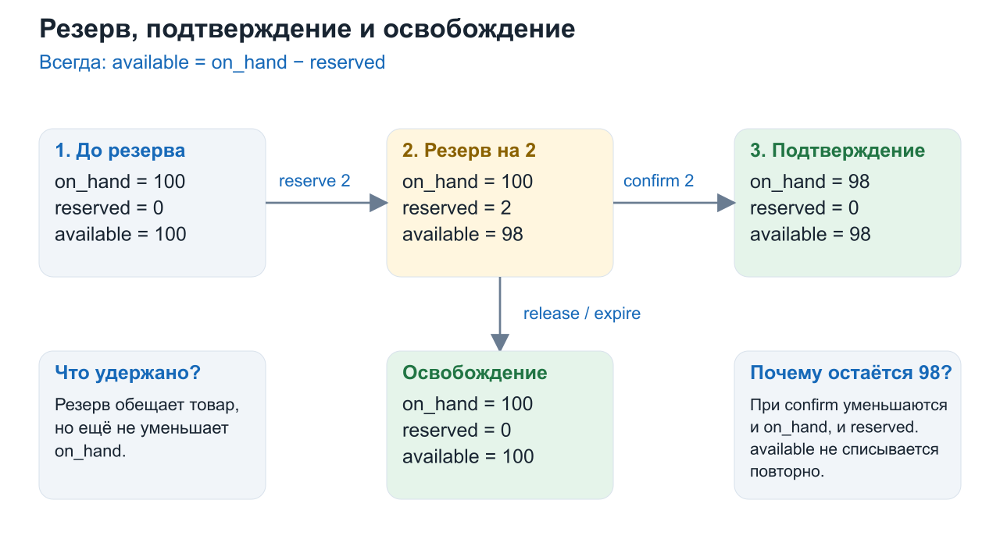
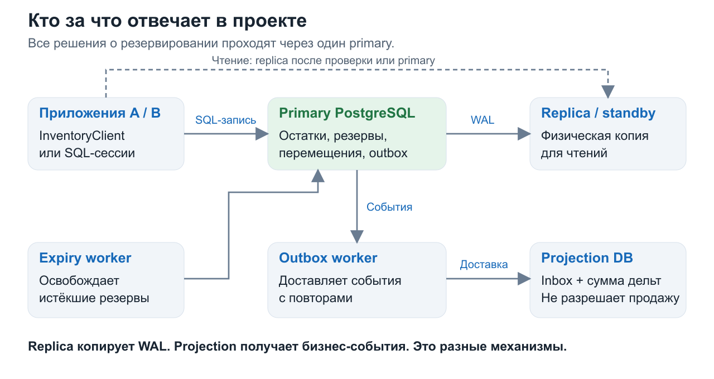
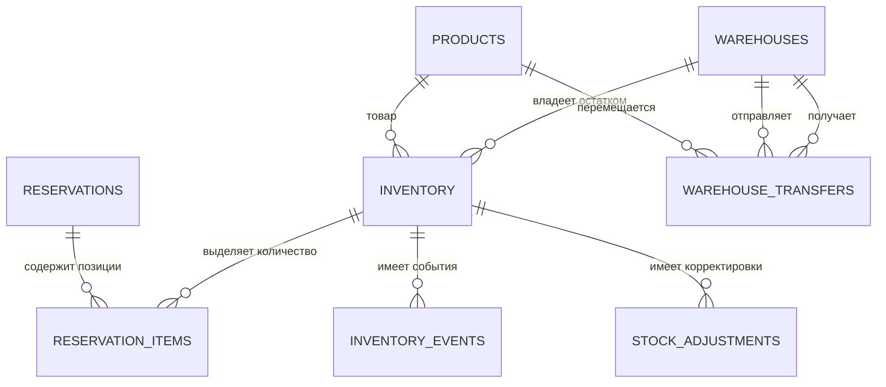
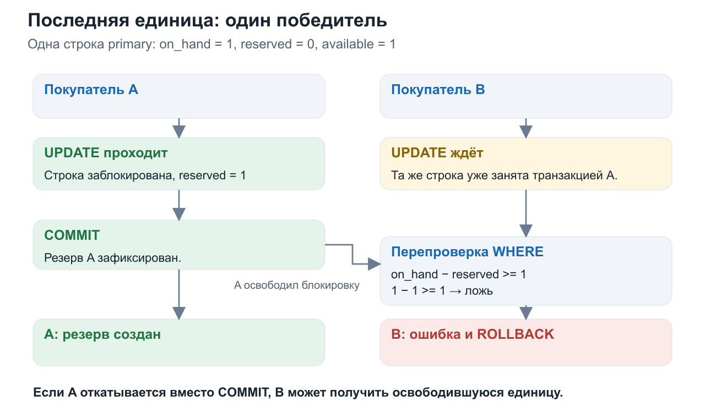
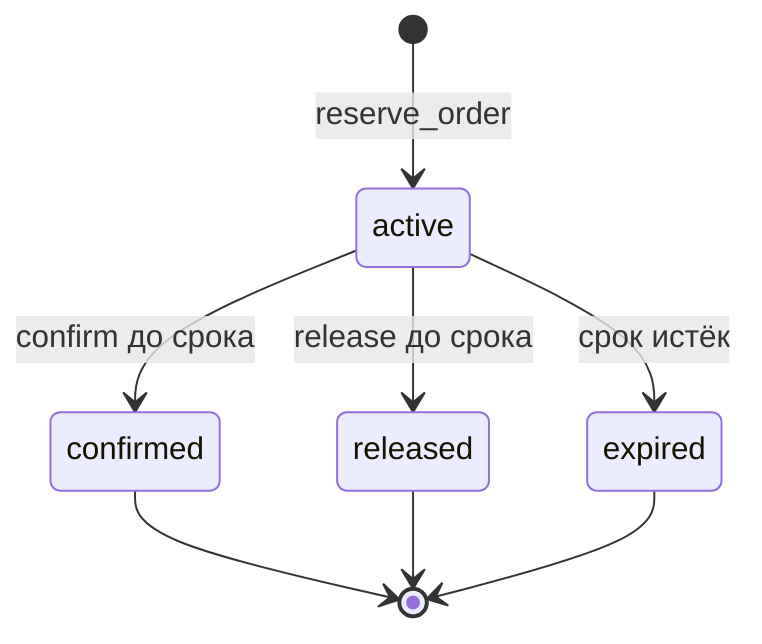
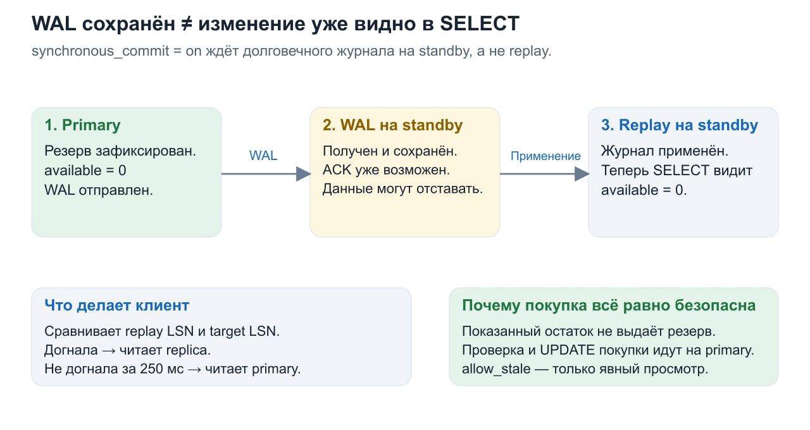
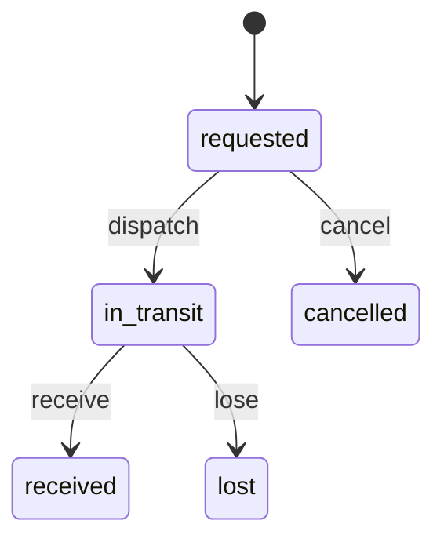
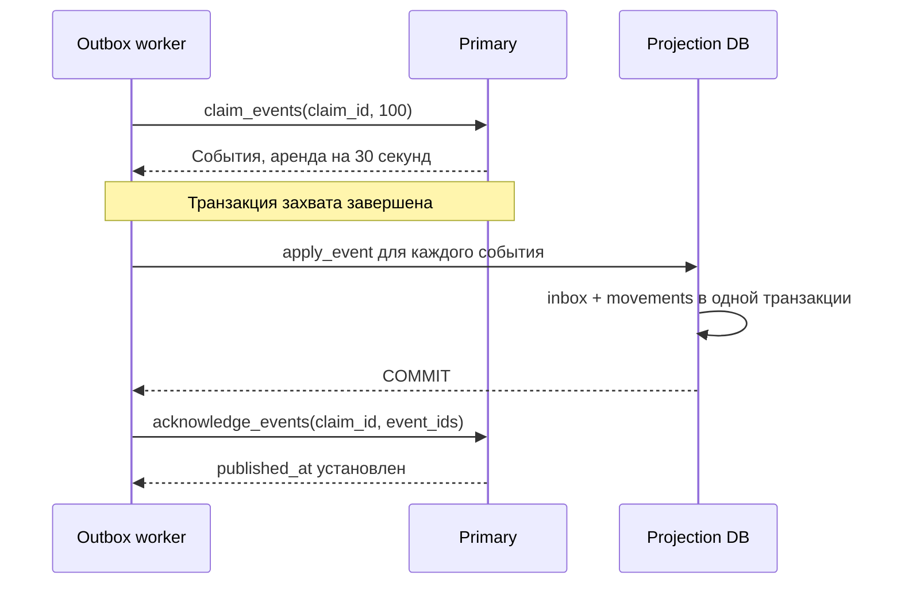

# Как работает мой Inventory Management: объяснение с нуля

Это учебник по **твоему конкретному проекту**. Он объясняет код, который находится в этой папке, и связывает его с лекциями 5, 6 и 7. Здесь сначала идёт простой пример, затем механизм в программе, затем формулировка для защиты.

Объяснение основано на SQL, Python-клиенте, обработчиках, Docker Compose и сохранённых результатах проверок. Код проекта при подготовке этого файла не изменялся. Результаты тестов и нагрузки ниже взяты из сохранённых файлов; заново эти эксперименты для написания объяснения не запускались.

## Как читать

Не пытайся сразу выучить все названия. Прочитай разделы 1–10 подряд: это основа. Затем разбери репликацию, разбиение данных и сбои. В конце находятся упражнения, ответы для защиты и связь со слайдами презентации.

1. [Что именно мы построили](#1-что-именно-мы-построили)
2. [Самая важная строка данных](#2-самая-важная-строка-данных)
3. [Какие программы запускаются](#3-какие-программы-запускаются)
4. [Как читать схему таблиц](#4-как-читать-схему-таблиц)
5. [Одна покупка от начала до конца](#5-одна-покупка-от-начала-до-конца)
6. [Что такое транзакция на нашем примере](#6-что-такое-транзакция-на-нашем-примере)
7. [Два покупателя и последняя единица](#7-два-покупателя-и-последняя-единица)
8. [Почему повтор запроса не списывает товар дважды](#8-почему-повтор-запроса-не-списывает-товар-дважды)
9. [Как резерв подтверждается, отменяется и истекает](#9-как-резерв-подтверждается-отменяется-и-истекает)
10. [Что делает Python-клиент](#10-что-делает-python-клиент)
11. [Как устроены репликация и чтения](#11-как-устроены-репликация-и-чтения)
12. [Зачем нужны партиции](#12-зачем-нужны-партиции)
13. [Приёмка и корректировка остатков](#13-приёмка-и-корректировка-остатков)
14. [Как товар перемещается между складами](#14-как-товар-перемещается-между-складами)
15. [События, outbox, inbox и проекция](#15-события-outbox-inbox-и-проекция)
16. [ACID, изоляция и блокировки из лекции 7](#16-acid-изоляция-и-блокировки-из-лекции-7)
17. [Сбои и восстановление](#17-сбои-и-восстановление)
18. [Что изменится при настоящем шардировании](#18-что-изменится-при-настоящем-шардировании)
19. [Что доказали тесты и нагрузка](#19-что-доказали-тесты-и-нагрузка)
20. [Как самому увидеть работу проекта](#20-как-самому-увидеть-работу-проекта)
21. [Как связаны проект и три лекции](#21-как-связаны-проект-и-три-лекции)
22. [Как объяснять слайды на защите](#22-как-объяснять-слайды-на-защите)
23. [Восемь вопросов задания и challenge](#23-восемь-вопросов-задания-и-challenge)
24. [Проверь себя](#24-проверь-себя)
25. [Словарь и карта файлов](#25-словарь-и-карта-файлов)

---

## 1. Что именно мы построили

Представь магазин, у которого есть склады в Алматы, Астане и Шымкенте. Он продаёт один и тот же iPhone, но на каждом складе лежит своё количество телефонов.

| Товар | Алматы | Астана | Шымкент |
| --- | ---: | ---: | ---: |
| iPhone 17 | 100 | 50 | 25 |

Нужно отвечать на два разных вопроса:

1. **Посмотреть:** сколько товара сейчас доступно?
2. **Изменить:** можем ли мы обещать конкретному покупателю конкретное количество?

Первый вопрос помогает показать каталог. Второй связан с обязательством перед покупателем. Если приложение показало «1 штука», а за секунду до нажатия кнопки её купил другой человек, покупку нужно отклонить. Поэтому показ количества и получение резерва — разные действия.

Главное правило проекта: **успешные резервы и продажи не должны обещать больше товара, чем имеется в учёте.** Продажу сверх остатка называют **overselling**.

### Что входит в проект

У нас есть PostgreSQL, SQL-функции для складских операций, Python-клиент, физическая реплика, обработчик просроченных резервов и доставка событий в отдельную БД.

Полноценного интернет-магазина с HTTP-сервером, интерфейсом оплаты и курьерской системой здесь нет. Их место в примерах занимает покупатель, который вызывает `InventoryClient`, либо SQL-сессия. Внешняя система заказов передаёт `order_id`; наш проект отвечает за складскую часть.

Стиль Kaspi в презентации относится к оформлению. Проект не описывает внутреннее устройство Kaspi.

**Фраза для защиты:** «Мы реализовали складскую базу данных: независимые остатки по складам, атомарные резервы, защиту от конкурентных продаж, репликацию и обработку отказов».

## 2. Самая важная строка данных

В центре проекта находится таблица `inventory`. Одна строка описывает **один товар на одном складе**, а не товар по всей стране.

```text
warehouse_id = 1       склад Алматы
product_id   = 17      iPhone 17
on_hand      = 100     количество в доступном складском учёте до вычета резервов
reserved     = 3       из него обещано активным резервам
available    = 97      ещё можно зарезервировать
```

Формула:

```text
available = on_hand − reserved
```

### Почему нужны три числа

Если покупатель ещё оформляет заказ, телефон физически не исчез. Но обещать его другому человеку уже нельзя. Поэтому создание резерва меняет `reserved`, а не сразу `on_hand`.

| Действие с двумя телефонами | on_hand | reserved | available |
| --- | ---: | ---: | ---: |
| Начало | 100 | 0 | 100 |
| Зарезервировали 2 | 100 | 2 | 98 |
| Подтвердили эти 2 | 98 | 0 | 98 |

Альтернативный финал: если вместо подтверждения резерв отменили, получим `100 / 0 / 100`.



Обрати внимание: **при подтверждении available повторно не уменьшается**. Эти две штуки уже перестали быть доступными на этапе резерва. Теперь одновременно уменьшаются `on_hand` и `reserved`.

### Важное упрощение нашей модели

В проекте подтверждённый заказ сразу уменьшает `on_hand`. Здесь это означает «товар больше не принадлежит продаваемому остатку». Это не доказательство, что курьер уже вывез коробку. Для подробного учёта сборки и отгрузки потребовались бы дополнительные состояния, например `allocated`, `picked`, `shipped`.

### Что такое инвариант

**Инвариант** — правило, которое должно сохраняться после каждой корректной операции:

```text
on_hand ≥ 0
0 ≤ reserved ≤ on_hand
```

Нельзя иметь минус пять телефонов. Нельзя зарезервировать 12, когда имеется 10.

В [sql/01_schema.sql](sql/01_schema.sql) это закреплено в самой БД:

```sql
available bigint GENERATED ALWAYS AS
    (on_hand - reserved) STORED,
CHECK (on_hand >= 0),
CHECK (reserved >= 0 AND reserved <= on_hand)
```

`GENERATED ... STORED` означает: PostgreSQL сам вычисляет и хранит `available`. Код не поддерживает третье число вручную, поэтому не может забыть его обновить.

Однако `CHECK` проверяет отдельную строку. Он сам не проверяет, что `reserved` равен сумме всех активных позиций заказов. Эту связь поддерживают транзакционные функции; отдельная сверка помогает обнаружить нарушения. Подробнее — в разделе 16.

## 3. Какие программы запускаются



Всё запускает [docker-compose.yml](docker-compose.yml). **Контейнер** — отдельный запущенный процесс со своим окружением. Несколько контейнеров на одном компьютере всё ещё зависят от этого компьютера.

| Компонент | Что делает | Адрес с нашего компьютера |
| --- | --- | --- |
| `db` | Главный PostgreSQL, принимает складские изменения | `127.0.0.1:55434` |
| `replica` | Копия главного PostgreSQL, обслуживает чтения | `127.0.0.1:55435` |
| `projection` | Отдельная БД для обработки доставленных событий | `127.0.0.1:55436` |
| `expiry-worker` | Находит истёкшие резервы и освобождает их | Работает в фоне |
| `outbox-worker` | Доставляет события из основной БД в проекцию | Работает в фоне |
| `sync-ready` | Настраивает и проверяет синхронную репликацию при запуске | После успешной проверки завершается |
| `InventoryClient` | Python-код, который вызывает SQL-функции и выбирает узел чтения | Запускается вызывающим кодом |

Есть также `replacement` в профиле `recovery`: это новая реплика для сценария восстановления, а не постоянно работающий дополнительный primary.

### Три БД нельзя путать

**Primary** — место, где решают: «можно ли зарезервировать товар?»

**Replica** — физическая копия primary, получающая его журнал изменений. На неё нельзя отправлять складские записи.

**Projection database** — самостоятельная БД с таблицами `inbox` и `movements`. Она получает бизнес-события через Python-обработчик. Это не физическая копия primary и не место для принятия решения о продаже.

### Где хранятся данные

Именованные Docker volumes `primary_data`, `replica_data`, `projection_data` сохраняют данные между обычными остановками контейнеров. `docker compose down` не удаляет эти тома. Команда с `-v` удаляет их и потому не подходит для обычной остановки.

Начальные SQL-файлы выполняются при создании новой БД в пустом томе. Изменение SQL-файла на диске само по себе не обновляет уже инициализированную БД.

**Связь с лекциями:** Lecture 5, PDF-страницы 3–8, объясняет leader/follower и репликацию. Наша роль leader называется `primary`, follower — `standby` или `replica`.

## 4. Как читать схему таблиц

Сначала три обозначения:

- **PK, primary key:** уникальный адрес строки. Две строки с одним PK существовать не могут.
- **FK, foreign key:** ссылка на существующую строку другой таблицы.
- **1:N:** одна родительская строка может иметь много дочерних. Например, один товар — много складских остатков.

### Восемь основных таблиц

| Таблица | Простое объяснение | Главный ключ |
| --- | --- | --- |
| `products` | Справочник: какие товары существуют | `product_id` |
| `warehouses` | Справочник: какие склады существуют | `warehouse_id` |
| `inventory` | Сколько одного товара принадлежит одному складу | `(warehouse_id, product_id)` |
| `reservations` | Заголовок резерва: чей идентификатор, срок и состояние | `order_id` |
| `reservation_items` | Какие количества и с каких складов входят в резерв | `(order_id, warehouse_id, product_id)` |
| `inventory_events` | Какие изменения остатков произошли; одновременно outbox | `event_id` |
| `stock_adjustments` | Какие приёмки и корректировки уже применены | `operation_id` |
| `warehouse_transfers` | Заявки на физические перемещения товара | `transfer_id` |

Полный SQL находится в [sql/01_schema.sql](sql/01_schema.sql). Файл [sql/07_workers.sql](sql/07_workers.sql) добавляет к событиям поля аренды доставки.



В этой схеме кратность описывает допустимые ссылки FK. Бизнес-функция создаёт резерв хотя бы с одной позицией; один FK сам по себе не запрещает заголовок без позиций при ручном административном вмешательстве.

### Почему отдельны заголовок и позиции резерва

Один заказ может содержать:

```text
order_id = O1
  ├─ склад Алматы, товар 17, количество 2
  └─ склад Астана, товар 17, количество 1
```

`reservations` хранит общие свойства `O1`: `active`, срок истечения и исходный запрос. `reservation_items` хранит две строки с количествами.

`request_items` в заголовке — нормализованная копия запроса в формате JSON. Она нужна, чтобы при повторе проверить: это действительно тот же заказ, а не другой набор товаров под старым ID.

### Почему нижние три таблицы связаны по-разному

`inventory_events` и `stock_adjustments` ссылаются на конкретную пару «склад + товар» в `inventory`.

У `warehouse_transfers` другая структура: один товар, склад отправления и склад получения. Поэтому у него FK на `products` и **два разных FK на `warehouses`**. Прямого FK этой таблицы на `inventory` в коде нет. Само списание и приёмку выполняет SQL-функция перемещения.

`operation_id` в `inventory_events` не является FK на одну общую таблицу операций. Он может обозначать заказ, корректировку или перемещение. Не надо рисовать несуществующую связь только из-за одинакового названия поля.

### Товар в каталоге и товар на складе

Наличие строки в `products` не означает, что все 100 складов держат этот товар. Если пары нет в `inventory`, склад сейчас не имеет заведённой строки для него. Обычная корректировка ожидает существующую строку. Приёмка перемещения умеет создать недостающую строку получателя.

## 5. Одна покупка от начала до конца

Покупатель хочет два iPhone из Алматы и один из Астаны. Начало: `100 / 50 / 25`, резервов нет.

### Шаг 1. Внешнее приложение создаёт идентификатор

Например:

```text
order_id = 00000000-0000-0000-0000-000000000001
```

Это UUID — практически уникальный идентификатор запроса. Он создаётся один раз на попытку заказа и сохраняется при сетевых повторах.

Приложение также выбирает конкретные склады. В нашем коде нет автоматического оптимизатора, который ищет ближайший склад. Входящий запрос уже содержит распределение по складам.

### Шаг 2. Вызывается Python-клиент

Смысл вызова:

```python
result = client.reserve_order(order_id, [
    {'warehouse_id': 1, 'product_id': 17, 'quantity': 2},
    {'warehouse_id': 2, 'product_id': 17, 'quantity': 1},
])
```

Клиент отправляет в primary параметризованный запрос:

```sql
SELECT inventory_app.reserve_order(%s, %s::jsonb);
```

`%s` — место для параметра, а не часть SQL-значения. `jsonb` — структурированный JSON, с которым PostgreSQL умеет работать.

### Шаг 3. SQL-функция проверяет запрос

В [reserve_order](sql/02_operations.sql) проверяется:

1. Передан непустой JSON-массив.
2. В нём не больше 100 пар «склад + товар».
3. У всех позиций заданы идентификаторы и положительное количество.
4. Нет двух одинаковых пар «склад + товар».

Затем позиции сортируются по `warehouse_id, product_id`. Сортировка нужна для стабильного сравнения повторов и для одинакового порядка захвата блокировок.

### Шаг 4. Создаётся и блокируется заголовок

```sql
INSERT INTO reservations (order_id, request_items, expires_at)
VALUES (p_order_id, v_items, clock_timestamp() + interval '15 minutes')
ON CONFLICT (order_id) DO NOTHING;
```

Если ID уже существует, вторая строка не создаётся. Следующий `SELECT ... FOR UPDATE` блокирует существующий заголовок, чтобы два запроса не меняли его жизненный цикл одновременно.

Старый ID с другими товарами вызывает ошибку. Старый ID с теми же товарами возвращает уже записанный статус — повторного резервирования не будет.

### Шаг 5. Для каждой позиции выполняется условный UPDATE

Ниже реальный ключевой фрагмент функции:

```sql
UPDATE inventory
SET reserved = reserved + v_row.quantity,
    version = version + 1,
    updated_at = clock_timestamp()
WHERE warehouse_id = v_row.warehouse_id
  AND product_id = v_row.product_id
  AND on_hand - reserved >= v_row.quantity
RETURNING version INTO v_version;
```

Прочитай его как предложение:

> «Для нужного склада и товара увеличь reserved, **но только если свободного количества хватает**, и верни новую версию строки».

Если подходящей строки нет или свободного количества мало, `UPDATE` не изменит ничего. Функция проверяет `IF NOT FOUND` и выбрасывает исключение.

### Шаг 6. Создаются позиции и события

После успешного изменения строки функция вставляет:

- запись в `reservation_items`: откуда и сколько выделено;
- запись в `inventory_events`: например, `event_type = 'reserved'`, `on_hand_delta = 0`, `reserved_delta = 2`.

Всё происходит внутри одной транзакции. Нельзя успешно зафиксировать только счётчик, забыв соответствующую позицию или событие.

### Шаг 7. Транзакция фиксируется

В конце создания нового резерва срок выставляется ещё раз: 15 минут от текущего времени после обработки позиций. Затем SQL-функция возвращает `active`.

Но для Python-клиента это ещё не конец: он выполняет `COMMIT`, ждёт требуемое синхронное подтверждение и только затем формирует успешный ответ с WAL-токеном.

Результат резервирования:

| Склад | on_hand | reserved | available |
| --- | ---: | ---: | ---: |
| Алматы | 100 | 2 | 98 |
| Астана | 50 | 1 | 49 |
| Шымкент | 25 | 0 | 25 |

### Шаг 8. Заказ подтверждают или освобождают

Подтверждение:

```python
client.finish_reservation(order_id, 'confirm')
```

Результат:

| Склад | on_hand | reserved | available |
| --- | ---: | ---: | ---: |
| Алматы | 98 | 0 | 98 |
| Астана | 49 | 0 | 49 |
| Шымкент | 25 | 0 | 25 |

Вместо подтверждения можно передать `'release'`, тогда оба склада вернутся к исходному количеству доступного товара. Внешняя оплата находится **между короткими транзакциями**, а не внутри транзакции, открытой на все 15 минут.

## 6. Что такое транзакция на нашем примере

**Транзакция** объединяет несколько действий БД в одно целое:

```text
BEGIN
  создать заголовок
  увеличить reserved в Алматы
  записать позицию и событие Алматы
  увеличить reserved в Астане
  записать позицию и событие Астаны
COMMIT
```

`COMMIT` закрепляет результат. `ROLLBACK` отменяет действия этой транзакции.

### А если в Астане не хватает?

Допустим, Алматы уже обработали, но запрос на Астану требует 1 000 телефонов вместо доступных 50.

```text
Алматы: UPDATE временно выполнился внутри транзакции
Астана: UPDATE не нашёл достаточного остатка
Функция: RAISE EXCEPTION
Итог: весь запрос отменён
```

В базе не остаются ни частичный резерв Алматы, ни заголовок неудавшегося заказа, ни его позиции, ни его события.

Это **atomicity**, атомарность из Lecture 7, PDF-страниц 2–5 и 9–12. Банковский перевод из лекции объединяет списание и зачисление; наш заказ объединяет выделение товара из нескольких складов.

### Где именно начинается транзакция в Python

В [inventory_client.py](inventory_client.py), метод `_write_once`:

```python
connection.autocommit = False
with connection:
    # SET LOCAL synchronous_commit = on
    # проверка роли primary
    # вызов SQL-функции
    ...
# при нормальном выходе здесь уже выполнен COMMIT
```

Контекст `with connection` у `psycopg2` фиксирует транзакцию при успехе и откатывает её при исключении.

SQL-функция сама не выполняет `COMMIT` посередине цикла. Она работает в транзакции вызывающей сессии. Если вызвать её из `psql` без явного `BEGIN`, обычный режим `psql` выполняет оператор в собственной транзакции.

Если ошибка произошла внутри явного `BEGIN`, сессия остаётся в состоянии неуспешной транзакции до `ROLLBACK`. В демонстрации B это нужно сделать явно.

## 7. Два покупателя и последняя единица

Это главный challenge задания и пример последнего места из Lecture 7, PDF-страница 14.

Начало для **одной и той же пары** склада и товара:

```text
on_hand = 1, reserved = 0, available = 1
```

Покупатель A работает через приложение A. Покупатель B — через другое приложение B. Они одновременно вызывают `reserve_order` с разными `order_id`.



| Момент | A | B |
| --- | --- | --- |
| 1 | Доходит до `UPDATE` первым | Тоже пытается изменить эту строку |
| 2 | Блокирует строку и делает `reserved = 1` | Ждёт освобождения блокировки |
| 3 | Делает `COMMIT` | Получает возможность продолжить |
| 4 | Имеет подтверждённый активный резерв | PostgreSQL заново проверяет условие `WHERE` |
| 5 | Победил | `1 − 1 >= 1` ложно; ноль изменённых строк, исключение и откат |

Если A вместо `COMMIT` сделает `ROLLBACK`, его изменение исчезнет, и B сможет успешно зарезервировать товар. Если первым пришёл B, роли поменяются. Гарантируется один победитель, а не победа определённого клиента.

### Кто держит блокировку

**PostgreSQL**, а не Python-процесс. Поэтому механизм работает между разными экземплярами приложения, контейнерами и компьютерами, если они обращаются к одному авторитетному primary.

Обычный `threading.Lock` в приложении A не защищает от приложения B. В клиенте есть Python-блокировка для безопасного управления пулом соединений, но она не обеспечивает защиту складского остатка.

### Почему нельзя сделать обычный SELECT, а потом UPDATE

Неправильная идея:

```text
A прочитал available = 1
B прочитал available = 1
A решил «мне можно»
B решил «мне тоже можно»
```

Оба прочитали правду на тот момент, но чтение ничего не закрепило за покупателем. Обычный `READ COMMITTED` сам по себе не превращает такую логику в безопасный резерв.

У нас проверка количества находится **в том же UPDATE, который меняет reserved**. Другой допустимый приём — сначала взять нужную строку через `SELECT ... FOR UPDATE`, потом проверить и изменить её в той же короткой транзакции. Наша функция резервирования использует именно условный `UPDATE`; завершение резерва дополнительно использует явные блокировки.

### Что увидит третий читатель, пока A не сделал COMMIT

При обычном `SELECT` он может увидеть старую зафиксированную версию строки с доступной единицей. PostgreSQL использует MVCC и не показывает ему незавершённую запись A. Это нормально для просмотра; попытка получить резерв всё равно столкнётся с блокировкой и проверкой на primary.

Если на **разных** складах имеется по одному телефону, две покупки могут пройти: это две разные реальные единицы и две разные строки `inventory`.

**Фраза для защиты:** «Оба приложения приходят в одну складскую строку. Условный UPDATE блокирует её; после победителя второй UPDATE перепроверяет WHERE и не резервирует уже недоступную единицу».

## 8. Почему повтор запроса не списывает товар дважды

Представь, что БД уже зарезервировала телефон и сделала `COMMIT`, но ответ потерялся в сети. Приложение не знает результат и повторяет запрос.

Транзакция решила вопрос «всё или ничего в БД». Но она не может гарантировать, что ответ по сети дошёл до покупателя. Это разные проблемы.

### Идемпотентность

**Идемпотентность** здесь означает: повтор той же команды не применяет складское изменение второй раз.

```text
Первый запрос:   ID = O1, Алматы, товар 17, количество 2
                → reserved увеличился на 2

Повтор запроса:  ID = O1, те же позиции
                → вернуть сохранённый статус
                → reserved больше не увеличивать
```

Защита состоит из PK по `order_id`, `ON CONFLICT`, блокировки заголовка и сравнения `request_items`.

Сортировка запроса делает порядок позиций несущественным: «Алматы, затем Астана» и «Астана, затем Алматы» нормализуются к одному порядку.

### Три разных повтора

| Ситуация | Поведение |
| --- | --- |
| Старый ID, те же товары | Возвращается сохранённый статус |
| Старый ID, другое количество или склад | Ошибка: нельзя поменять смысл ID |
| Новый ID с теми же товарами | Это отдельная операция, которая может зарезервировать ещё товар |

Поэтому нельзя генерировать новый UUID при каждом сетевом повторе.

Повтор старого истёкшего резерва вернёт `expired`; это **не новый успешный резерв**. Для новой попытки покупки после истечения нужен новый ID. Вызывающий код обязан проверять возвращённый статус.

Если первоначальная попытка полностью откатилась из-за недостатка товара, её заголовок тоже откатился. Постоянной записи об отклонённом запросе в этой модели не остаётся, и ID можно повторить, например после пополнения.

Подобная защита существует у корректировок (`operation_id`) и перемещений (`transfer_id`). Завершение резерва повторно читает конечный статус и не применяет изменение ещё раз.

## 9. Как резерв подтверждается, отменяется и истекает

В [finish_reservation](sql/02_operations.sql) разрешены действия `confirm`, `release`, `expire`.



Конечные состояния не возвращаются в `active`.

### Порядок работы finish_reservation

1. Проверить, что действие допустимо.
2. Найти заголовок и взять `FOR UPDATE`.
3. Если статус уже конечный, вернуть его.
4. Заблокировать все связанные строки `inventory` в порядке склада и товара.
5. **После получения блокировок** проверить текущее время БД относительно `expires_at`.
6. Выбрать конечный статус и изменить счётчики.
7. Записать события, статус и `completed_at` в одной транзакции.

| Конечный результат | Изменение on_hand | Изменение reserved |
| --- | ---: | ---: |
| `confirmed` | `−quantity` | `−quantity` |
| `released` | 0 | `−quantity` |
| `expired` | 0 | `−quantity` |

### Confirm и expiry пришли одновременно

Оба пытаются заблокировать один заголовок. Один проходит первым, второй ждёт. После ожидания второй видит конечный статус и не делает второе освобождение или списание.

Если время уже истекло, даже действие `confirm` превратится в `expired`, а товар освободится. Проверяется время сервера БД, а не часы телефона покупателя.

Граница срока — момент проверки после захвата блокировок. Допущенное до срока подтверждение может завершить `COMMIT` чуть позже; это не означает, что время проверяли после фиксации.

### Почему нужен expiry-worker

Без него забытый резерв может оставаться в счётчике `reserved`, пока никто не вызовет его завершение. Обработчик постоянно находит истёкшие активные резервы.

Основной SQL в [sql/07_workers.sql](sql/07_workers.sql):

```sql
SELECT order_id INTO v_order FROM reservations
WHERE status = 'active' AND expires_at <= statement_timestamp()
ORDER BY expires_at, order_id
FOR UPDATE SKIP LOCKED LIMIT 1;
```

`SKIP LOCKED` означает «не жди резерв, который уже взял другой обработчик; возьми следующий». Это удобно для фоновой очереди задач. Использовать такую семантику для ответа «точно сколько всего товара» нельзя: она намеренно пропускает занятые строки.

После выбора `expire_one()` вызывает `finish_reservation(..., 'expire')` в том же операторе/транзакции. Поэтому взятый резерв не остаётся наполовину обработанным.

Python-цикл находится в [workers.py](workers.py). Если работы нет, он ждёт 0,25 секунды; после обрабатываемой ошибки — одну секунду перед следующей попыткой. Точное освобождение в миллисекунду окончания TTL не обещается. Задержка worker может временно уменьшить доступность товара, но не даёт просроченному заказу пройти поздний `confirm`.

## 10. Что делает Python-клиент

[inventory_client.py](inventory_client.py) — удобная точка входа в операции БД. Бизнес-правила остатков находятся в SQL, а клиент управляет соединениями, транзакциями, повторами и маршрутом чтения.

### Одна операция записи

```text
reserve_order / finish_reservation / adjust_stock / ...
    → _write
        → _write_once
            → соединение с primary
            → READ COMMITTED, BEGIN
            → synchronous_commit = on
            → проверка, что узел не standby
            → вызов SQL-функции
            → COMMIT
            → получить WAL-токен
            → вернуть status + token
```

Токен формируется после фиксации. Он может указывать и на более позднюю позицию WAL, если в промежутке завершились другие записи; для гарантии «не раньше моей записи» это допустимо.

### Пул соединений

Установить соединение с PostgreSQL дороже, чем переиспользовать уже открытое. Поэтому клиент использует `ThreadedConnectionPool` и ограничивающий семафор.

По умолчанию максимум — **8 соединений на набор параметров подключения в экземпляре клиента**, а не 8 на все приложения мира. Primary и replica могут иметь разные пулы. У фоновых workers в коде задан `pool_size=2`.

Если все слоты заняты, ожидание свободного слота ограничено двумя секундами. Закрытые или повреждённые соединения удаляются из пула. Это управление ресурсами; от overselling защищает SQL-механизм из раздела 7.

### Повторы после временных ошибок

`_write` делает максимум три попытки, включая первую. Между повторными попытками есть растущая пауза и небольшой случайный разброс — **backoff + jitter**. Это уменьшает одновременный повтор всех клиентов.

В коде повторяются некоторые ошибки сериализации, deadlock, ожидания блокировки, отмены оператора и соединения. Запрос повторяется с теми же параметрами и ID. Ошибка `Insufficient stock` считается бизнес-ошибкой и не попадает в обычную ветку автоматических повторов.

Если попытки исчерпаны, вызывающий код получает ошибку. Это не всегда доказывает отсутствие `COMMIT`: соединение могло оборваться после успешной записи. Поэтому ID нельзя забывать и заменять новым.

### Таймауты не равны общему сроку ответа

В клиенте есть `connect_timeout=2`, `statement_timeout=2000`, `lock_timeout=1000` и ограничение ожидания пула. Эти настройки отвечают за разные этапы.

Нельзя обещать «вся покупка всегда заканчивается за две секунды»: ожидание синхронного `COMMIT` при недоступной обязательной реплике может длиться дольше. Отсутствие ответа означает необходимость выяснить результат исходного ID.

### Права приложения

Файл [sql/08_access.sql](sql/08_access.sql) создаёт роль `inventory_service`. Ей разрешены чтение и вызовы выделенных функций, но не прямые `UPDATE inventory`.

Функции работают как `SECURITY DEFINER` с фиксированным `search_path`. Простыми словами: приложению разрешают выполнить конкретную проверенную процедуру с нужными правами, а не произвольно изменять все таблицы.

Workers настроены на эту роль. В конфигурации клиента по умолчанию для локальной демонстрации указан администратор `postgres`; для приложения роль выбирается через параметры окружения. Поэтому ограничения роли защищают рабочий путь, но не запрещают владельцу БД вручную испортить данные.

## 11. Как устроены репликация и чтения

**Репликация** — копирование одних и тех же данных на другой узел. Это Lecture 5.

### 11.1. Как создаётся реплика

В [docker/replica-entrypoint.sh](docker/replica-entrypoint.sh) запускается `pg_basebackup`: согласованная начальная копия primary. Она привязана к позиции в журнале. Затем standby получает последующие изменения потоковой физической репликацией.

Это соответствует Lecture 5, PDF-странице 7: snapshot, точная позиция журнала, догон изменений, дальнейшая непрерывная доставка.

Replication slot помогает primary удерживать нужный реплике WAL. В стенде хранение ограничено `max_slot_wal_keep_size=1GB`. Если отставшая реплика потеряла доступ к уже удалённому WAL, может понадобиться новая базовая копия. Slot не даёт бесконечного бесплатного хранения.

### 11.2. Что такое WAL

**Write-ahead log** — журнал, в котором PostgreSQL фиксирует сведения для восстановления изменений. Сначала нужные записи журнала должны надёжно сохраниться, а уже обновлённые страницы таблиц могут записываться в свои файлы позже. После сбоя PostgreSQL использует WAL для восстановления.

В этом проекте standby получает физический WAL. Python не копирует таблицы на replica строка за строкой и не вызывает `reserve_order` повторно на ней.

### 11.3. Что именно синхронно

`sync-ready` устанавливает:

```text
synchronous_standby_names = FIRST 1 (inventory_replica)
```

А клиент для записи устанавливает:

```sql
SET LOCAL synchronous_commit = on;
```

Для успешно подтверждённой клиентской записи это означает: WAL зафиксирован на primary и долговечно сохранён на выбранном синхронном standby. Если обязательный standby пропал, новые записи не должны получать небезопасное успешное подтверждение.

Но **сохранить журнал и применить журнал к читаемым данным — разные этапы**.



```text
Primary: зарезервировал последнюю штуку
Standby: получил WAL и сохранил его → достаточно для sync ACK
Standby: ещё не применил WAL → SELECT пока может показать старую штуку
```

Это и объясняет, почему «у нас синхронная реплика» не отменяет обработку replay lag. Вариант `synchronous_commit=remote_apply` ждал бы также применения, но текущий код использует `on`.

### 11.4. LSN — позиция в журнале

**LSN, log sequence number** — адрес/позиция в WAL, например `0/16B6C50`. Это не число товаров и не время в миллисекундах.

Простая аналогия: primary уже записал журнал до страницы 120, а replica прочитала и применила только до страницы 118. Чтобы увидеть нужную запись, надо дождаться достаточной позиции применения.

Код берёт на primary `pg_current_wal_flush_lsn()`, а на replica проверяет `pg_last_wal_replay_lsn()`.

### 11.5. Обычное свежее чтение

Метод `read_inventory` по умолчанию:

1. Обращается к primary и получает целевую долговечную позицию WAL.
2. Проверяет, что узел действительно primary.
3. Подключается к replica и проверяет её роль, `system_id`, `timeline`, replay LSN.
4. Если replica применила WAL хотя бы до целевой позиции, читает остаток с неё.
5. Если отстаёт, ждёт до 250 мс по умолчанию.
6. Если не дождался, replica недоступна или имеет другую идентичность, читает с primary.

В ответе указаны `source`, `reason`, `lag_bytes` и `stock`. `lag_bytes` — отставание по позиции WAL, а не количество потерянных событий и не точный возраст данных.

Обычный свежий режим всё равно обращается к primary за метаданными. Он разгружает чтение самих складских данных, но не делает primary полностью ненужным.

### 11.6. Read-after-write и токен

После записи клиент возвращает:

```text
status: active
token:
  system_id: идентификатор PostgreSQL-кластера
  timeline: ветка истории WAL
  lsn: долговечная позиция после COMMIT
```

Передав `after=result['token']` в следующее чтение, можно связать его с ранее выполненной записью. Это идея **read-your-writes / read-after-write** из Lecture 5, PDF-страниц 11–12.

Зачем `system_id` и `timeline`? Просто сравнивать большие номера LSN недостаточно, если подключились к другому кластеру или после failover история пошла по другой ветке. Код отклоняет такие токены. Он не переводит старый токен в новую историю автоматически: результат заказа выясняют на новом primary по исходному ID.

Свежесть означает «не раньше проверенной позиции WAL». Она не обещает видеть любую запись, которую кто-то успел завершить уже после выбора этой позиции. Входящий остаток всё равно может измениться сразу после чтения; окончательное решение принимает новый условный UPDATE.

### 11.7. Два специальных режима

| Вызов | Поведение |
| --- | --- |
| `authoritative=True` | Сразу читает основной узел |
| `allow_stale=True` | Читает replica без обращения к primary; явно указывает `freshness: not_guaranteed` |

`allow_stale` полезен, чтобы показывать ориентировочный каталог, даже когда primary упал. Его нельзя объединить с `after` или `authoritative=True`. Он не разрешает продавать товар по устаревшему остатку.

### 11.8. Почему не multi-leader и не leaderless

В Lecture 5 обсуждаются несколько лидеров, кворумы, разрешение конфликтов и last-write-wins. Здесь выбран один primary, потому что для последней единицы нужен один авторитетный порядок изменений.

Если два независимых лидера оба обещают последнюю штуку и только потом обмениваются изменениями, простое слияние не отменяет два обещания покупателям. Last-write-wins может выбросить одну запись, но не решить бизнес-проблему.

У нас нет кворумного протокола клиента `w+r>n`, version vectors, read repair или CRDT. Одно число `inventory.version` не является version vector. Это альтернативные идеи из лекции, которые не нужно выдавать за реализованные компоненты.

## 12. Зачем нужны партиции

**Partitioning** — разделение одного набора данных на части. **Replication** — создание копий данных. В Lecture 6, PDF-странице 4, показано, что их можно сочетать: разные части данных и копии каждой части.

В коде:

```sql
PRIMARY KEY (warehouse_id, product_id)
) PARTITION BY HASH (warehouse_id);
```

Цикл создаёт `inventory_p0` … `inventory_p15`.

```text
Логическая таблица inventory
  ├─ inventory_p0
  ├─ inventory_p1
  ├─ ...
  └─ inventory_p15

Все эти части сейчас находятся в одном PostgreSQL primary.
Standby получает их копию вместе с остальной физической БД.
```

### Как выбирается часть

Используется хеш от `warehouse_id`. Концептуально это «хеш ключа распределяет значения по 16 корзинам». Не надо утверждать, что PostgreSQL делает простое `warehouse_id % 16`: фактическая хеш-функция сложнее.

Один склад всегда попадает в одну партицию. Но в одной партиции может быть несколько складов. **100 складов не означает 100 партиций.**

### Почему по складу

Потому что приёмка, списание и большая часть складских операций уже знают `warehouse_id`. Он также определяет независимого владельца остатка.

Если запрос содержит:

```sql
WHERE warehouse_id = 1 AND product_id = 17
```

PostgreSQL может исключить ненужные части — это **partition pruning**. Составной PK позволяет искать строку внутри нужной части.

Если запрос содержит только `product_id = 17` и ищет товар по всей сети, условие не определяет одну складскую партицию. Приходится рассматривать несколько частей и объединять результат. При настоящих удалённых шардах аналогичный подход называется **scatter/gather**.

### А если разделить по product_id

Станет удобнее искать один товар по всем складам. Но товары одного склада окажутся в разных частях. При физическом распределении усложнятся локальные складские операции.

Выбор зависит от запросов, как и объясняет Lecture 6, PDF-страницы 5–10. `warehouse_id` — обоснованный компромисс, а не универсально лучший ключ для любого магазина.

### Партиционирование нашего PostgreSQL и шардирование из лекции

Лекция в основном обсуждает части **на разных машинах**. У нас реализован первый этап: декларативные части внутри одного сервера.

Поэтому 16 партиций:

- не дают 16 независимых CPU и дисков;
- не означают 16 writable-серверов;
- не требуют распределённого `COMMIT` для заказа между ними;
- не обеспечивают автоматическую балансировку между машинами.

Индексы находятся на соответствующих частях; отдельного распределённого global index, каталога маршрутизации через ZooKeeper, consistent-hash ring и автоматического rebalancing в проекте нет.

Физическое расширение и его цену разбираем в разделе 18.

## 13. Приёмка и корректировка остатков

Не каждое изменение — покупка. Например, поставщик привёз 10 телефонов или инвентаризация обнаружила повреждённый товар.

Для этого есть `adjust_stock` в [sql/02_operations.sql](sql/02_operations.sql):

```text
operation_id: уникальный идентификатор этой корректировки
warehouse_id: склад
product_id: товар
delta: изменение, например +10 или −1
reason: причина
```

Порядок действий:

1. Записать команду в `stock_adjustments`, если её ID ещё не было.
2. При повторе сверить склад, товар, delta и причину.
3. Для новой команды изменить `on_hand`, увеличить `version`, записать событие.
4. Зафиксировать всё вместе.

Пример: после подтверждения покупки в Алматы было `98 / 0 / 98`. Поставка `+10` даст `108 / 0 / 108`. Повтор той же поставки вернёт `already_applied`, а не 118 телефонов.

При отрицательной корректировке проверяется:

```sql
AND on_hand + p_delta >= reserved
```

Если `on_hand=10`, `reserved=8`, можно списать 2, но нельзя молча списать 5: иначе обещанных телефонов окажется больше оставшегося товара. Реальное расхождение инвентаризации требует бизнес-решения: расследования, отмены или перераспределения затронутых резервов.

`adjust_stocks` в Python объединяет 1–100 таких операций в одну транзакцию и сортирует их. Если одна некорректна, откатываются предыдущие в этом пакете. Это пакетный режим, а не отключение проверок.

## 14. Как товар перемещается между складами

«Синхронизировать склады» не означает сделать во всех городах одинаковое количество. Нужно корректно учесть физическую отправку и получение.

В [sql/06_transfers.sql](sql/06_transfers.sql) две функции:

- `request_transfer` создаёт заявку с `transfer_id`;
- `advance_transfer` продвигает её действиями `dispatch`, `receive`, `cancel`, `lose`.



### Пример: везём 10 из Алматы в Астану

| Состояние | Алматы on_hand | Астана on_hand | В пути | Итого учтённых единиц |
| --- | ---: | ---: | ---: | ---: |
| До отправки / `requested` | 100 | 50 | 0 | 150 |
| После `dispatch` / `in_transit` | 90 | 50 | 10 | 150 |
| После `receive` / `received` | 90 | 60 | 0 | 150 |

«В пути» в примере вычисляется из количества заявок со статусом `in_transit`; отдельного столбца `inventory.in_transit` нет.

`request_transfer` сам товар не резервирует и не списывает. Наличие проверяется при `dispatch`. Покупатель и отправка конкурируют за одну исходную строку `inventory`: оба не могут использовать одну последнюю доступную единицу.

Получатель видит прибавление только после `receive`. Если строки получателя ещё нет, функция создаёт её и увеличивает остаток атомарно. Статус, изменение остатка и событие текущего этапа фиксируются вместе.

Повторный `receive` не прибавляет 10 снова. Два одновременных действия сериализуются блокировкой строки `warehouse_transfers`. Другая заявка под старым `transfer_id` отклоняется.

До отправки разрешён `cancel`. После отправки нельзя просто отменить заявку и автоматически вернуть 10 на исходный склад: коробки уже уехали. Потерю фиксирует `lose`; тогда товар остаётся списанным у отправителя и не поступает получателю. Для сверки сохранения количества надо учитывать также потери.

### Почему это не одна транзакция на всё время пути

Машина может ехать несколько часов. Держать всё это время открытую SQL-транзакцию и блокировки нельзя. Поэтому каждый этап — короткая транзакция, а состояние пути хранится долговечно в таблице.

Это отличается от банковского перевода в Lecture 7: там две записи можно объединить сразу. Здесь реальный внешний процесс требует отдельного промежуточного состояния.

## 15. События, outbox, inbox и проекция

Этот раздел отвечает на вопрос: «Если склад уже обновился, как надёжно сообщить об этом другому сервису?»

### 15.1. Почему недостаточно просто отправить сообщение

Наивный вариант:

```text
1. Изменить остаток и сделать COMMIT.
2. Отправить сообщение другому сервису.
```

Если приложение упадёт между шагами, остаток изменился, а сообщения нет.

Обратный порядок тоже плох: сообщение ушло, а транзакция с остатком откатилась. Другой сервис получил событие о том, чего не произошло.

### 15.2. Transactional outbox

В нашем проекте `inventory_events` одновременно служит журналом событий и **outbox**, исходящей очередью в БД.

```text
Одна транзакция primary:
  изменить inventory
  изменить резерв / корректировку / перемещение
  вставить inventory_events
COMMIT
```

Если commit состоялся, событие не забыто: оно уже в той же базе. Пока `published_at IS NULL`, доставка ещё не подтверждена.

**Событие** содержит дельты — величины изменений:

| Событие для quantity=2 | on_hand_delta | reserved_delta |
| --- | ---: | ---: |
| `reserved` | 0 | +2 |
| `confirmed` | −2 | −2 |
| `released` или `expired` | 0 | −2 |

У каждой складской строки растёт `version`; событие запоминает её как `inventory_version`. Это версия изменения конкретной пары склада и товара, а не глобальный номер всех заказов.

### 15.3. Как relay доставляет событие

`deliver_once` в [workers.py](workers.py) делает три отдельные стадии:



`claim_events` коротко блокирует доступные события через `SKIP LOCKED` и ставит `delivery_claim`, `delivery_until`. Это **lease**, аренда: если обработчик исчез, через 30 секунд события может взять другой.

На время сетевой отправки не держится транзакция, заблокировавшая складские остатки. Если projection недоступна, продажа на primary не обязана ждать её восстановления: события копятся в outbox.

### 15.4. Что такое inbox

В отдельной [sql/projection.sql](sql/projection.sql) есть таблица `inbox` с ключом:

```text
(source, operation_id, warehouse_id, product_id, event_type)
```

Ключ отвечает на вопрос: «Этот потребитель уже применял именно такое событие?»

`apply_event` вставляет ключ в `inbox`. Если он новый, в той же транзакции добавляет дельты к `movements`. Если такой ключ уже есть, сравнивает содержимое и не применяет дельты ещё раз. Совпадающая идентичность с изменёнными данными вызывает ошибку.

### 15.5. Самый показательный сбой

```text
1. Projection применила событие и сделала COMMIT.
2. Worker упал до acknowledge_events на primary.
3. Primary по-прежнему считает доставку неподтверждённой.
4. Аренда истекла, событие доставляется повторно.
5. Inbox обнаруживает уже применённый ключ.
6. Второго изменения movements нет.
```

Это **at-least-once delivery + idempotent effect**: доставка может повториться, полезный эффект не повторяется. Не нужно называть сеть «exactly once».

### 15.6. Почему movements — не текущий складской остаток

Начальный остаток мог быть 100. События: резерв `reserved +2`, подтверждение `on_hand −2, reserved −2`.

В `movements` получится суммарно:

```text
on_hand_change = −2
reserved_change = 0
```

Это изменение от исходного состояния, а не `on_hand=−2`. Чтобы восстановить абсолютное значение 98, нужно знать начальные 100. Текущая проекция не загружает начальный снимок и не служит источником разрешения покупки.

### 15.7. А если события пришли не по порядку

Для суммы дельт важны все уникальные слагаемые: `+10` и `−2` в любом порядке дают `+8`. Поэтому код применяет каждую уникальную дельту, даже если её версия меньше ранее увиденной.

`highest_version` — диагностическое максимальное значение. Код **не отбрасывает** более старую уникальную дельту. Иначе при доставке версии 7 раньше версии 6 можно потерять изменение.

Абсолютный кеш «последний баланс» потребовал бы другой логики: снимков, контроля пропусков или упорядоченного replay. Этот проект пока реализует именно накопление дельт.

## 16. ACID, изоляция и блокировки из лекции 7

### 16.1. Четыре буквы на конкретных действиях

| Свойство | Смысл | Где в проекте |
| --- | --- | --- |
| **A — Atomicity** | Связанные изменения фиксируются вместе | Счётчики, позиции, заголовок и событие одного заказа |
| **C — Consistency** | Сохраняются правила данных | CHECK, PK, FK, условия UPDATE и переходы состояний |
| **I — Isolation** | Конкуренты не нарушают эти правила | READ COMMITTED, блокировки строк, перепроверка условий |
| **D — Durability** | Подтверждённые данные переживают оговорённый отказ | WAL, постоянное хранение, синхронный standby |

Lecture 7, PDF-страница 11, подчёркивает: согласованность не появляется только из-за слова ACID. Приложение должно правильно сформулировать правила. Наша БД не умеет сама догадаться, когда считать резерв просроченным или что делать с коробкой, потерянной в пути.

Слово **consistency** в двух темах имеет разные оттенки. В ACID это соблюдение правил данных, например `reserved <= on_hand`. В разговоре о репликации это ещё и то, насколько чтения копий согласованы с историей записей. Реплика может показывать старую, но внутренне допустимую строку: CHECK не нарушен, а свежести пока нет.

### 16.2. Почему выбран READ COMMITTED

Обычное чтение не видит чужих незавершённых изменений. Каждый новый SQL-оператор получает новый снимок зафиксированных данных. Конкурирующие записи в одну строку координируются блокировками.

Для наших известных складских строк этого достаточно **в сочетании** с условным UPDATE и правильными блокировками жизненного цикла. Одна надпись `READ COMMITTED` без этого протокола не защищает произвольную бизнес-логику.

### 16.3. Какие проблемы обсуждает лекция

| Термин | Пример | Что важно у нас |
| --- | --- | --- |
| Dirty read | B прочитал незавершённый резерв A, а A потом откатился | READ COMMITTED не показывает такую запись |
| Dirty write | Один клиент затирает ещё не завершённое изменение другого | Конфликтующие записи ожидают блокировку |
| Lost update | A и B прочитали 100, оба посчитали 99 и записали 99, хотя суммарно нужно 98 | Код меняет счётчик выражением в UPDATE, а не старым значением из Python |
| Non-repeatable read | Два SELECT одной строки в одной транзакции дали разные значения | При READ COMMITTED это допустимо; для согласованной отчётности полезен общий снимок |
| Phantom read | При повторе запроса по условию появился новый подходящий объект | Важен для правил по наборам строк; блокировка одной известной строки не решает всё |
| Write skew | Две операции меняют разные строки и совместно нарушают общее правило | Новые правила по сумме/предикату потребуют дополнительной защиты |

Пример write skew: правило «хотя бы один из двух складов должен держать аварийную единицу». A и B смотрят на оба склада, каждый видит запас другого и списывает свой. Они меняют разные строки, поэтому простые отдельные ограничения `on_hand >= 0` не сохраняют это новое общее правило. Его нужно защищать специально: блокировать общий набор/объект правила либо использовать подходящую SERIALIZABLE-транзакцию с повторами.

### 16.4. MVCC и уровни изоляции

**MVCC** хранит версии строк, чтобы чтение могло работать с подходящим снимком. Это объясняет, почему обычный SELECT может читать старую зафиксированную строку, пока UPDATE другого клиента держит новую незавершённую версию.

| Уровень в PostgreSQL | Как его понимать |
| --- | --- |
| READ UNCOMMITTED | Реально ведёт себя как READ COMMITTED |
| READ COMMITTED | Новый снимок на оператор; выбран в клиенте |
| REPEATABLE READ | Стабильный снимок транзакции; конфликтующие обновления могут потребовать повтора |
| SERIALIZABLE | Успешные транзакции эквивалентны некоторому последовательному порядку; возможны отмены и повторы |

Более высокий уровень не обязательно означает «программа никогда не получает ошибку». Иногда безопасность достигается тем, что СУБД отменяет конфликтующую транзакцию и требует повторить её.

### 16.5. Пессимистическая и оптимистическая блокировка

**Пессимистический подход:** заранее согласовать изменение через блокировку. `FOR UPDATE` резервирует право изменять нужную строку в текущей транзакции. UPDATE тоже берёт блокировку записи. Именно этот подход используется для конфликтующих резервов.

**Оптимистический подход:** прочитать версию и попытаться обновить, только если она не поменялась. Поясняющий пример, не используемый протокол `reserve_order`:

```sql
UPDATE inventory_app.inventory
SET reserved = reserved + 1,
    version = version + 1
WHERE warehouse_id = 1
  AND product_id = 17
  AND version = :expected_version
  AND on_hand - reserved >= 1;
```

`:expected_version` здесь — условный параметр объяснения, не готовая команда `psql`. Если строка не обновилась, версия могла измениться: надо перечитать и решить, повторять ли операцию.

Оба варианта используют внутренние блокировки БД при самой записи. «Оптимистический» не означает полного отсутствия блокировок. У нас увеличение `version` полезно для событий, но без предиката ожидаемой версии не превращает резервирование в optimistic locking.

### 16.6. Deadlock

Если A захватил строку Алматы и ждёт Астану, а B захватил Астану и ждёт Алматы, получается круг ожидания — **deadlock**.

Сортировка `(warehouse_id, product_id)` заставляет операции брать складские строки в одинаковом порядке и снижает риск. Она не даёт права заявлять, что deadlock невозможен при любой комбинации будущих запросов. PostgreSQL обнаруживает deadlock, отменяет одну транзакцию, клиент ограниченно повторяет её целиком с исходным ID.

### 16.7. Не путай 2PL и 2PC

- **2PL, two-phase locking** из Lecture 7, PDF-страниц 29–30, — подход к изоляции через фазы приобретения и освобождения блокировок. Не следует объявлять весь наш READ COMMITTED классическим строгим 2PL: обычные чтения работают через MVCC и не берут такие shared locks на каждую прочитанную строку.
- **2PC, two-phase commit** — согласование фиксации между несколькими участниками распределённой транзакции. Такой координатор в нашем стенде не развёрнут.

Две похожие аббревиатуры отвечают на разные вопросы: «как согласовать конкурентный доступ» и «как совместно зафиксировать несколько БД».

### 16.8. Сверка счётчиков и позиций

Полезное правило:

```text
inventory.reserved = сумма quantity всех ACTIVE reservation_items
```

Один CHECK в `inventory` не может проверить всю эту связь. В `defense.sql` есть проверочный запрос, который объединяет активные заголовки с позициями и сравнивает сумму со счётчиком.

Сверять нужно в одном согласованном снимке — например, одним SELECT, как в демонстрации. Иначе между несколькими отдельными чтениями успеет пройти нормальный `confirm`, и можно получить ложное расхождение. Это связано с разделом про snapshot и аналитические проверки в Lecture 7, PDF-страницах 23–26.

## 17. Сбои и восстановление

### 17.1. Ошибка посередине транзакции

Если операция не дошла до фиксации и её транзакция прекращена, PostgreSQL откатывает связанные изменения. Поэтому не остаётся резерва только на одном из двух складов.

### 17.2. Потеря ответа

Если соединение оборвалось во время или после COMMIT, клиент может не знать результат. Нельзя по одному timeout утверждать «покупки точно не было». Нужно повторить/проверить исходный ID. Идемпотентность разруливает этот случай.

Во время ожидания синхронного подтверждения часть работы уже может оказаться локально зафиксированной, а успешный ответ ещё не выдан. Это ещё одна причина не приравнивать отсутствие ACK к гарантированному откату.

### 17.3. Недоступна replica

Если replica не обслуживает чтения, обычный маршрутизатор может читать primary. Но если она одновременно является обязательным синхронным standby и перестала подтверждать WAL, новые COMMIT могут оставаться в ожидании. «Primary жив» и «запись безопасно подтверждается» — не одно и то же.

Этот выбор соответствует Lecture 5, PDF-странице 6: синхронность укрепляет сохранность подтверждённых записей ценой доступности при отказе follower.

### 17.4. Упал expiry-worker

Просроченный товар может временно оставаться зарезервированным. После возврата worker обработает очередь. Поздний `confirm` всё равно проверяет время сам. Следить нужно за количеством и возрастом просроченных активных резервов.

### 17.5. Упала projection или outbox-worker

События остаются на primary. После восстановления доставка продолжится. Потерянное подтверждение может вызвать повторную доставку, которую обработает inbox. Следить нужно за возрастом самого старого недоставленного события, а не только за фактом «контейнер работает».

### 17.6. Упал primary: controlled failover

В [tests/verify_failover.py](tests/verify_failover.py) проверяется такая последовательность:

```text
1. Создать подтверждённый резерв на старом primary.
2. Остановить и удалить контейнер старого primary: fencing.
3. Продвинуть синхронный standby в новый primary: promotion.
4. Проверить, что подтверждённый резерв сохранился.
5. Построить новую синхронную replica для нового primary.
6. Перенаправить клиента и возобновить checkout.
```

**Fencing** — гарантированно лишить старый узел возможности принимать записи. Без этого после сетевого разделения могут появиться два узла, считающих себя primary: **split brain**. Это риск из Lecture 5, PDF-страницы 9.

В проекте нет работающего менеджера, который сам выбирает primary, меняет адрес приложения и автоматически выполняет fencing. Сценарий проверен отдельным управляемым тестом, создающим изолированный временный Docker-проект.

### 17.7. Что означают RPO и RTO

**RPO** — сколько уже подтверждённых данных можно потерять при конкретном отказе. Цель `RPO=0` относится к отказу одного primary при сохранном синхронном standby и корректном fencing.

**RTO** — сколько времени занимает восстановление работы. В сохранённом тесте controlled failover с восстановлением синхронной защиты занял 4,8 секунды. Это наблюдение на маленьком локальном стенде, а не SLA для любого объёма и отказа.

### 17.8. Упал весь компьютер

Primary, replica и projection находятся на одном Docker-хосте. Если уничтожить его диск, вторая копия в соседнем контейнере не спасает. Для такого отказа нужны независимые fault domains и внешние копии.

[ops/backup.py](ops/backup.py) делает логическую резервную копию `pg_dump -Fc`, записывает SHA-256 и умеет восстановить её **в новую БД**, проверив контрольную сумму и заново применив права.

Потеря при восстановлении из внешней копии определяется её возрастом. Архивирование WAL и PITR — восстановление на выбранный момент времени — этим инструментом не реализованы. Репликация не заменяет backup: ошибочное удаление может попасть и на replica.

## 18. Что изменится при настоящем шардировании

Сейчас заказ «Алматы + Астана» проходит в одной БД, даже если строки лежат в разных партициях. Поэтому обычная транзакция может откатить обе части.

Если склады разместить на разных writable-серверах:

```text
Координатор заказа
  ├─ shard A: резерв Алматы
  └─ shard B: резерв Астаны
```

`BEGIN` в БД A не откатит автоматически `COMMIT` в БД B. Появляется настоящая задача распределённой транзакции.

### Вариант Saga

Координатор долговечно хранит прогресс заказа. Он резервирует локальные части с одним внешним ID. Если одна часть не прошла, отправляет **компенсацию** — освобождение уже успешных резервов. После собственного сбоя продолжает с сохранённого состояния.

Компенсация — новая бизнес-операция, а не магический rollback всей истории. Между этапами возможны частичные состояния. Нужны идемпотентность, повторы, сроки и правило «не начинать отгрузку до общего решения».

### Вариант 2PC

Координатор сначала просит участников подготовиться, затем сообщает общее решение commit/abort. Это даёт более строгую атомарность, но подготовленные транзакции держат ресурсы и могут ждать недоступного координатора.

### Что уже реализовано

Ни Saga-координатор для отдельных складских шардов, ни 2PC в этом стенде не реализованы. Они показаны в отчёте и дополнительном слайде как способы дальнейшего развития.

Нет и автоматического rebalancing из Lecture 6. Перенос склада на другой шард потребовал бы правил переноса данных, маршрутизации, обработки активных резервов и переключения владельца. Просто добавить контейнер недостаточно.

## 19. Что доказали тесты и нагрузка

### 19.1. Проверки правильности

В сохранённых результатах проверок от 5 ноября 2026 года:

| Набор | Количество |
| --- | ---: |
| Функциональные сценарии | 28 |
| Репликация и маршрутизация чтений | 18 |
| Операции клиента и обработчиков | 16 |
| Запущенные фоновые сервисы | 5 |
| Восстановление | 9 |
| Controlled failover | 5 |
| Всего | 81 |

Например, проверялись 20 конкурирующих покупателей одной единицы, повторное подтверждение, полный откат многоскладского запроса, гонка expiry/confirm, повторная приёмка, задержка replay и потерянное подтверждение доставки события.

Тесты подтверждают конкретные сценарии. Они не доказывают, что любая будущая версия и любой отказ всегда безопасны. Оригинальные сценарии находятся в [tests](tests).

### 19.2. Миллионы товаров — в каком смысле

Нагрузочный набор содержит 2 млн товаров, 100 складов и 2 млн строк `inventory`: изначально каждый товар назначен одному складу. Это **разреженный ассортимент**.

Если все 2 млн товаров держать на каждом из 100 складов, понадобится до 200 млн строк. Такой плотный набор не был измерен в данном эксперименте. Возможность одного товара на нескольких складах отдельно проверена функционально.

### 19.3. Результаты разных операций

Источник: [tests/benchmark_results.json](tests/benchmark_results.json).

| Нагрузка | Обновлений inventory/с | p95 времени сценария/транзакции |
| --- | ---: | ---: |
| Одиночная корректировка | 2 548,50 | 17,184 мс |
| Пакет 64 корректировок | 12 733,35 | 270,031 мс за пакет |
| Checkout: reserve + confirm | 2 080,80 | 40,264 мс за сценарий |
| Checkout в одну горячую строку | 159,37 | 1 069,757 мс за сценарий |

Условия: 32 клиента, 30 секунд на режим после прогрева, Docker с 12 CPU и примерно 14,6 GiB RAM, PostgreSQL 17.11, синхронный standby. HTTP, оплата и одновременное вычитывание benchmark-outbox в эту нагрузку не входили.

**p95**: примерно 95% измеренных длительностей не превышали это значение; это не среднее время и не гарантированный максимум.

### Почему batch быстрее в обновлениях в секунду

Один пакет делает 64 изменения в одной транзакции. Накладные расходы фиксации распределяются между ними. 198,96 пакета/с дают примерно 12,7 тыс. обновлений строк/с. Пакет при этом выполняется дольше одной одиночной корректировки.

### Почему 2 080 обновлений — примерно 1 040 заказов

Checkout меняет `inventory` дважды: при резервировании и при подтверждении. В нагрузочном SQL это два отдельных зафиксированных вызова. Поэтому сценарий с 1 040,4 checkout/с даёт 2 080,8 обновления/с.

Слово `transactions_per_second` в результатах pgbench относится к его сценарию; для checkout его нельзя без пояснения приравнивать к количеству отдельных SQL COMMIT.

### Почему горячая строка медленная

Если все клиенты меняют одну пару «склад + товар», записи в неё сериализуются. Разбиение остальных строк на 16 частей не позволит двум покупателям одновременно владеть одной последней единицей.

Поэтому честный вывод: **целевые 10 000 обновлений/с превышены в пакетном сценарии**, но не доказаны для 10 000 отдельных покупок/с или 10 000 обновлений одной строки/с.

### Ограничения длительной эксплуатации

10 000 событий/с — это 864 млн событий в сутки. Понадобятся хранение и архивирование истории, мониторинг WAL, очередей и горячих складов. При удалении истории нельзя случайно уничтожить всю защиту от повторов в пределах поддерживаемого срока повторной доставки.

Часть этих решений описана как эксплуатационное развитие, а не проверена длительным production-тестом.

## 20. Как самому увидеть работу проекта

Лучше сначала прочитать этот раздел целиком, затем выполнить шаги по очереди. Команды запускаются из папки проекта в PowerShell.

### 20.1. Подготовить окружение

Если окружение ещё не подготовлено:

```powershell
./ops/prepare.ps1
```

Скрипт создаёт Python-окружение при необходимости, устанавливает зависимость и запускает Compose. Нужен Docker Desktop с Linux-контейнерами. Начальная подготовка может скачивать образы.

Если всё уже установлено, запуск:

```powershell
docker compose up -d --build --wait
docker compose ps -a
```

У `sync-ready` ожидается успешное завершение, а не постоянная работа. У `db`, `replica`, `projection` ожидаются работающие процессы; workers работают в фоне.

### 20.2. Не путать две базы

| База | Для чего |
| --- | --- |
| `inventory_case2` | Основной стенд, который обрабатывают фоновые workers |
| `inventory_defense` | Отдельная управляемая демонстрация, чтобы worker не вмешивался между твоими Enter |

В `inventory_case2` после начального `sql/03_demo.sql` уже могут быть результаты демонстрационных операций: для товара 17 остатки `108 / 49 / 25`, а не исходные `100 / 50 / 25`.

### 20.3. Создать чистую демонстрацию

```powershell
docker compose exec -T db psql -X -U postgres -d postgres -f /defense/sql/05_defense_setup.sql
```

Этот файл **пересоздаёт только схему учебной `inventory_defense`**, поэтому очищает предыдущие резервы и события этой демонстрации. Основную `inventory_case2` не очищает. Перед повторным сбросом закрой сеансы A и B.

Затем можно прочитать стартовые значения:

```powershell
docker compose exec -T db psql -X -U postgres -d inventory_defense -c "SELECT warehouse_id, product_id, on_hand, reserved, available FROM inventory_app.inventory ORDER BY product_id, warehouse_id;"
```

Ожидание: товар 17 — `100 / 50 / 25`; товар 99 в Алматы — одна единица.

### 20.4. Пройти сценарий по одному SQL-оператору

```powershell
docker compose exec db psql -X -U postgres -d inventory_defense -P pager=off -v ON_ERROR_STOP=0 --single-step -f /defense/defense.sql
```

`--single-step` показывает оператор и ждёт Enter. Читай его до нажатия. В этом интерактивном запуске нет `-T`, потому что требуется работа с терминалом.

Что наблюдать:

| Шаг в defense.sql | Что должно стать понятно |
| --- | --- |
| 2–3 | Независимые остатки, 16 партиций и отсечение ненужных частей |
| 4–5 | Резерв 2+1 и безопасный повтор без нового удержания |
| 6 | Двойной confirm списывает только один раз |
| 7–8 | Release и expiry возвращают доступность |
| 9 | Нехватка в Астане отменяет и уже обработанную часть Алматы |
| 10–11 | Приёмка идемпотентна; отрицательная корректировка не съедает резерв |
| 12–13 | ROLLBACK отменяет всё; старый ID с другим запросом запрещён |
| 14–15 | События соответствуют изменениям; проверки расхождений возвращают ноль |

Ошибки в шагах **9, 11 и 13 запланированы**: это демонстрация отклонения недопустимых операций. После них нужно продолжить к проверочным SELECT. Шаг expiry вручную переносит срок одного тестового резерва в прошлое; это приём демонстрации, а не API покупателя.

Workers подключены к `inventory_case2`. Поэтому события в отдельной `inventory_defense` сами не станут опубликованными. Это не поломка outbox.

### 20.5. Увидеть двух покупателей

После подготовки чистой демонстрации открой два терминала.

**Терминал A:**

```powershell
docker compose exec db psql -X -U postgres -d inventory_defense -P pager=off -v ON_ERROR_STOP=0 --single-step -f /defense/sql/defense_session_a.sql
```

Пройди `BEGIN`, резервирование и подсказку A2. Остановись, когда показан `COMMIT`, но **до Enter для его выполнения**. Транзакция A пока держит строку.

**Терминал B:**

```powershell
docker compose exec db psql -X -U postgres -d inventory_defense -P pager=off -v ON_ERROR_STOP=0 --single-step -f /defense/sql/defense_session_b.sql
```

Дойди до вызова `reserve_order` и выполни его. B зависнет в ожидании блокировки — это ожидаемое поведение. Теперь возвращайся в A, а не жди завершения B.

В A выполни `COMMIT`. B продолжится и получит `Insufficient stock`. В B выполни предусмотренный `ROLLBACK`, затем проверки: `losing_order_rows=0`, `available=0`.

До подтверждения победителя допустимо увидеть `on_hand=1, reserved=1`. После его confirm будет `0,0`. В обоих случаях `available=0`, то есть второй покупатель не получил единицу.

Для наблюдения ожидания можно открыть третий терминал:

```powershell
docker compose exec -T db psql -X -U postgres -d inventory_defense -P pager=off -f /defense/sql/defense_observer.sql
```

У B ищи `wait_event_type = Lock` и заполненный список блокирующих сеансов.

### 20.6. Посмотреть чтение и фоновые процессы

Команды относятся к основному стенду:

```powershell
./.venv/Scripts/python.exe inventory_client.py 1 17
./.venv/Scripts/python.exe inventory_client.py 1 17 --authoritative
./.venv/Scripts/python.exe inventory_client.py 1 17 --allow-stale
docker compose logs --tail 10 expiry-worker outbox-worker
docker compose exec -T db psql -U postgres -d inventory_case2 -f /ops/health.sql
```

Смотри на `source`, `reason`, `stock`, количество ожидающих событий, просроченные резервы и состояние репликации. Случайное единичное число из журнала само по себе не доказывает проблему: смотри на состояние и возраст очереди.

Полный тестовый прогон `./ops/check.ps1` и дополнительные `-Recovery`, `-Benchmark` описаны в README. Recovery намеренно прерывает работу стенда, поэтому его запускают отдельно от демонстрации и нагрузки.

Для обычной остановки:

```powershell
docker compose down
```

Тома остаются. Для повторения именно демонстрации используй её отдельный setup, а не удаление всех томов.

## 21. Как связаны проект и три лекции

Ниже указаны **номера страниц PDF при счёте с первой страницы**, а не маленькие печатные номера внизу слайдов: в файлах они иногда не совпадают.

Источники:

- [Lecture 5 — Replication](<C:/Users/Мади/Загрузки/Lecture 5 - Replication.pdf>)
- [Lecture 6 — Partitioning](<C:/Users/Мади/Загрузки/Lecture 6 - Partitioning.pdf>)
- [Lecture 7 — Transactions](<C:/Users/Мади/Загрузки/Lecture 7 - Transactions.pdf>)

| Лекция и страницы PDF | Идея | Как проявляется у нас |
| --- | --- | --- |
| L5, 2–6 | Репликация, single leader, sync/async, доступность и сохранность | Один writable primary, один обязательный синхронный standby |
| L5, 7–9 | Начальная копия, восстановление, failover, split brain | pg_basebackup, WAL-streaming, fencing и controlled promotion |
| L5, 10–14 | Lag, read-your-writes, monotonic и causal reads | Проверка replay LSN и токенов; не обещаем универсальный session/causal API |
| L5, 15–23 | Несколько лидеров и разрешение конфликтов | Обсуждённая альтернатива; от независимых складских записей на копиях отказались |
| L5, 24–30 | Leaderless, quorum, repair, staleness | Не реализованы; вместо них один упорядоченный WAL и сравнение позиций |
| L5, 33–39 | Last-write-wins, версии, version vectors | LWW не решает два обещания последней единицы; наш version не vector |
| L6, 2–7 | Разделение данных, ключ, range/hash | HASH по warehouse_id, 16 частей в одном сервере |
| L6, 8–10 | Consistent hashing и hot spots | Consistent hashing не реализован; горячий склад/товар остаётся риском |
| L6, 11–13, 19 | Локальные/глобальные индексы, scatter/gather | Известный склад помогает локальному поиску; поиск товара по всей сети дороже |
| L6, 14–18 | Rebalancing и request routing | Будущая задача при физическом распределении; отдельного router/ZooKeeper нет |
| L7, 2–12 | Транзакция, атомарность, ACID и бизнес-инварианты | Резерв со всех складов либо целиком фиксируется, либо откатывается |
| L7, 13–22 | Конкуренция и READ COMMITTED | Условный UPDATE, блокировки, последний товар |
| L7, 23–26 | Снимки и MVCC | Читатель видит committed-версию; сверки требуют согласованного снимка |
| L7, 27–30 | Serializable и 2PL | Сравниваем с выбранным RC; не объявляем наши обычные чтения строгим 2PL |
| L7, 31–33 | Короткие транзакции, повторы, lost update, write skew | Нет ожидания оплаты внутри BEGIN, есть bounded retries и явные правила записи |

**Связь трёх лекций в одном предложении:** транзакции защищают правильность одного изменения, репликация хранит и обслуживает его копии, а partitioning определяет, где лежат разные части данных.

## 22. Как объяснять слайды на защите

Это подсказка для понимания, а не текст, который нужно читать с экрана слово в слово. Названия соответствуют английской презентации.

| Слайд | О чём говорить | Где разобраться здесь |
| --- | --- | --- |
| 1. Database for a warehouse network | Какую складскую проблему решаем | 1–2 |
| 2. Assignment requirements | Независимые остатки и многоскладской заказ | 1, 5, 19 |
| 3. What we built and how | SQL задаёт правила, Python вызывает их, Compose запускает компоненты | 3, 10, 25 |
| 4. Architecture | Различие primary, replica и projection | 3, 11, 15 |
| 5. Schema | Как заголовок заказа связан с позициями и остатками | 4 |
| 6. Invariants | Почему generated available и CHECK полезны, но не заменяют весь протокол | 2, 16 |
| 7. Partitioning | Почему ключом выбран склад и почему 16 частей не равны 16 серверам | 12 |
| 8. Overselling | Прочитать условный UPDATE как одно предложение | 5, 7 |
| 9. The last item | A держит строку, B ждёт, после commit перепроверяет условие | 7 |
| 10. Transactions | Обосновать READ COMMITTED, порядок блокировок и повторы | 10, 16 |
| 11. Reservation lifecycle | Разница reserve/confirm/release/expire | 2, 9 |
| 12. Replica reads | Durable WAL ещё не означает replay; зачем токен и fallback | 11 |
| 13. Warehouses | requested/in_transit/received и сохранение количества | 14 |
| 14. Event delivery | Две отдельные БД, поэтому возможна повторная доставка; inbox убирает второй эффект | 15 |
| 15. Failures | Что делать с неизвестным commit и отказом primary | 17 |
| 16. Tests | Назвать проверяемые ситуации, а не только число 81 | 19 |
| 17. Throughput | Пакеты, заказы и обновления/с — разные единицы | 19 |
| 18. Demo | Самому показать ожидание B и один победивший резерв | 20 |
| 19. Isolation alternatives | Почему версии сами по себе не optimistic locking | 16 |
| 20. Different shards | Что пришлось бы добавить для Saga/2PC | 18 |
| 21. Expiry worker | Зачем SKIP LOCKED и повторная проверка срока | 9 |
| 22. Python client | Пул, bounded retries и неизменный ID | 8, 10 |

Короткий связный рассказ:

> «Единица учёта у нас — товар на конкретном складе. Доступный остаток равен on_hand минус reserved. Создание резерва выполняется одной короткой транзакцией: она меняет счётчики, создаёт позиции и записывает события. Условный UPDATE и блокировка PostgreSQL не дают двум приложениям обещать последнюю единицу. После подтверждения уменьшаются и on_hand, и reserved; при отмене уменьшается только reserved. Все записи идут на primary. Реплика помогает читать, но перед свежим чтением мы проверяем replay LSN. Партиции по складу помогают организовать данные, хотя сейчас они находятся на одном сервере. Outbox и inbox надёжно доставляют события в отдельную проекцию. При сбоях мы сохраняем ID операций, а при failover сначала изолируем старый primary».

## 23. Восемь вопросов задания и challenge

| Вопрос | Короткий ответ, за которым теперь есть понимание |
| --- | --- |
| 1. Design the schema | 8 основных таблиц; центр — inventory с составным PK; заголовок резерва отделён от позиций |
| 2. Product ID or warehouse ID? | warehouse_id: независимое владение остатком и локальные складские операции; поиск по всей сети — принятый компромисс |
| 3. Prevent overselling? | Условный UPDATE available-проверки и изменения reserved в одной транзакции |
| 4. Concurrent updates? | PostgreSQL row locks, READ COMMITTED, стабильный порядок, ограниченные повторы с теми же ID |
| 5. Replication for reads? | Да, standby для чтений; решения о резервировании принимает primary |
| 6. Replication lag? | Проверить identity и replay LSN, ждать до 250 мс, затем читать primary; stale mode только явно |
| 7. Reservations? | active на 15 минут; confirm/release/expire с блокировкой заголовка и строк; повтор безопасен |
| 8. Warehouse synchronization? | Долговечное перемещение с transfer_id и этапами отправки/получения; остатки не уравниваются |
| Last item challenge | Одна строка primary сериализует конкурентов; второй UPDATE после ожидания видит недостаточный остаток и откатывается |

Не заявляй: «10 000 заказов/с доказаны», «у нас 16 серверов», «синхронная replica всегда читает самое новое», «проекция знает текущий баланс», «failover полностью автоматический» или «просто поле version делает optimistic locking». Эти фразы не соответствуют реализации.

## 24. Проверь себя

Сначала попробуй ответить без подсказок.

### Упражнение 1. Счётчики

Было `on_hand=20, reserved=5`. Ещё один покупатель резервирует 3. Затем именно этот новый резерв подтверждается. Какие числа после каждого шага?

**Ответ:** сначала `20 / 8 / 12`; после confirm — `17 / 5 / 12`. Старые пять зарезервированных единиц никуда не исчезли.

### Упражнение 2. Отмена

Было `20 / 5 / 15`. Освободили резерв на 2 из этих пяти.

**Ответ:** `20 / 3 / 17`. on_hand не меняется.

### Упражнение 3. Недостаток во втором складе

В одной функции успели зарезервировать Алматы, а в Астане получили ошибку.

**Ответ:** транзакция не фиксируется; изменение Алматы, заголовок, позиции и события не остаются.

### Упражнение 4. Неизвестный результат

Клиент не дождался ответа на заказ O1. Можно отправить то же количество как O2?

**Ответ:** для повтора исходного намерения нельзя. O1 уже мог успешно зафиксироваться. Сначала повторяем/выясняем O1 с теми же параметрами.

### Упражнение 5. Старая единица на replica

Replica показывает `available=1`, primary уже зарезервировал её. Кто разрешит покупку?

**Ответ:** primary через новый условный UPDATE. Старый просмотр не обещает наличие.

### Упражнение 6. Пропал worker

Outbox-worker упал после COMMIT projection, но до ACK primary. Потеряется ли событие или применится второй раз?

**Ответ:** произойдёт повторная доставка после аренды. Inbox не даст второго эффекта для того же ключа.

### Упражнение 7. Горячая строка

Добавили ещё 15 партиций для других данных. Могут два покупателя теперь одновременно успешно обновить одну последнюю единицу?

**Ответ:** нет. Конфликт по одной складской строке остаётся; безопасность требует одного согласованного решения.

### Упражнение 8. Товар в пути

Отправили 10 из Алматы, приёмки ещё нет. Можно ли показать эти 10 как доступные в Астане?

**Ответ:** нет. До `receive` они находятся в состоянии `in_transit`, получатель не получил on_hand.

### Упражнение 9. Primary и standby на одном ноутбуке

Можно ли гарантировать отсутствие потерь при уничтожении диска ноутбука только за счёт этих двух контейнеров?

**Ответ:** нет. Оговорённая гарантия относится к отказу primary при сохранной replica. Нужны отдельные места хранения и внешние копии для других отказов.

### Упражнение 10. Version

Каждый UPDATE делает `version=version+1`. Достаточно ли этого для optimistic locking?

**Ответ:** нет. Нужна проверка ожидаемой версии при записи и обработка конфликта.

Если можешь объяснить эти десять ситуаций своими словами и предсказать результат двух SQL-сессий, основа проекта уже понятна.

## 25. Словарь и карта файлов

| Термин | Значение в этом проекте |
| --- | --- |
| Primary / leader | Основной узел, принимающий записи |
| Standby / replica / follower | Физическая копия primary для чтений и возможного promotion |
| Reservation | Временное обещание товара конкретному заказу |
| Overselling | Обещано/продано больше доступного товара |
| Invariant | Правило, которое операции обязаны сохранять |
| Transaction | Группа изменений с общим commit/rollback |
| Row lock | Согласование конкурирующих изменений строки в PostgreSQL |
| Idempotency | Повтор того же ID и содержимого не применяет эффект снова |
| WAL | Журнал для восстановления и физической репликации |
| LSN | Позиция в WAL |
| Replay | Применение полученного WAL на standby |
| Partition | Одна часть логической таблицы |
| Shard | Часть данных с отдельным сервером/владельцем в обсуждаемом расширении |
| Outbox | Долговечные исходящие события в основной БД |
| Inbox | Долговечные ключи уже применённых событий потребителя |
| Projection | Производное представление событий; у нас суммы дельт |
| Lease | Временное право worker доставлять события |
| Fencing | Лишение старого primary права/возможности писать |
| Failover | Переключение на новый primary |
| RPO / RTO | Допустимая потеря данных / время восстановления для заданного отказа |

| Файл | Что читать в нём после этого объяснения |
| --- | --- |
| [sql/01_schema.sql](sql/01_schema.sql) | Таблицы, ключи, CHECK, партиции, индексы |
| [sql/02_operations.sql](sql/02_operations.sql) | reserve_order, finish_reservation, adjust_stock |
| [sql/06_transfers.sql](sql/06_transfers.sql) | request_transfer, advance_transfer |
| [sql/07_workers.sql](sql/07_workers.sql) | expire_one, claim_events, acknowledge_events |
| [sql/08_access.sql](sql/08_access.sql) | Ограниченные права приложения |
| [sql/projection.sql](sql/projection.sql) | inbox, movements, apply_event |
| [inventory_client.py](inventory_client.py) | Транзакции клиента, пулы, повторы, read routing |
| [workers.py](workers.py) | Фоновые циклы expiry и outbox |
| [docker-compose.yml](docker-compose.yml) | Как соединены и запускаются компоненты |
| [docker/replica-entrypoint.sh](docker/replica-entrypoint.sh) | Создание физической replica |
| [docker/enable-sync.sh](docker/enable-sync.sh) | Включение и проверка синхронности |
| [ops/backup.py](ops/backup.py) | Логический backup и restore в новую БД |
| [defense.sql](defense.sql) | Пошаговые операции для самостоятельного наблюдения |
| [DEFENSE_WALKTHROUGH.md](DEFENSE_WALKTHROUGH.md) | Полные команды интерактивной демонстрации |
| [tests/verify.py](tests/verify.py) | Конкурентность и основные складские правила |
| [tests/verify_replication.py](tests/verify_replication.py) | Lag, токены, fallback и чтения |
| [tests/verify_operations.py](tests/verify_operations.py) | Пулы, повторы, права и доставка событий |
| [tests/verify_services.py](tests/verify_services.py) | Работа реально запущенных workers |
| [tests/verify_recovery.py](tests/verify_recovery.py) | Crash, backup, неопределённый результат commit |
| [tests/verify_failover.py](tests/verify_failover.py) | Изолированный controlled failover |
| [tests/benchmark_results.json](tests/benchmark_results.json) | Точные сохранённые цифры нагрузки |
| [REPORT.md](REPORT.md) | Полное техническое обоснование и ограничения |

Рекомендуемый второй проход: открой `reserve_order`, найди знакомый условный UPDATE, затем пройди демонстрацию двух покупателей. После этого вернись к `read_inventory` и `deliver_once`. Так связь между словами из лекций и конкретными строками кода станет гораздо понятнее.
