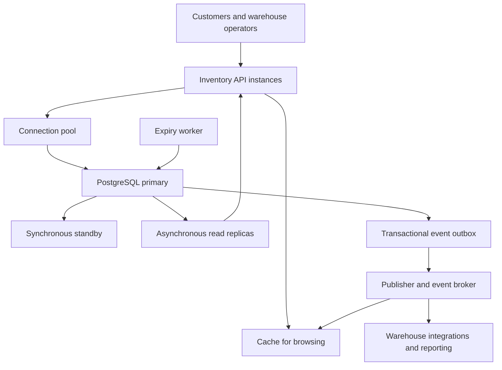
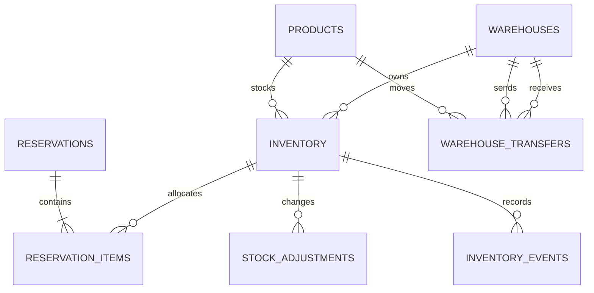

# Inventory Management Database Design

## Problem 2

This design supports a retailer with 2 million products, 100 warehouses, and a target of 10,000 inventory updates per second. Each warehouse owns its stock independently. An order may reserve items from several warehouses. The central correctness requirement is that committed reservations and sales must never exceed the available stock.

The proposed baseline is PostgreSQL 17 with one writable primary, a synchronous standby, and asynchronous read replicas. Inventory is partitioned by warehouse ID. Short database transactions perform conditional stock updates, record reservations, and write durable events together. Checkout always uses the primary. Browsing may use replicas or a cache because a displayed quantity is not a purchase guarantee.

The accompanying SQL implements the inventory schema, reservation lifecycle, idempotent stock adjustments, and event records on one database. Replication, failover, event delivery, and future sharding are architecture decisions, not deployed components of the demonstration.

## 1 Architecture and consistency boundary

Application instances are stateless and share the database as their concurrency authority. An inventory service validates commands and routes writes to the primary through a connection pool. A reservation worker releases expired holds. An outbox publisher forwards committed inventory events to a broker; consumers update search and cache views. A warehouse integration service submits receiving, transfer, and correction commands.



The transaction boundary includes stock counters, reservation state, reservation lines, and event inserts. It excludes customer think time, payment calls, and broker communication. A transaction must commit before the API reports success. If the commit outcome is uncertain, the caller retries with the same operation ID and queries the stored result.

The 15-minute reservation lifetime is a configurable business assumption for this case; the assignment does not specify one. Requests contain explicit warehouse allocations. If alternative warehouses are acceptable, allocation planning occurs before the atomic reservation attempt and may be retried after a stock conflict.

## 2 Database schema and relationships

| Table | Primary key | Purpose |
| --- | --- | --- |
| products | product_id | Product identity, unique SKU, and name |
| warehouses | warehouse_id | Warehouse identity and location |
| inventory | warehouse_id, product_id | Stock, reserved quantity, derived availability, and version |
| reservations | order_id | One reservation attempt per order ID, canonical request, deadline, and status |
| reservation_items | order_id, warehouse_id, product_id | Positive quantity allocated from each warehouse |
| stock_adjustments | operation_id | Idempotent receiving and correction commands |
| inventory_events | event_id | Stock deltas, row version, audit data, and outbox delivery marker |
| warehouse_transfers | transfer_id | Source, destination, quantity, and transfer lifecycle |



Orders and customers belong to the commerce service. Here, order_id is an external identifier and the reservation idempotency key. The demonstration deliberately omits unrelated customer, address, and payment details.

For each warehouse and product, available = on_hand - reserved. The constraints require on_hand >= 0 and 0 <= reserved <= on_hand. The generated available column cannot drift because callers cannot update it independently. A missing inventory row means that warehouse does not stock the product; the service must provision a row before accepting stock updates.

In this model, on_hand means stock not yet consumed by confirmed orders. Confirmation deducts the sold quantity immediately. Physical warehouse reconciliation must separately account for sold units awaiting shipment; a richer fulfillment model would add an allocated or picked state.

The supplied example begins with iPhone 17 quantities of 100 in Almaty, 50 in Astana, and 25 in Shymkent, with no reservations. Each balance remains independent. A total of 175 is useful for discovery, but checkout must reserve a concrete allocation from specific warehouses.

The complete DDL is in sql/01_schema.sql. It defines foreign keys, positive quantities, legal reservation states, a partial expiry index, and an index for unpublished events. A reservation's lines and counters are kept consistent by the transactional functions. Row constraints alone do not enforce agreement between counters and the sum of reservation lines.

## 3 Partitioning and future sharding

I choose warehouse_id as the inventory partition key because stock ownership, receiving, replenishment, and most operational queries are warehouse specific. The initial schema uses 16 hash partitions. Each warehouse maps to one partition; a partition can contain several warehouses. The primary key includes warehouse_id, as PostgreSQL requires a partitioned unique key to include the partition key [2].

Product-ID partitioning would help product-wide queries, but would distribute a warehouse's normal operations across many partitions or servers. The selected design accepts fan-out for global product availability and serves those discovery queries from a materialized read view. A warehouse-specific inventory lookup uses the composite primary key directly.

Partitioning is not sharding: all 16 partitions initially share one PostgreSQL primary and its CPU, storage, and WAL capacity. The partition count is an initial operational choice to benchmark, not a claim that 16 partitions guarantee the throughput target.

If measurements require multiple writable servers, use a routing directory from warehouse ID to shard. Keep a warehouse's balances and local reservations together. Replicate product metadata to each shard. There are only 100 warehouses, so a single very busy warehouse can still become a hot shard. A secondary product hash within that warehouse is a later option, with the cost of more distributed transactions.

## 4 Preventing overselling and concurrent lost updates

The key operation is a conditional UPDATE, never a separate unlocked availability check followed by a write:

```sql
UPDATE inventory_app.inventory
SET reserved = reserved + 1,
    version = version + 1,
    updated_at = clock_timestamp()
WHERE warehouse_id = 1
  AND product_id = 17
  AND on_hand - reserved >= 1
RETURNING warehouse_id, product_id, available;
```

This is the concurrency primitive, not a complete reservation API. The reserve_order function also inserts the reservation, lines, and events within the same transaction. If any requested item cannot be reserved, it raises an error and the entire attempt rolls back.

READ COMMITTED is sufficient for this known-row invariant. PostgreSQL serializes conflicting updates with row locks and rechecks the UPDATE condition after a competing committed update [1]. All write paths must follow the same rules. A cache lock or an application-instance mutex cannot replace this database guarantee.

For multi-item operations, rows are updated in ascending (warehouse_id, product_id) order. Completion first locks the reservation header and then its inventory rows in the same order. This reduces deadlock risk. The service still retries the whole transaction after a deadlock or serialization failure, with bounded exponential backoff and jitter; an insufficient-stock response is a business result, not an automatic retry loop.

Pessimistic locking fits the last-item conflict: competitors must serialize before stock can be promised. Optimistic locking is an alternative for low-contention edits: UPDATE ... WHERE version = expected_version must affect one row, otherwise the caller rereads and retries. Repeated conflicts make this wasteful for hot products. The version column is also useful for rejecting stale cache events.

Atomicity comes from committing all related changes together. Consistency comes from guarded writes, constraints, and lifecycle rules. Isolation comes from row locks and READ COMMITTED semantics. Durability comes from WAL and the replication policy. SERIALIZABLE would be appropriate for additional complex cross-row rules that cannot be encoded with these locks; it introduces retries and is not required for the stated stock invariant.

## 5 Reservations and order completion

The reservation lifecycle is active -> confirmed, released, or expired. Terminal states do not return to active. A fresh checkout attempt after cancellation or expiry needs a new order ID. The API must inspect the returned status: an idempotent replay returning released or expired is not a new successful reservation.

```sql
BEGIN ISOLATION LEVEL READ COMMITTED;
SELECT inventory_app.reserve_order(
    '00000000-0000-0000-0000-000000000001',
    '[{"warehouse_id":1,"product_id":17,"quantity":2},
      {"warehouse_id":2,"product_id":17,"quantity":1}]'
);
COMMIT;
```

The function validates positive quantities and rejects duplicate warehouse-product pairs. It sorts the request into a canonical representation. Reusing the same order ID and identical contents returns the stored state; reusing the ID with different contents raises an error. Concurrent duplicate inserts serialize through the primary key. An unsuccessful attempt is rolled back completely, so its ID has no persisted rejection and can be retried.

On reservation, reserved increases and on_hand remains unchanged. On confirmation, both decrease by the reserved quantity. On release or expiry, only reserved decreases. Every change produces a versioned inventory event in the same transaction. The adjust_stock function handles signed receiving or correction deltas, checks that remaining stock covers existing reservations, and deduplicates by operation ID.

finish_reservation locks the header and all affected stock rows before deciding the transition. It reads the database clock after acquiring those locks. A confirmation at or after expires_at becomes expiry and releases the hold. A confirmation admitted before the deadline may commit shortly afterward; this admission decision is the defined cutoff. Application-server clocks do not determine expiry.

The expiry worker uses the partial index to find due active reservations. sql/04_expiry_worker.sql locks one candidate with FOR UPDATE SKIP LOCKED, invokes the same completion function, and commits. Several workers can operate without waiting on the same candidate. They repeat until the queue is drained. If the worker is late, stock remains conservatively unavailable; it is never silently sold twice.

No database transaction remains open while the customer pays. Authorize payment externally, confirm the live reservation, and then capture through a retryable payment workflow. An expired reservation must not be resurrected by a late payment callback. If money was already captured, use a refund or an explicit new allocation attempt. Fulfillment waits for both confirmed inventory and a satisfactory payment state. Duplicate callbacks call the idempotent transition; reconciliation queries the provider when callbacks are lost.

## 6 Replication and stale reads

Use asynchronous replicas for browsing, search, dashboards, and reports that tolerate freshness delays. Use the primary for reserving stock, confirming or releasing reservations, warehouse adjustments, and authoritative order status immediately after a write. Frequently read product descriptions can be cached for longer than quantities.

A replica might display one available item after the primary has reserved it. The display remains advisory; checkout runs the conditional write on the primary and may return unavailable. Event-based invalidation shortens stale periods but is not a correctness mechanism. Read-your-writes requests are routed to the primary. A more advanced replica-routing scheme can wait for a post-commit WAL position to replay on the selected replica, with a timeout and primary fallback; tokens must be invalidated on timeline changes.

Monitor replay delay, WAL backlog, replica health, and cache age. Remove lagging replicas from routes with a freshness requirement and degrade browsing to explicitly stale results if primary read capacity is exhausted. Do not route writes to asynchronous replicas.

For important acknowledged stock writes, configure synchronous_commit = on and a synchronous standby, which waits for durable WAL receipt. remote_apply additionally waits for replay and can support reads on the selected synchronous standby, at extra latency [3]. Neither setting makes every other replica current.

Failover requires a manager that fences the former primary and promotes a standby proven to contain acknowledged commits. If no safe replica is available, stop authoritative checkout writes until safety is restored. Losing acknowledged reservations by promoting a stale asynchronous replica could sell the same stock again. Under a network partition, this design favors consistent stock ownership over uninterrupted writes; cached browsing may remain available. Backups and archived WAL support point-in-time recovery, and restoration must be rehearsed.

## 7 Multiple warehouses and stock transfers

In the baseline database, a cross-warehouse reservation is one ordinary ACID transaction. If Almaty succeeds and Astana lacks stock, the complete operation rolls back. There is no need for a distributed transaction while all rows share the same PostgreSQL primary.

After physical sharding, use a durable order coordinator and a saga. Each shard reserves its local items with a stable (order_id, warehouse_id) key. If a participant fails, release earlier holds. Record coordinator progress durably and retry commands idempotently after crashes. The order remains pending until every participant confirms; a timeout alone must not be interpreted as a definite failure.

Cross-shard confirmation is not globally atomic. A reservation can expire while another shard confirms. The coordinator must compensate confirmed but unfulfilled allocations through a separate idempotent restock operation and refund payment when necessary. It must not issue fulfillment until all inventory and payment decisions succeed. Once shipment begins, recovery is a return or business exception, not a blind counter increment. A prepared-allocation protocol can strengthen this boundary, but needs explicit recovery of abandoned prepared holds. Two-phase commit is an alternative for strict atomicity; its prepared transactions can retain locks during coordinator failures. The baseline avoids this complexity.

Warehouse synchronization means exchanging inventory events and recording physical transfers, not copying one warehouse's stock number to another. A transfer of 10 units follows this protocol:

1. Create a requested transfer with a unique transfer_id and fixed source, destination, product, and quantity.
2. At dispatch, lock the transfer record and conditionally deduct 10 available units at the source. Change requested to in_transit and insert an outbox event in the same transaction. The destination has not gained sellable stock yet.
3. At verified receipt, lock the transfer and add 10 units to the destination exactly once. Change in_transit to received and write an event atomically. Retries observe the terminal state.
4. Cancel a requested transfer without stock changes. After dispatch, a return requires verified physical receipt. A lost shipment is marked lost and recorded as a loss; it must not recreate stock at the source.

During transit, the source is down 10, the destination is unchanged, and the transfer ledger accounts for 10 in transit. Source plus destination plus in-transit quantity is conserved until a documented loss. Across shards, source and destination transactions use the same transfer ID, distinct dispatch/receipt operations, durable messages, and an inbox with a unique consumer/event key. A receiver verifies receipt rather than increasing stock merely because a dispatch event arrived. Transfer automation is specified here but is not implemented by the demonstration functions.

## 8 Failure handling and recovery

Recovery preserves committed stock decisions and retries incomplete work with stable identifiers. The following matrix links each failure to the action that restores service without duplicating inventory effects.

| Failure | Required behavior |
| --- | --- |
| Two buyers reserve the last item | The row lock serializes updates; one conditional update succeeds and the other reports insufficient stock. |
| Application dies before commit | PostgreSQL rolls back stock, reservation, and event changes together. |
| Commit succeeds but response is lost | Retry the same ID and request; return stored state without applying another delta. |
| Confirmation races with expiry | Both lock the same header; one terminal transition wins and the other observes it. |
| Expiry worker stops | Holds remain reserved; a restarted worker drains due holds. Alert on oldest due reservation. |
| Broker or publisher fails | Events remain committed in the database and are retried. Inventory writes do not depend on broker availability. |
| Publish succeeds but acknowledgement is lost | Publication may repeat. Consumers deduplicate event IDs in the same transaction as their side effects. |
| Events arrive out of order | Balance projections apply newer per-item versions; gap-sensitive consumers request a fresh snapshot or replay. |
| Primary fails or becomes isolated | Fence it and promote only a sufficiently durable replica. Pause writes when safe promotion cannot be proved. |
| Multiwarehouse operation partly fails | One-database transactions roll back; a sharded saga stays pending and runs durable compensation. |
| Physical count is below reserved stock | Reject a blind negative adjustment; investigate and cancel or reallocate affected reservations through an audited workflow. |
| Deadlock or lock timeout | Roll back and retry the whole bounded operation with its original ID. Never retry only the last SQL statement. |

The event table doubles as a transactional outbox. Publishing is at least once: mark published only after broker acknowledgement. Delivery claims are short database operations with leases or a recoverable claim state; do not retain inventory locks during network calls. Event payload fields are immutable; published_at is delivery metadata. The SQL records events, but a production publisher and consumer inbox are separate components.

Periodically reconcile inventory.reserved against active reservation lines in one consistent database snapshot. Also reconcile stock movements, opening balances, transfers, and warehouse counts. A mismatch is an incident to investigate; overwriting a counter while live transactions continue can destroy valid reservations. Restrict direct table mutations to trusted service code and administrative repair workflows. The demonstration functions use invoker privileges; production role grants and a hardened function-only write interface require separate deployment work.

## 9 Exact last item concurrency challenge

Initially, (warehouse_id = 1, product_id = 17) has on_hand = 1 and reserved = 0. Alice and Bob call different API instances with different order IDs. Both requests reach the same authoritative inventory row.

| Step | Transaction A | Transaction B |
| --- | --- | --- |
| 1 | Inserts Alice's reservation header | Inserts Bob's reservation header |
| 2 | Conditional UPDATE locks the row and sets reserved to 1 | Attempts the same UPDATE and waits for the row lock |
| 3 | Inserts Alice's line and event, then commits | Still waiting until A completes |
| 4 | Receives success after commit | Rechecks available >= 1 against the committed row; available is 0 |
| 5 | Owns the single active reservation | UPDATE affects zero rows; function raises an exception and Bob's whole attempt rolls back |

If A rolls back instead, B can acquire the row and reserve the item. If Bob acquires the lock first, the names reverse. The winner depends on scheduling, but two successful committed reservations are impossible while all writers follow the protocol. PostgreSQL's READ COMMITTED update behavior is the relevant guarantee [1].

Later, confirmation reduces both on_hand and reserved from 1 to 0. A duplicate confirmation sees confirmed and makes no second deduction. The guarantee is scoped to the same warehouse-product row. If two different warehouses each own one unit, both sales are valid. A product-wide browse total does not represent a shared global balance.

## 10 Capacity planning and limitations

The theoretical dense inventory has 2,000,000 x 100 = 200,000,000 rows. Store only actual warehouse assortments when the matrix is sparse. The composite key supports the hot access path; avoid indexing counters that change on every reservation. Hash partitioning helps organize maintenance but does not eliminate contention on one popular row.

At a sustained 10,000 row updates per second, one event per row update produces 864 million events per day. This is a major storage and WAL concern, not just an API throughput figure. Batch asynchronous export of immutable events to an analytical or archival store, retain only the required operational window, and monitor publisher backlog. At that scale, move events to time partitions with carefully designed uniqueness and durable idempotency records; do not discard replay protection merely because an event partition was archived.

Benchmark realistic mixes of reservations, confirmations, deliveries, and reads, including hot products and large multiwarehouse carts. Measure throughput, p95/p99 latency, lock waits, WAL generation, synchronous-replica latency, CPU, disk latency, autovacuum progress, and event backlog. Set maximum cart size, short transaction timeouts, and pool limits. The target is 10,000 updates per second, not 10,000 open database connections.

One highly contended warehouse-product row remains serialized. Add admission control and queue hot-item requests; scale independent warehouse workloads by sharding only after measuring the bottleneck. Do not split a single stock balance into independent writable copies without a quota or ownership protocol. No claim of reaching 10,000 updates per second is made by this small correctness demonstration.

## 11 Implementation and verification

The package includes schema DDL, three transactional functions, seed data and a demonstration, an expiry-worker transaction, a Docker Compose configuration, and an automated Python test runner. All code is free of comments. The Compose database uses temporary storage and a local demonstration password; it is not a production deployment.

Verification on PostgreSQL 17 in Docker passed 13 checks. These covered 20 competing buyers for one item, explicit rejection of losing buyers, concurrent duplicate confirmations and reservations, changed-payload rejection, duplicate cancellation, multiwarehouse rollback, late confirmation against expiry, duplicate receiving, protected reserved stock, explicit rollback, early expiry, and cancellation after a completed sale.

The native PostgreSQL 17.4 smoke test also loaded the schema and operations and ran the example successfully. The demonstration leaves iPhone 17 quantities at Almaty 108, Astana 49, and Shymkent 25 after the purchase and supplier delivery. These are functional checks; replication failover, physical transfer integration, broker delivery, and target-scale performance require separate integration and load testing.

## References

[1] PostgreSQL documentation. Transaction Isolation. https://www.postgresql.org/docs/17/transaction-iso.html

[2] PostgreSQL documentation. Table Partitioning. https://www.postgresql.org/docs/17/ddl-partitioning.html

[3] PostgreSQL documentation. Log Shipping Standby Servers. https://www.postgresql.org/docs/17/warm-standby.html

[4] PostgreSQL documentation. Explicit Locking. https://www.postgresql.org/docs/17/explicit-locking.html

[5] PostgreSQL documentation. SELECT and SKIP LOCKED. https://www.postgresql.org/docs/17/sql-select.html
