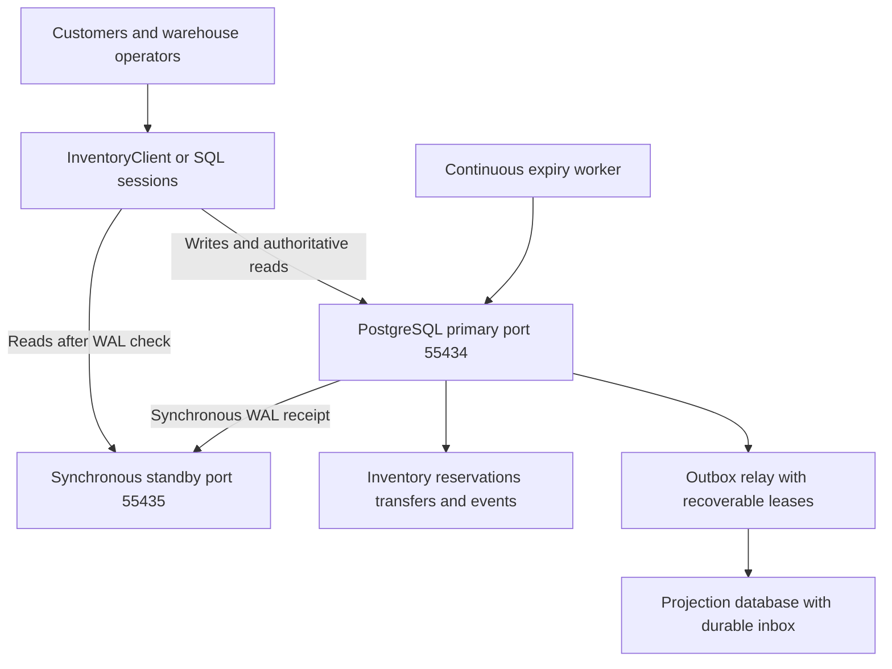
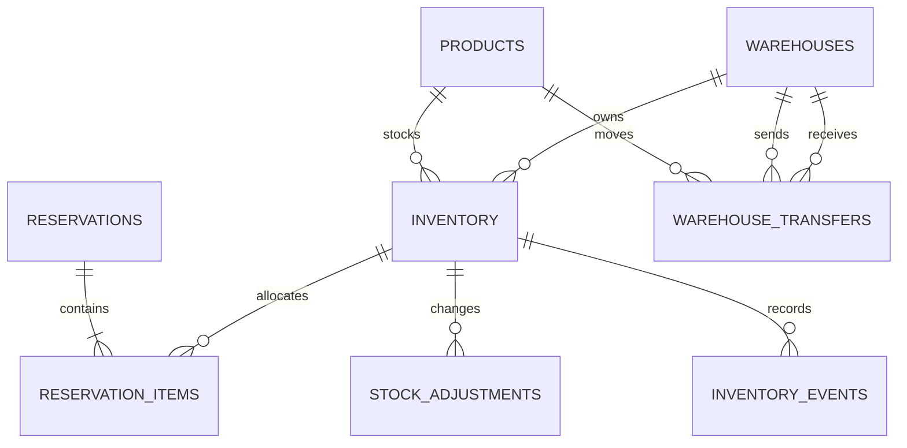
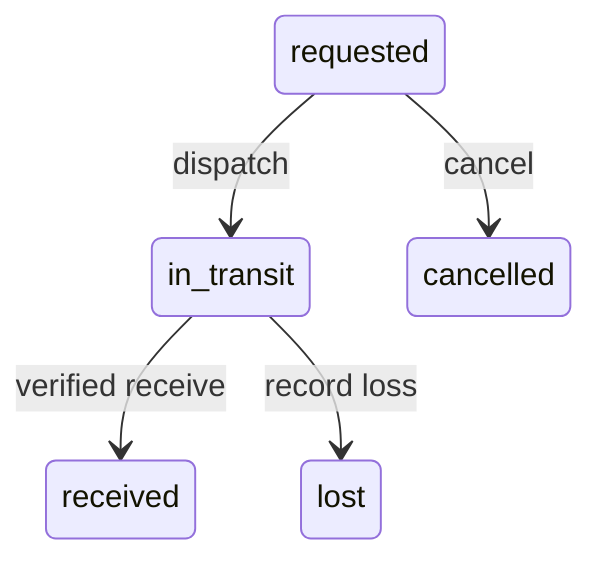

# Inventory Management Database Design

Updated implementation and verification, 5 November 2026.

## Problem 2

This design supports a retailer with 2 million products, 100 warehouses, and a target of 10,000 inventory updates per second. Each warehouse owns its stock independently. An order may reserve items from several warehouses. The central correctness requirement is that committed reservations and sales must never exceed the available stock.

The runnable baseline is PostgreSQL 17 with one writable primary and one synchronous standby on persistent volumes. A startup gate waits until the standby is synchronous before starting the application workers. Inventory is partitioned by warehouse ID. Short database transactions perform conditional stock updates, record reservations, and write durable events together. Checkout always uses the primary. Browsing uses WAL-aware replica routing, while a displayed quantity remains subject to a successful reservation.

The accompanying SQL implements inventory, reservations, adjustments, transfers, a leased outbox, and restricted application access. Docker Compose deploys the primary, synchronous standby, independent projection database, expiry worker, and outbox relay. The client pools connections, retries transient failures with stable identifiers, supports batches of up to 100 adjustments, and offers fresh or explicitly advisory reads. Recovery tests exercise a crash, backup restoration, and fenced promotion with a rebuilt synchronous standby. Physical sharding and an unattended HA manager are deployment choices, not claims about this single-primary implementation.

## Architecture and consistency boundary

Application callers and warehouse operators use InventoryClient or SQL sessions. All stock commands reach the shared primary through transactional functions. Fresh reads check WAL progress; advisory browsing can query the standby without contacting the primary and explicitly reports that freshness is not guaranteed. The expiry worker continuously releases due holds. The outbox worker delivers committed events to a separate PostgreSQL projection service. Each service has persistent storage. The project focuses on database design; an HTTP storefront and payment provider are outside its boundary.

The transaction boundary includes stock counters, reservation state, reservation lines, and event inserts. It excludes customer think time, payment calls, and broker communication. A transaction must commit before the API reports success. If the commit outcome is uncertain, the caller retries with the same operation ID and queries the stored result.

The reservation functions use a fixed 15-minute lifetime as a business assumption for this case. Changing that policy currently requires editing the SQL functions. Requests contain explicit warehouse allocations. If alternative warehouses are acceptable, allocation planning occurs before the atomic reservation attempt and may be retried after a stock conflict.



## 1 Database schema

| Table | Primary key | Purpose |
| --- | --- | --- |
| products | product_id | Product identity, unique SKU, and name |
| warehouses | warehouse_id | Warehouse identity and location |
| inventory | warehouse_id, product_id | Stock, reserved quantity, derived availability, and version |
| reservations | order_id | One reservation attempt per order ID, canonical request, deadline, and status |
| reservation_items | order_id, warehouse_id, product_id | Positive quantity allocated from each warehouse |
| stock_adjustments | operation_id | Idempotent receiving and correction commands |
| inventory_events | event_id | Stock deltas, row version, audit data, publication marker, and delivery lease |
| warehouse_transfers | transfer_id | Source, destination, quantity, and transfer lifecycle |

Orders and customers belong to the commerce service. Here, order_id is an external identifier and the reservation idempotency key. The demonstration deliberately omits unrelated customer, address, and payment details.

For each warehouse and product, available = on_hand - reserved. The constraints require on_hand >= 0 and 0 <= reserved <= on_hand. The generated available column cannot drift because callers cannot update it independently. A missing inventory row means that warehouse does not stock the product; ordinary stock adjustments require a provisioned row. Transfer receipt creates a missing destination row atomically.

In this model, on_hand means stock not yet consumed by confirmed orders. Confirmation deducts the sold quantity immediately. Physical warehouse reconciliation must separately account for sold units awaiting shipment; a richer fulfillment model would add an allocated or picked state.

The supplied example begins with iPhone 17 quantities of 100 in Almaty, 50 in Astana, and 25 in Shymkent, with no reservations. Each balance remains independent. A total of 175 is useful for discovery, but checkout must reserve a concrete allocation from specific warehouses.

The complete DDL is in sql/01_schema.sql. It defines foreign keys, positive quantities, legal reservation states, a partial expiry index, and an index for unpublished events. A reservation's lines and counters are kept consistent by the transactional functions. Row constraints alone do not enforce agreement between counters and the sum of reservation lines.



## 2 Partitioning by warehouse ID

I choose warehouse_id as the inventory partition key because stock ownership, receiving, replenishment, and most operational queries are warehouse specific. The initial schema uses 16 hash partitions. Each warehouse maps to one partition; a partition can contain several warehouses. The primary key includes warehouse_id, as PostgreSQL requires a partitioned unique key to include the partition key [2].

Product-ID partitioning would help product-wide queries, but would distribute a warehouse's normal operations across many partitions or servers. The implemented schema accepts fan-out for global product availability. A materialized read view is a future optimization for those discovery queries. A warehouse-specific inventory lookup uses the composite primary key directly.

Partitioning is not sharding: all 16 partitions initially share one PostgreSQL primary and its CPU, storage, and WAL capacity. The partition count is an initial operational choice to benchmark, not a claim that 16 partitions guarantee the throughput target.

If measurements require multiple writable servers, use a routing directory from warehouse ID to shard. Keep a warehouse's balances and local reservations together. Replicate product metadata to each shard. There are only 100 warehouses, so a single very busy warehouse can still become a hot shard. A secondary product hash within that warehouse is a later option, with the cost of more distributed transactions.

## 3 Preventing overselling

The key operation is a conditional UPDATE, never a separate unlocked availability check followed by a write:

```sql
UPDATE inventory_app.inventory
SET reserved = reserved + 1,
    version = version + 1,
    updated_at = clock_timestamp()
WHERE warehouse_id = 1
  AND product_id = 17
  AND on_hand - reserved >= 1
RETURNING warehouse_id, product_id, available;
```

This is the concurrency primitive, not a complete reservation API. The reserve_order function also inserts the reservation, lines, and events within the same transaction. If any requested item cannot be reserved, it raises an error and the entire attempt rolls back.

## 4 Handling concurrent inventory updates

READ COMMITTED is sufficient for this known-row invariant. PostgreSQL serializes conflicting updates with row locks and rechecks the UPDATE condition after a competing committed update [1]. All write paths must follow the same rules. A cache lock or an application-instance mutex cannot replace this database guarantee.

For multi-item operations, rows are updated in ascending (warehouse_id, product_id) order. Completion first locks the reservation header and then its inventory rows in the same order. This reduces deadlock risk. Production callers should retry the whole transaction after a deadlock or serialization failure using bounded backoff and the original operation ID. The Python client retries deadlocks, serialization failures, lock timeouts, statement cancellation, and connection failures up to three attempts with bounded exponential backoff and jitter. It reuses exactly the same operation identifiers and payload. Business errors such as insufficient stock are not retried. Exhaustion returns an error; a lost commit response still requires replay with the original identifier. Insufficient stock is returned as a business failure.

Pessimistic locking fits the last-item conflict: competitors must serialize before stock can be promised. Optimistic locking is an alternative for low-contention edits: UPDATE ... WHERE version = expected_version must affect one row, otherwise the caller rereads and retries. Repeated conflicts make this wasteful for hot products. The version column is also useful for rejecting stale cache events.

Atomicity comes from committing all related changes together. Consistency comes from guarded writes, constraints, and lifecycle rules. Isolation comes from row locks and READ COMMITTED semantics. Durability comes from WAL and the replication policy. SERIALIZABLE would be appropriate for additional complex cross-row rules that cannot be encoded with these locks; it introduces retries and is not required for the stated stock invariant.

| Isolation level | Relevant behavior | Decision for this design |
| --- | --- | --- |
| READ UNCOMMITTED | PostgreSQL treats it as READ COMMITTED; dirty reads remain disallowed | No separate benefit |
| READ COMMITTED | Each statement sees a fresh committed snapshot; conflicting updates wait and recheck their condition | Selected with known-row locks and constraints |
| REPEATABLE READ | One transaction snapshot; a concurrent change to a target row can require retry | Useful for consistent reporting, unnecessary for the guarded stock command |
| SERIALIZABLE | Detects serialization anomalies, including predicate-based conflicts, and can abort transactions | Choose for new complex cross-row rules; retry the entire transaction |

Optimistic compare-and-swap uses UPDATE ... WHERE version = expected_version and treats zero affected rows as a conflict. It still takes a database write lock while updating; optimistic means conflicts are detected from a version rather than holding an early read lock. Incrementing version alone is not optimistic locking. This project deliberately chooses guarded updates and pessimistic lifecycle locks for contested stock; it does not claim to implement every locking alternative simultaneously.

## 5 Database replication for inventory reads

Use read replicas for browsing, search, dashboards, and reports. The deployed standby synchronously acknowledges WAL receipt; its replay can still lag. Additional asynchronous replicas are a possible reporting extension. Use the primary for reserving stock, confirming or releasing reservations, warehouse adjustments, and authoritative order status immediately after a write. Frequently read product descriptions can be cached for longer than quantities. The Compose replica starts from pg_basebackup with standby.signal and streams through a dedicated replication role and physical slot. It is available on localhost port 55435, alongside the primary on 55434.

## 6 Handling replication lag

A replica might display one available item after the primary has reserved it. Checkout runs the conditional write on the primary and may return unavailable. The implemented inventory_client.py samples the primary's durable WAL position before a read, then checks pg_last_wal_replay_lsn() on the replica. It waits up to 250 ms by default, then falls back to the primary. Connection establishment and individual statements have separate two-second limits; pool acquisition is bounded and lock acquisition has a one-second limit. These are not a total request deadline: synchronous COMMIT can remain pending while the required standby is unavailable. Do not cancel synchronous replication waits and report success; a disconnected caller must treat the result as unknown and replay the same identifier. Authoritative reads select the primary immediately. The replica probe and inventory SELECT are separate READ COMMITTED statements on the same connection, ensuring a new data snapshot after replay has reached the sampled position.

Client write methods commit on the primary with synchronous_commit enabled and then return a token containing the cluster ID, timeline, and WAL position. Subsequent reads validate that token against the current primary. A different cluster or timeline, or a token ahead of the primary's durable WAL, is rejected. Replica identity mismatch or connection failure causes primary fallback. Fresh reads still require primary metadata and primary availability. Explicit allow_stale browsing bypasses that dependency and cannot be combined with an authoritative or token-bound request. Thread-safe, bounded pools reuse sessions. The deployed workers use inventory_service, which has read access and hardened function execution but cannot directly alter balances. Monitoring-function grants are explicit; demonstration secrets must be replaced when deployed outside the local lab.

The client reports the selected source, routing reason, and observed WAL gap in bytes. pg_stat_replication provides sender state and sent/replayed positions. Position comparison handles an idle primary without misclassifying an old replay timestamp as active lag. The lab bounds slot retention with max_slot_wal_keep_size = 1GB. A replica that falls beyond retained WAL requires a new base backup. Production monitoring should additionally track backlog, replica health, and cache age.

The deployed configuration sets synchronous_standby_names to FIRST 1 (inventory_replica) and uses synchronous_commit = on. An acknowledged application commit therefore has durable WAL on the selected standby. Synchronous receipt does not imply synchronous replay, which is why read routing still checks replay LSN. remote_apply is an alternative that also waits for replay, at additional latency [3]. The fresh read tests deliberately pause replay while writes continue to reach standby storage.

The tested failover procedure removes the failed primary container before promotion, promotes the synchronous standby, immediately requires a replacement synchronous standby, rebuilds that standby from a base backup, and only then resumes checkout through the new endpoint. The recovery drill uses a separate temporary Docker project. An isolated old primary must never be restarted as writable; rebuilding or pg_rewind and role reassignment are required before rejoining it. This is controlled failover, not an unattended election system. Under a partition the design stops acknowledging writes rather than risking double ownership. Advisory browsing remains possible. Logical backups have checksums, restore into a new database, and reapply application permissions. Whole-host disaster recovery additionally requires off-host copies; WAL archiving for PITR is an extension, not a tested feature.

## 7 Inventory reservations and completion

The reservation lifecycle is active -> confirmed, released, or expired. Terminal states do not return to active. A fresh checkout attempt after cancellation or expiry needs a new order ID. The API must inspect the returned status: an idempotent replay returning released or expired is not a new successful reservation.

```sql
BEGIN ISOLATION LEVEL READ COMMITTED;
SELECT inventory_app.reserve_order(
    '00000000-0000-0000-0000-000000000001',
    '[{"warehouse_id":1,"product_id":17,"quantity":2},
      {"warehouse_id":2,"product_id":17,"quantity":1}]'
);
COMMIT;
```

The function validates positive quantities, caps a reservation at 100 warehouse-product pairs, and rejects duplicate pairs. It sorts the request into a canonical representation. Reusing the same order ID and identical contents returns the stored state; reusing the ID with different contents raises an error. Concurrent duplicate inserts serialize through the primary key. An unsuccessful attempt is rolled back completely, so its ID has no persisted rejection and can be retried.

On reservation, reserved increases and on_hand remains unchanged. On confirmation, both decrease by the reserved quantity. On release or expiry, only reserved decreases. Every change produces a versioned inventory event in the same transaction. The adjust_stock function handles signed receiving or correction deltas, checks that remaining stock covers existing reservations, and deduplicates by operation ID.

finish_reservation locks the header and all affected stock rows before deciding the transition. It reads the database clock after acquiring those locks. A confirmation at or after expires_at becomes expiry and releases the hold. A confirmation admitted before the deadline may commit shortly afterward; this admission decision is the defined cutoff. Application-server clocks do not determine expiry.

The deployed expiry worker repeatedly calls expire_one in separate short transactions. Its candidate query uses expires_at <= statement_timestamp(), so the partial expiry index provides a bounded search. The final transition still checks clock_timestamp() after acquiring stock locks. FOR UPDATE SKIP LOCKED lets multiple workers claim different reservations. Each transaction handles one order to preserve short lock lifetimes and deterministic per-order locking; an empty queue sleeps for 250 ms. Database errors are retried after a delay and Docker restarts failed worker processes. The manual sql/04_expiry_worker.sql demonstrates the same transaction. If processing falls behind, stock remains conservatively reserved. ops/health.sql exposes the oldest overdue hold.

No database transaction remains open while the customer pays. Authorize payment externally, confirm the live reservation, and then capture through a retryable payment workflow. An expired reservation must not be resurrected by a late payment callback. If money was already captured, use a refund or an explicit new allocation attempt. Fulfillment waits for both confirmed inventory and a satisfactory payment state. Duplicate callbacks call the idempotent transition; reconciliation queries the provider when callbacks are lost.

An idempotent reserve_order replay returns the stored state. If the deadline has passed while the expiry worker is delayed, that state can still be active. finish_reservation checks the database clock after acquiring its locks and converts a late confirmation to expired. This preserves stock safety while cleanup is pending.

## 8 Warehouse synchronization and transfers

In the baseline database, a cross-warehouse reservation is one ordinary ACID transaction. If Almaty succeeds and Astana lacks stock, the complete operation rolls back. There is no need for a distributed transaction while all rows share the same PostgreSQL primary.

After physical sharding, use a durable order coordinator and a saga. Each shard reserves its local items with a stable (order_id, warehouse_id) key. If a participant fails, release earlier holds. Record coordinator progress durably and retry commands idempotently after crashes. The order remains pending until every participant confirms; a timeout alone must not be interpreted as a definite failure.

Cross-shard confirmation is not globally atomic. A reservation can expire while another shard confirms. The coordinator must compensate confirmed but unfulfilled allocations through a separate idempotent restock operation and refund payment when necessary. It must not issue fulfillment until all inventory and payment decisions succeed. Once shipment begins, recovery is a return or business exception, not a blind counter increment. A prepared-allocation protocol can strengthen this boundary, but needs explicit recovery of abandoned prepared holds. Two-phase commit is an alternative for strict atomicity; its prepared transactions can retain locks during coordinator failures. The baseline avoids this complexity.

Warehouse synchronization means exchanging inventory events and recording physical transfers, not copying one warehouse's stock number to another. A transfer of 10 units follows this protocol:

1. Create a requested transfer with a unique transfer_id and fixed source, destination, product, and quantity.
2. At dispatch, lock the transfer record and conditionally deduct 10 available units at the source. Change requested to in_transit and insert an outbox event in the same transaction. The destination has not gained sellable stock yet.
3. At verified receipt, lock the transfer and add 10 units to the destination exactly once. Change in_transit to received and write an event atomically. Retries observe the terminal state.
4. Cancel a requested transfer without stock changes. After dispatch, a return requires verified physical receipt. A lost shipment is marked lost and recorded as a loss; it must not recreate stock at the source.

During transit, the source is down 10, the destination is unchanged, and the transfer ledger accounts for 10 in transit. Source plus destination plus in-transit quantity is conserved until a documented loss. Across shards, source and destination transactions use the same transfer ID, distinct dispatch/receipt operations, durable messages, and an inbox with a unique consumer/event key.

sql/06_transfers.sql implements this lifecycle on the shared primary. request_transfer validates fixed contents on an idempotent transfer ID. advance_transfer locks that record and accepts dispatch, receive, cancel, or lose. Dispatch uses a conditional source deduction that protects reserved stock. Receipt creates a destination inventory row if necessary and adds stock once. Both movements write versioned inventory events atomically. A receipt command represents verified physical receipt submitted by a trusted warehouse operator or integration. Cancellation applies before dispatch. Loss after dispatch preserves the source deduction and prevents later receipt. Conflicting terminal actions serialize through the transfer lock. The functions can be added to an existing schema without a table rebuild, and every committed change streams to the read replica.



In the replication test fixture, the source starts with 10 available units and the destination with 0. Dispatching 4 leaves 6 available at the source, 0 at the destination, and 4 in transit. Receipt produces source 6 and destination 4. Repeating receipt keeps the same balances. Both movement events and the received status reach the standby.

## 9 Failure handling and recovery

Recovery preserves committed stock decisions and retries incomplete work with stable identifiers. The following matrix links each failure to the action that restores service without duplicating inventory effects.

| Failure | Required behavior |
| --- | --- |
| Two buyers reserve the last item | The row lock serializes updates; one conditional update succeeds and the other reports insufficient stock. |
| Application dies before commit | PostgreSQL rolls back stock, reservation, and event changes together. |
| Commit succeeds but response is lost | Retry the same ID and request; return stored state without applying another delta. |
| Confirmation races with expiry | Both lock the same header; one terminal transition wins and the other observes it. |
| Expiry worker stops | Holds remain reserved; a restarted worker drains due holds. Alert on oldest due reservation. |
| Projection service or relay fails | Events remain in the outbox. Delivery leases expire and workers retry; stock commits do not depend on the projection service. |
| Consumer commit succeeds but acknowledgement is lost | The leased event is delivered again; the durable inbox and movement update transaction prevent duplicate effects. |
| Events arrive out of order | The movement projection applies every deduplicated delta. Absolute balance caches require snapshots or gap-aware replay, not simply ignoring older deltas. |
| Primary fails or becomes isolated | Fence it, promote the synchronous standby, rebuild synchronous protection, and reroute checkout. A partition without a safe candidate leaves writes pending. |
| Multiwarehouse operation partly fails | One-database transactions roll back; a sharded saga stays pending and runs durable compensation. |
| Physical count is below reserved stock | Reject a blind negative adjustment; investigate and cancel or reallocate affected reservations through an audited workflow. |
| Deadlock or lock timeout | The client retries the whole operation, up to three attempts, with the same IDs. It never retries only the final statement. |

The event table is a transactional outbox. claim_events reserves up to 100 records with a 30-second lease in a short transaction. The relay commits delivery to the separate projection database, then acknowledges the source claim. A crash between these commits causes redelivery after lease expiry. The inbox deduplicates by source, operation ID, warehouse, product, and event type in the same transaction as movement totals; changed duplicate payloads are rejected. Delta events are additive, so out-of-order delivery retains every delta rather than discarding lower versions. highest_version is diagnostic only. The projection records changes, not authoritative balances: opening stock and physical reconciliation are separate. No inventory lock is held during network delivery. The recovery tests inject the lost acknowledgement and verify exactly one consumer effect. This is direct durable service-to-service delivery; a message broker is optional.

Periodically reconcile inventory.reserved against active reservation lines in one consistent database snapshot. Also reconcile stock movements, opening balances, transfers, and warehouse counts. A mismatch is an incident to investigate; overwriting a counter while live transactions continue can destroy valid reservations. Restrict direct table mutations to trusted service code and administrative repair workflows. The transactional functions use SECURITY DEFINER with a fixed inventory_app, pg_temp search path. Public execution is revoked, and inventory_service receives explicit schema, read, function, and monitoring permissions. Direct stock mutations by this role are rejected and tested. Administrative repair remains a separate trusted operation.

## 10 Last item concurrency challenge

Initially, (warehouse_id = 1, product_id = 17) has on_hand = 1 and reserved = 0. Alice and Bob call different API instances with different order IDs. Both requests reach the same authoritative inventory row.

| Step | Transaction A | Transaction B |
| --- | --- | --- |
| 1 | Inserts Alice's reservation header | Inserts Bob's reservation header |
| 2 | Conditional UPDATE locks the row and sets reserved to 1 | Attempts the same UPDATE and waits for the row lock |
| 3 | Inserts Alice's line and event, then commits | Still waiting until A completes |
| 4 | Receives success after commit | Rechecks available >= 1 against the committed row; available is 0 |
| 5 | Owns the single active reservation | UPDATE affects zero rows; function raises an exception and Bob's whole attempt rolls back |

If A rolls back instead, B can acquire the row and reserve the item. If Bob acquires the lock first, the names reverse. The winner depends on scheduling, but two successful committed reservations are impossible while all writers follow the protocol. PostgreSQL's READ COMMITTED update behavior is the relevant guarantee [1].

Later, confirmation reduces both on_hand and reserved from 1 to 0. A duplicate confirmation sees confirmed and makes no second deduction. The guarantee is scoped to the same warehouse-product row. If two different warehouses each own one unit, both sales are valid. A product-wide browse total does not represent a shared global balance.

## 11 Capacity planning and measured limits

The dense upper bound is 2,000,000 x 100 = 200,000,000 inventory rows. The measured dataset contains 2,000,000 products, 100 warehouses and 2,000,000 inventory rows, with each product initially stocked at one warehouse. This explicitly sparse dataset exercises the full product catalog and warehouse count; it does not claim to benchmark the dense Cartesian product. Functional tests separately cover the same product stocked in multiple warehouses.

The measured platform is PostgreSQL 17.11 on Docker Desktop, with 12 allocated CPUs and approximately 14.6 GiB RAM for the Docker engine. Primary and synchronous standby use persistent volumes on one host. PostgreSQL uses 512 MB shared_buffers, a 4 GB max_wal_size, a 15-minute checkpoint timeout and WAL compression. Each workload ran for 30 seconds after a three-second warm-up, using 32 clients. Latency percentiles are from a 10 percent random transaction sample. This is a reproducible capacity experiment, not a long-duration production soak test.

| Workload | Inventory updates / second | Transaction p95 / p99 |
| --- | --- | --- |
| adjustment | 2,548.50 | 17.184 / 22.33 ms |
| batch | 12,733.35 | 270.031 / 323.509 ms |
| checkout | 2,080.80 | 40.264 / 58.415 ms |
| hot | 159.37 | 1069.757 / 1394.231 ms |

Adjustment means one guarded, idempotent stock update and its event per committed transaction. Batch means 64 distinct row adjustments in one atomic transaction. Checkout reserves and confirms one unit in two committed statements, so it performs two inventory updates per reported pgbench transaction. Hot checkout sends all clients to the same warehouse-product row. Batch latency is the latency of the entire batch, not an individual operation SLA.

The 10,000-update target was exceeded in the batched write scenario with synchronous WAL acknowledgement. Individual adjustments, customer checkout and a single hot row have lower measured capacity. It would be incorrect to describe this result as 10,000 independent customer orders per second. The first experiment, preserved in tests/benchmark_before.json, used 16 clients and 32-row batches and measured 9,727.86 batched updates/s. Both configuration and workload changed in the second experiment; the improvement cannot be attributed solely to one tuning parameter.

All four final runs had zero failed transactions, zero invalid stock rows and zero unfinished active reservations. The initial database occupied 507.6 MiB and the final database 746.5 MiB. tests/benchmark_results.json records WAL generation and exact results; benchmarks/run.py reproduces the experiment and cleans up its database. The database write benchmark includes idempotency and event insertion. It excludes HTTP, payment, customer think time and simultaneous delivery of the benchmark's event backlog. Relay correctness and recovery are tested separately; end-to-end delivery capacity needs its own load test before deployment.

At 10,000 row updates/s, one event per update creates 864 million events/day. A finite retention and archival policy is therefore mandatory for a sustained deployment. Size storage using measured WAL and event sizes, export acknowledged immutable events in batches, partition event history by time, and retain durable operation deduplication records for the supported retry horizon. Do not erase idempotency protection when dropping an event partition. The lab keeps its small demonstration history; it is not a long-term archive.

For a sustained unbatched target, the measured adjustment rate with a 30 percent capacity reserve gives a planning estimate of six comparable primary/standby shard pairs; the measured checkout rate gives seven. These are starting estimates, not measured linear scaling. Route by warehouse ID, validate skew and cross-shard coordination, and benchmark before accepting production traffic. A hot warehouse-product row remains serialized even after warehouse sharding. Admission control and a bounded hot-item queue are required; independent copies of the same balance would violate stock ownership.

## 12 Implementation and verified recovery

Verification was performed on 5 November 2026. The package contains the original transaction and replication suites plus new operational, deployed-service, crash/backup and fenced-failover checks. The Python dependency is pinned. All test databases are isolated and removed. The failover drill creates its own random Docker project, fences its old primary by removing the container, and deletes only that temporary project's volumes afterward.

| Suite | Checks passed | Outcome |
| --- | --- | --- |
| Functional | 28 of 28 | PASS |
| Replication | 18 of 18 | PASS |
| Operational | 16 of 16 | PASS |
| Deployed services | 5 of 5 | PASS |
| Recovery | 9 of 9 | PASS |
| Failover | 5 of 5 | PASS |
| Total | 81 of 81 | PASS |

The live worker checks confirm automatic expiry, independent inventory writes during projection outage, durable pending events and catch-up after consumer recovery. Operational tests cover restricted privileges, connection reuse, transaction retry, atomic batches, leased delivery, lost acknowledgement and out-of-order deltas. The original last-item and transfer races remain passing.

In the measured recovery run, logical restore into a fresh database took 1.852 seconds. A forced primary SIGKILL and recovery, including the advisory-read check during downtime, took 5.639 seconds. The separate fenced promotion and rebuilding of synchronous protection took 4.8 seconds. These observed local results are evidence for the lab, not contractual production RTOs.

The recovery objective for an isolated primary failure is zero lost acknowledged transactions, provided the selected synchronous standby and its storage survive and the old primary is fenced. Checkout remains pending while the required synchronous protection is unavailable. For loss of the entire Docker host, the recovery point is the latest available off-host backup; local named volumes alone cannot cover that fault. The operational target is to rehearse the procedure within 60 seconds on this small lab dataset, and to measure restoration on production-sized data before assigning a production RTO.

The backup tool writes a custom-format pg_dump with a SHA-256 manifest, restores only into a new database, and reapplies restricted role permissions. Restored stock, reservations, events and permissions are checked. Commit-response loss is injected after a durable commit; replaying the same operation ID changes stock exactly once. Standby outage is tested as a pending commit, not falsely treated as an automatic rollback. Database SQL timeouts are not assumed to bound the synchronous commit wait.

Run ./ops/check.ps1 for regular verification, ./ops/check.ps1 -Recovery for the disruptive lab drills, and ./ops/check.ps1 -Benchmark for capacity measurement. Run these groups sequentially. The complete observed output is in tests/verification_results.txt. The PDF reports and submission ZIP are generated from these sources.

## Appendix A Functional verification

| Check | Verified behavior | Result |
| --- | --- | --- |
| F01 | 20 simultaneous buyers produce one reservation for one item | PASS |
| F02 | All losing buyers receive an explicit insufficient stock error | PASS |
| F03 | Concurrent duplicate confirmations consume stock once | PASS |
| F04 | Concurrent duplicate reservation requests reserve only once | PASS |
| F05 | Reusing an order ID with changed items is rejected | PASS |
| F06 | Duplicate cancellation releases stock once | PASS |
| F07 | A failed multiwarehouse reservation rolls back all earlier items | PASS |
| F08 | Expiry and late confirmation cannot both consume or release stock | PASS |
| F09 | Duplicate concurrent deliveries add physical stock once | PASS |
| F10 | Negative adjustments cannot consume reserved units | PASS |
| F11 | Transaction rollback leaves no held stock | PASS |
| F12 | Early expiry does not release a valid reservation | PASS |
| F13 | Cancellation after confirmation does not recreate sold stock | PASS |
| F14 | Concurrent transfer requests create one transfer without moving stock | PASS |
| F15 | Changed transfer payload is rejected | PASS |
| F16 | Receipt before dispatch is rejected | PASS |
| F17 | Rolled-back dispatch leaves stock and events unchanged | PASS |
| F18 | Repeated dispatch deducts once and leaves destination unavailable in transit | PASS |
| F19 | Source plus destination plus in-transit stock is conserved | PASS |
| F20 | Dispatched goods cannot be cancelled back into source stock | PASS |
| F21 | Rolled-back receipt also rolls back new destination row | PASS |
| F22 | Concurrent receipts provision destination and credit exactly once | PASS |
| F23 | A delayed duplicate dispatch cannot deduct received goods again | PASS |
| F24 | A purchase and a transfer competing for the last unit have one winner | PASS |
| F25 | Dispatch cannot consume reserved units and a failed attempt remains retryable | PASS |
| F26 | Cancellation is idempotent and prevents future dispatch | PASS |
| F27 | A lost shipment stays deducted and cannot later be received | PASS |
| F28 | Concurrent receipt and loss resolve to one terminal decision | PASS |

## Appendix B Replication and routing verification

| Check | Verified behavior | Result |
| --- | --- | --- |
| R01 | Separate primary and physical standby are running | PASS |
| R02 | Caught-up inventory reads are served by the replica | PASS |
| R03 | The replica rejects inventory writes | PASS |
| R04 | Primary commits a reservation while paused replica still displays old stock | PASS |
| R05 | Post-commit read token falls back to primary during replay lag | PASS |
| R06 | Ordinary browsing also detects lag without a caller token | PASS |
| R07 | Authoritative reads always use primary | PASS |
| R08 | Stale replica availability cannot authorize an overselling purchase | PASS |
| R09 | Bounded read wait uses replica once replay catches up | PASS |
| R10 | Missing inventory is reported consistently | PASS |
| R11 | Read tokens from another timeline are rejected | PASS |
| R12 | A writable server configured as replica is excluded | PASS |
| R13 | An unreachable replica falls back to primary | PASS |
| R14 | Transfer command runs through the primary client | PASS |
| R15 | Replica shows source deduction while goods are in transit | PASS |
| R16 | Verified receipt reaches replica exactly once after duplicate callback | PASS |
| R17 | Transfer ledger and both movement events replicate together | PASS |
| R18 | Write tokens are captured after durable commits in WAL order | PASS |

## Appendix C Operational and recovery verification

| Check | Verified behavior | Result |
| --- | --- | --- |
| E01 | Application role cannot mutate stock tables directly | PASS |
| E02 | Connection pool reuses a database session | PASS |
| E03 | Restricted application role can reserve and receive a WAL token | PASS |
| E04 | Advisory reads cannot masquerade as token-bound fresh reads | PASS |
| E05 | Concurrent expiry workers process every due reservation exactly once | PASS |
| E06 | Expiry releases all held quantities without negative counters | PASS |
| E07 | An idle expiry worker returns without changing stock | PASS |
| E08 | A lock timeout retries the whole operation successfully | PASS |
| E09 | Retry after lock timeout applies the stock delta once | PASS |
| E10 | Consumer commit survives a lost publisher acknowledgement | PASS |
| E11 | Expired delivery leases replay events without duplicate consumer effects | PASS |
| E12 | Durable inbox and movement totals commit atomically | PASS |
| E13 | The batched client preserves operation-level idempotency | PASS |
| E14 | A failing stock batch rolls back all preceding adjustments | PASS |
| E15 | Out-of-order delta events retain every movement instead of dropping older versions | PASS |
| E16 | A duplicate event identity with changed data is rejected | PASS |
| E17 | The deployed expiry process automatically releases an expired reservation | PASS |
| E18 | The deployed relay automatically acknowledges committed reservation events | PASS |
| E19 | Inventory writes succeed independently of an unavailable projection service | PASS |
| E20 | An undelivered movement remains durable in the outbox during consumer outage | PASS |
| E21 | The deployed relay catches up after consumer recovery with correct movement totals | PASS |
| E22 | Verified backup restores inventory and active reservations into a new database | PASS |
| E23 | Backup restoration preserves the committed event ledger | PASS |
| E24 | Restoration reapplies the restricted application permissions | PASS |
| E25 | Explicit advisory browsing remains available while the primary is down | PASS |
| E26 | A SIGKILL and restart retain the acknowledged stock and reservation | PASS |
| E27 | No successful write acknowledgement is returned without the synchronous standby | PASS |
| E28 | Retry after a delayed acknowledgement applies the original operation exactly once | PASS |
| E29 | Connection loss after commit is recovered with the same idempotency key | PASS |
| E30 | Recovery leaves a single idempotency record for the delayed operation | PASS |
| E31 | Former primary container is removed before standby promotion | PASS |
| E32 | The fenced standby becomes the new primary | PASS |
| E33 | Promotion preserves the reservation acknowledged by the former primary | PASS |
| E34 | A fresh synchronous standby is rebuilt before checkout resumes | PASS |
| E35 | Checkout resumes through the promoted primary with synchronous durability | PASS |

## References

[1] PostgreSQL documentation. Transaction Isolation. https://www.postgresql.org/docs/17/transaction-iso.html

[2] PostgreSQL documentation. Table Partitioning. https://www.postgresql.org/docs/17/ddl-partitioning.html

[3] PostgreSQL documentation. Log Shipping Standby Servers. https://www.postgresql.org/docs/17/warm-standby.html

[4] PostgreSQL documentation. Explicit Locking. https://www.postgresql.org/docs/17/explicit-locking.html

[5] PostgreSQL documentation. SELECT and SKIP LOCKED. https://www.postgresql.org/docs/17/sql-select.html
