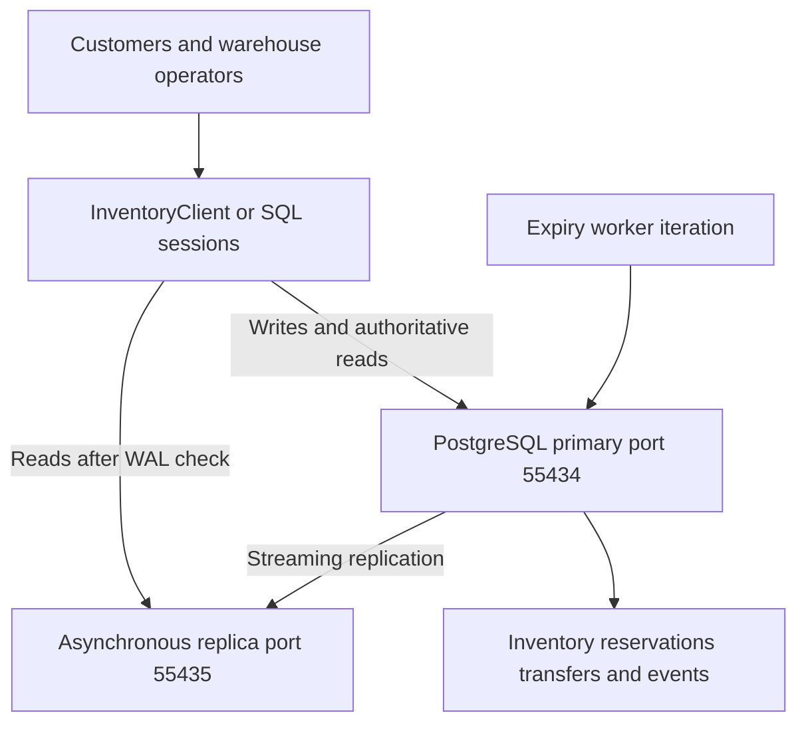
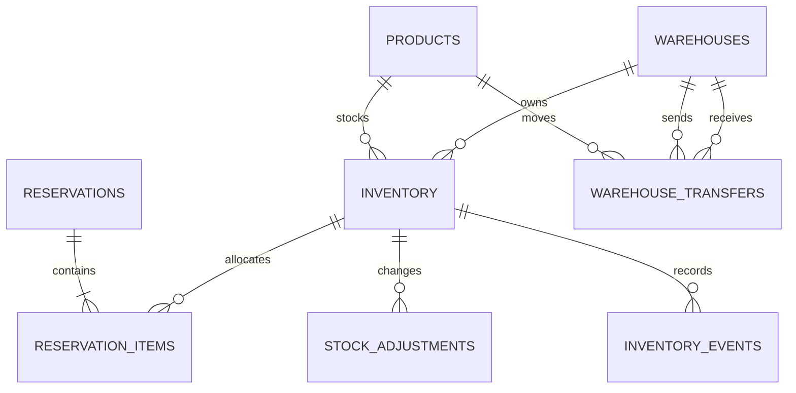
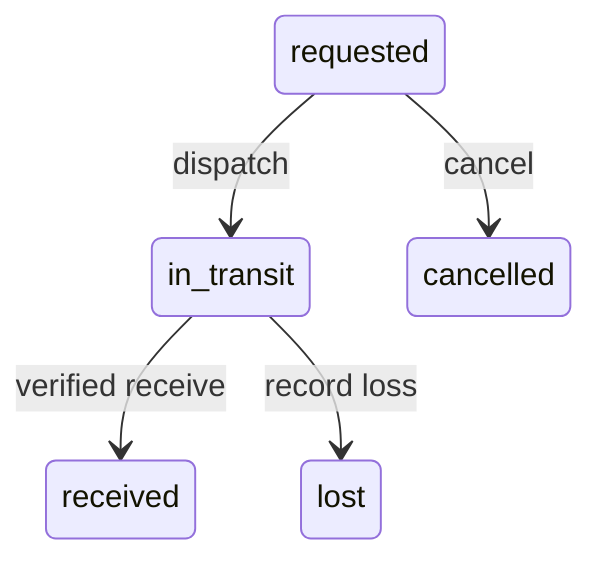

# Inventory Management Database Design

Updated implementation and verification, 4 November 2026.

## Problem 2

This design supports a retailer with 2 million products, 100 warehouses, and a target of 10,000 inventory updates per second. Each warehouse owns its stock independently. An order may reserve items from several warehouses. The central correctness requirement is that committed reservations and sales must never exceed the available stock.

The runnable baseline is PostgreSQL 17 with one writable primary and an asynchronous read replica. A synchronous standby is an additional high-availability deployment option. Inventory is partitioned by warehouse ID. Short database transactions perform conditional stock updates, record reservations, and write durable events together. Checkout always uses the primary. Browsing uses WAL-aware replica routing, while a displayed quantity remains subject to a successful reservation.

The accompanying SQL implements the inventory schema, reservation lifecycle, idempotent stock adjustments, warehouse transfer transitions, and event records. Docker Compose deploys one writable PostgreSQL 17 primary and one asynchronous streaming read replica. The Python client implements WAL-based read routing and primary fallback. A synchronous HA standby, automatic failover, external event delivery, and future sharding remain deployment extensions to this runnable baseline.

## Architecture and consistency boundary

Application callers and warehouse operators use InventoryClient or SQL sessions. All stock commands reach the shared primary through transactional functions. The Python client routes browsing reads to the standby after checking its WAL progress. The expiry SQL script releases due reservations in short transactions. Inventory changes and their outbox records commit together. A production API, connection pool, and external event publisher are deployment extensions.

The transaction boundary includes stock counters, reservation state, reservation lines, and event inserts. It excludes customer think time, payment calls, and broker communication. A transaction must commit before the API reports success. If the commit outcome is uncertain, the caller retries with the same operation ID and queries the stored result.

The reservation functions use a fixed 15-minute lifetime as a business assumption for this case. Changing that policy currently requires editing the SQL functions. Requests contain explicit warehouse allocations. If alternative warehouses are acceptable, allocation planning occurs before the atomic reservation attempt and may be retried after a stock conflict.



## 1 Database schema

| Table | Primary key | Purpose |
| --- | --- | --- |
| products | product_id | Product identity, unique SKU, and name |
| warehouses | warehouse_id | Warehouse identity and location |
| inventory | warehouse_id, product_id | Stock, reserved quantity, derived availability, and version |
| reservations | order_id | One reservation attempt per order ID, canonical request, deadline, and status |
| reservation_items | order_id, warehouse_id, product_id | Positive quantity allocated from each warehouse |
| stock_adjustments | operation_id | Idempotent receiving and correction commands |
| inventory_events | event_id | Stock deltas, row version, audit data, and outbox delivery marker |
| warehouse_transfers | transfer_id | Source, destination, quantity, and transfer lifecycle |

Orders and customers belong to the commerce service. Here, order_id is an external identifier and the reservation idempotency key. The demonstration deliberately omits unrelated customer, address, and payment details.

For each warehouse and product, available = on_hand - reserved. The constraints require on_hand >= 0 and 0 <= reserved <= on_hand. The generated available column cannot drift because callers cannot update it independently. A missing inventory row means that warehouse does not stock the product; ordinary stock adjustments require a provisioned row. Transfer receipt creates a missing destination row atomically.

In this model, on_hand means stock not yet consumed by confirmed orders. Confirmation deducts the sold quantity immediately. Physical warehouse reconciliation must separately account for sold units awaiting shipment; a richer fulfillment model would add an allocated or picked state.

The supplied example begins with iPhone 17 quantities of 100 in Almaty, 50 in Astana, and 25 in Shymkent, with no reservations. Each balance remains independent. A total of 175 is useful for discovery, but checkout must reserve a concrete allocation from specific warehouses.

The complete DDL is in sql/01_schema.sql. It defines foreign keys, positive quantities, legal reservation states, a partial expiry index, and an index for unpublished events. A reservation's lines and counters are kept consistent by the transactional functions. Row constraints alone do not enforce agreement between counters and the sum of reservation lines.



## 2 Partitioning by warehouse ID

I choose warehouse_id as the inventory partition key because stock ownership, receiving, replenishment, and most operational queries are warehouse specific. The initial schema uses 16 hash partitions. Each warehouse maps to one partition; a partition can contain several warehouses. The primary key includes warehouse_id, as PostgreSQL requires a partitioned unique key to include the partition key [2].

Product-ID partitioning would help product-wide queries, but would distribute a warehouse's normal operations across many partitions or servers. The implemented schema accepts fan-out for global product availability. A materialized read view is a future optimization for those discovery queries. A warehouse-specific inventory lookup uses the composite primary key directly.

Partitioning is not sharding: all 16 partitions initially share one PostgreSQL primary and its CPU, storage, and WAL capacity. The partition count is an initial operational choice to benchmark, not a claim that 16 partitions guarantee the throughput target.

If measurements require multiple writable servers, use a routing directory from warehouse ID to shard. Keep a warehouse's balances and local reservations together. Replicate product metadata to each shard. There are only 100 warehouses, so a single very busy warehouse can still become a hot shard. A secondary product hash within that warehouse is a later option, with the cost of more distributed transactions.

## 3 Preventing overselling

The key operation is a conditional UPDATE, never a separate unlocked availability check followed by a write:

```sql
UPDATE inventory_app.inventory
SET reserved = reserved + 1,
    version = version + 1,
    updated_at = clock_timestamp()
WHERE warehouse_id = 1
  AND product_id = 17
  AND on_hand - reserved >= 1
RETURNING warehouse_id, product_id, available;
```

This is the concurrency primitive, not a complete reservation API. The reserve_order function also inserts the reservation, lines, and events within the same transaction. If any requested item cannot be reserved, it raises an error and the entire attempt rolls back.

## 4 Handling concurrent inventory updates

READ COMMITTED is sufficient for this known-row invariant. PostgreSQL serializes conflicting updates with row locks and rechecks the UPDATE condition after a competing committed update [1]. All write paths must follow the same rules. A cache lock or an application-instance mutex cannot replace this database guarantee.

For multi-item operations, rows are updated in ascending (warehouse_id, product_id) order. Completion first locks the reservation header and then its inventory rows in the same order. This reduces deadlock risk. Production callers should retry the whole transaction after a deadlock or serialization failure using bounded backoff and the original operation ID. The current Python client surfaces these errors to its caller. Insufficient stock is returned as a business failure.

Pessimistic locking fits the last-item conflict: competitors must serialize before stock can be promised. Optimistic locking is an alternative for low-contention edits: UPDATE ... WHERE version = expected_version must affect one row, otherwise the caller rereads and retries. Repeated conflicts make this wasteful for hot products. The version column is also useful for rejecting stale cache events.

Atomicity comes from committing all related changes together. Consistency comes from guarded writes, constraints, and lifecycle rules. Isolation comes from row locks and READ COMMITTED semantics. Durability comes from WAL and the replication policy. SERIALIZABLE would be appropriate for additional complex cross-row rules that cannot be encoded with these locks; it introduces retries and is not required for the stated stock invariant.

## 5 Database replication for inventory reads

Use asynchronous replicas for browsing, search, dashboards, and reports that tolerate freshness delays. Use the primary for reserving stock, confirming or releasing reservations, warehouse adjustments, and authoritative order status immediately after a write. Frequently read product descriptions can be cached for longer than quantities. The Compose replica starts from pg_basebackup with standby.signal and streams through a dedicated replication role and physical slot. It is available on localhost port 55435, alongside the primary on 55434.

## 6 Handling replication lag

A replica might display one available item after the primary has reserved it. Checkout runs the conditional write on the primary and may return unavailable. The implemented inventory_client.py samples the primary's durable WAL position before a read, then checks pg_last_wal_replay_lsn() on the replica. It waits up to 250 ms by default, then falls back to the primary. Connection establishment and individual statements have separate two-second limits. Authoritative reads select the primary immediately. The replica probe and inventory SELECT are separate READ COMMITTED statements on the same connection, ensuring a new data snapshot after replay has reached the sampled position.

Client write methods commit on the primary with synchronous_commit enabled and then return a token containing the cluster ID, timeline, and WAL position. Subsequent reads validate that token against the current primary. A different cluster or timeline, or a token ahead of the primary's durable WAL, is rejected. Replica identity mismatch or connection failure causes primary fallback. The client still performs a small metadata query on the primary per read and requires primary availability to establish freshness. These metadata calls use the administrative demo account; production role grants need to expose only the required monitoring functions and application commands.

The client reports the selected source, routing reason, and observed WAL gap in bytes. pg_stat_replication provides sender state and sent/replayed positions. Position comparison handles an idle primary without misclassifying an old replay timestamp as active lag. The lab bounds slot retention with max_slot_wal_keep_size = 1GB. A replica that falls beyond retained WAL requires a new base backup. Production monitoring should additionally track backlog, replica health, and cache age.

For important acknowledged stock writes, the proposed HA extension configures synchronous_commit = on and a synchronous standby, which waits for durable WAL receipt. remote_apply additionally waits for replay and can support reads on the selected synchronous standby, at extra latency [3]. The runnable pair uses asynchronous replication, so an acknowledged primary commit can precede standby receipt. Its read routing and post-commit tokens handle this delay during normal operation. Safe failover needs the additional policy below.

Failover requires a manager that fences the former primary and promotes a standby proven to contain acknowledged commits. If no safe replica is available, stop authoritative checkout writes until safety is restored. Losing acknowledged reservations by promoting a stale asynchronous replica could sell the same stock again. Under a network partition, this design favors consistent stock ownership over uninterrupted writes; cached browsing may remain available. Backups and archived WAL support point-in-time recovery, and restoration must be rehearsed.

## 7 Inventory reservations and completion

The reservation lifecycle is active -> confirmed, released, or expired. Terminal states do not return to active. A fresh checkout attempt after cancellation or expiry needs a new order ID. The API must inspect the returned status: an idempotent replay returning released or expired is not a new successful reservation.

```sql
BEGIN ISOLATION LEVEL READ COMMITTED;
SELECT inventory_app.reserve_order(
    '00000000-0000-0000-0000-000000000001',
    '[{"warehouse_id":1,"product_id":17,"quantity":2},
      {"warehouse_id":2,"product_id":17,"quantity":1}]'
);
COMMIT;
```

The function validates positive quantities and rejects duplicate warehouse-product pairs. It sorts the request into a canonical representation. Reusing the same order ID and identical contents returns the stored state; reusing the ID with different contents raises an error. Concurrent duplicate inserts serialize through the primary key. An unsuccessful attempt is rolled back completely, so its ID has no persisted rejection and can be retried.

On reservation, reserved increases and on_hand remains unchanged. On confirmation, both decrease by the reserved quantity. On release or expiry, only reserved decreases. Every change produces a versioned inventory event in the same transaction. The adjust_stock function handles signed receiving or correction deltas, checks that remaining stock covers existing reservations, and deduplicates by operation ID.

finish_reservation locks the header and all affected stock rows before deciding the transition. It reads the database clock after acquiring those locks. A confirmation at or after expires_at becomes expiry and releases the hold. A confirmation admitted before the deadline may commit shortly afterward; this admission decision is the defined cutoff. Application-server clocks do not determine expiry.

The expiry worker uses the partial index to find due active reservations. sql/04_expiry_worker.sql locks one candidate with FOR UPDATE SKIP LOCKED, invokes the same completion function, and commits. Several workers can operate without waiting on the same candidate. They repeat until the queue is drained. If the worker is late, stock remains conservatively unavailable; it is never silently sold twice.

No database transaction remains open while the customer pays. Authorize payment externally, confirm the live reservation, and then capture through a retryable payment workflow. An expired reservation must not be resurrected by a late payment callback. If money was already captured, use a refund or an explicit new allocation attempt. Fulfillment waits for both confirmed inventory and a satisfactory payment state. Duplicate callbacks call the idempotent transition; reconciliation queries the provider when callbacks are lost.

An idempotent reserve_order replay returns the stored state. If the deadline has passed while the expiry worker is delayed, that state can still be active. finish_reservation checks the database clock after acquiring its locks and converts a late confirmation to expired. This preserves stock safety while cleanup is pending.

## 8 Warehouse synchronization and transfers

In the baseline database, a cross-warehouse reservation is one ordinary ACID transaction. If Almaty succeeds and Astana lacks stock, the complete operation rolls back. There is no need for a distributed transaction while all rows share the same PostgreSQL primary.

After physical sharding, use a durable order coordinator and a saga. Each shard reserves its local items with a stable (order_id, warehouse_id) key. If a participant fails, release earlier holds. Record coordinator progress durably and retry commands idempotently after crashes. The order remains pending until every participant confirms; a timeout alone must not be interpreted as a definite failure.

Cross-shard confirmation is not globally atomic. A reservation can expire while another shard confirms. The coordinator must compensate confirmed but unfulfilled allocations through a separate idempotent restock operation and refund payment when necessary. It must not issue fulfillment until all inventory and payment decisions succeed. Once shipment begins, recovery is a return or business exception, not a blind counter increment. A prepared-allocation protocol can strengthen this boundary, but needs explicit recovery of abandoned prepared holds. Two-phase commit is an alternative for strict atomicity; its prepared transactions can retain locks during coordinator failures. The baseline avoids this complexity.

Warehouse synchronization means exchanging inventory events and recording physical transfers, not copying one warehouse's stock number to another. A transfer of 10 units follows this protocol:

1. Create a requested transfer with a unique transfer_id and fixed source, destination, product, and quantity.
2. At dispatch, lock the transfer record and conditionally deduct 10 available units at the source. Change requested to in_transit and insert an outbox event in the same transaction. The destination has not gained sellable stock yet.
3. At verified receipt, lock the transfer and add 10 units to the destination exactly once. Change in_transit to received and write an event atomically. Retries observe the terminal state.
4. Cancel a requested transfer without stock changes. After dispatch, a return requires verified physical receipt. A lost shipment is marked lost and recorded as a loss; it must not recreate stock at the source.

During transit, the source is down 10, the destination is unchanged, and the transfer ledger accounts for 10 in transit. Source plus destination plus in-transit quantity is conserved until a documented loss. Across shards, source and destination transactions use the same transfer ID, distinct dispatch/receipt operations, durable messages, and an inbox with a unique consumer/event key.

sql/06_transfers.sql implements this lifecycle on the shared primary. request_transfer validates fixed contents on an idempotent transfer ID. advance_transfer locks that record and accepts dispatch, receive, cancel, or lose. Dispatch uses a conditional source deduction that protects reserved stock. Receipt creates a destination inventory row if necessary and adds stock once. Both movements write versioned inventory events atomically. A receipt command represents verified physical receipt submitted by a trusted warehouse operator or integration. Cancellation applies before dispatch. Loss after dispatch preserves the source deduction and prevents later receipt. Conflicting terminal actions serialize through the transfer lock. The functions can be added to an existing schema without a table rebuild, and every committed change streams to the read replica.



In the replication test fixture, the source starts with 10 available units and the destination with 0. Dispatching 4 leaves 6 available at the source, 0 at the destination, and 4 in transit. Receipt produces source 6 and destination 4. Repeating receipt keeps the same balances. Both movement events and the received status reach the standby.

## 9 Failure handling and recovery

Recovery preserves committed stock decisions and retries incomplete work with stable identifiers. The following matrix links each failure to the action that restores service without duplicating inventory effects.

| Failure | Required behavior |
| --- | --- |
| Two buyers reserve the last item | The row lock serializes updates; one conditional update succeeds and the other reports insufficient stock. |
| Application dies before commit | PostgreSQL rolls back stock, reservation, and event changes together. |
| Commit succeeds but response is lost | Retry the same ID and request; return stored state without applying another delta. |
| Confirmation races with expiry | Both lock the same header; one terminal transition wins and the other observes it. |
| Expiry worker stops | Holds remain reserved; a restarted worker drains due holds. Alert on oldest due reservation. |
| Broker or publisher fails | Events remain committed in the database and are retried. Inventory writes do not depend on broker availability. |
| Publish succeeds but acknowledgement is lost | Publication may repeat. Consumers deduplicate event IDs in the same transaction as their side effects. |
| Events arrive out of order | Balance projections apply newer per-item versions; gap-sensitive consumers request a fresh snapshot or replay. |
| Primary fails or becomes isolated | Fence it and promote only a sufficiently durable replica. Pause writes when safe promotion cannot be proved. |
| Multiwarehouse operation partly fails | One-database transactions roll back; a sharded saga stays pending and runs durable compensation. |
| Physical count is below reserved stock | Reject a blind negative adjustment; investigate and cancel or reallocate affected reservations through an audited workflow. |
| Deadlock or lock timeout | Roll back and retry the whole bounded operation with its original ID. Never retry only the last SQL statement. |

The event table doubles as a transactional outbox. Publishing is at least once: mark published only after broker acknowledgement. Delivery claims are short database operations with leases or a recoverable claim state; do not retain inventory locks during network calls. Event payload fields are immutable; published_at is delivery metadata. The SQL records events, but a production publisher and consumer inbox are separate components.

Periodically reconcile inventory.reserved against active reservation lines in one consistent database snapshot. Also reconcile stock movements, opening balances, transfers, and warehouse counts. A mismatch is an incident to investigate; overwriting a counter while live transactions continue can destroy valid reservations. Restrict direct table mutations to trusted service code and administrative repair workflows. The demonstration functions use invoker privileges; production role grants and a hardened function-only write interface require separate deployment work.

## 10 Last item concurrency challenge

Initially, (warehouse_id = 1, product_id = 17) has on_hand = 1 and reserved = 0. Alice and Bob call different API instances with different order IDs. Both requests reach the same authoritative inventory row.

| Step | Transaction A | Transaction B |
| --- | --- | --- |
| 1 | Inserts Alice's reservation header | Inserts Bob's reservation header |
| 2 | Conditional UPDATE locks the row and sets reserved to 1 | Attempts the same UPDATE and waits for the row lock |
| 3 | Inserts Alice's line and event, then commits | Still waiting until A completes |
| 4 | Receives success after commit | Rechecks available >= 1 against the committed row; available is 0 |
| 5 | Owns the single active reservation | UPDATE affects zero rows; function raises an exception and Bob's whole attempt rolls back |

If A rolls back instead, B can acquire the row and reserve the item. If Bob acquires the lock first, the names reverse. The winner depends on scheduling, but two successful committed reservations are impossible while all writers follow the protocol. PostgreSQL's READ COMMITTED update behavior is the relevant guarantee [1].

Later, confirmation reduces both on_hand and reserved from 1 to 0. A duplicate confirmation sees confirmed and makes no second deduction. The guarantee is scoped to the same warehouse-product row. If two different warehouses each own one unit, both sales are valid. A product-wide browse total does not represent a shared global balance.

## 11 Capacity planning and limitations

The theoretical dense inventory has 2,000,000 x 100 = 200,000,000 rows. Store only actual warehouse assortments when the matrix is sparse. The composite key supports the hot access path; avoid indexing counters that change on every reservation. Hash partitioning helps organize maintenance but does not eliminate contention on one popular row.

At a sustained 10,000 row updates per second, one event per row update produces 864 million events per day. This is a major storage and WAL concern, not just an API throughput figure. Batch asynchronous export of immutable events to an analytical or archival store, retain only the required operational window, and monitor publisher backlog. At that scale, move events to time partitions with carefully designed uniqueness and durable idempotency records; do not discard replay protection merely because an event partition was archived.

Benchmark realistic mixes of reservations, confirmations, deliveries, and reads, including hot products and large multiwarehouse carts. Measure throughput, p95/p99 latency, lock waits, WAL generation, synchronous-replica latency, CPU, disk latency, autovacuum progress, and event backlog. Set maximum cart size, short transaction timeouts, and pool limits. The target is 10,000 updates per second, not 10,000 open database connections.

One highly contended warehouse-product row remains serialized. Add admission control and queue hot-item requests; scale independent warehouse workloads by sharding only after measuring the bottleneck. Do not split a single stock balance into independent writable copies without a quota or ownership protocol. No claim of reaching 10,000 updates per second is made by this small correctness demonstration.

## 12 Implementation and test results

The package contains the schema, five transactional functions, the inventory client, seed data, an expiry-worker transaction, a two-instance Docker configuration, and reproducible tests. The PDFs are generated from this Markdown source. The ZIP includes both PDFs, source code, run instructions, and tests/verification_results.txt with the complete observed test output.

Verification ran on 4 November 2026 using PostgreSQL 17.11 in Docker, with a writable primary and an asynchronous physical standby. Both suites passed. The lab containers use temporary storage and demonstration credentials. Each suite created and removed its own randomly named database. The replication suite briefly paused WAL replay and resumed it during cleanup.

| Suite | Checks passed | Outcome |
| --- | --- | --- |
| tests/verify.py | 28 of 28 | PASS |
| tests/verify_replication.py | 18 of 18 | PASS |
| Total | 46 of 46 | PASS |

The functional suite includes the original 13 reservation checks and 15 transfer checks. The replication suite covers real standby replay lag, primary fallback, bounded waiting, read-token validation, unreachable-replica handling, and replication of transfer states and events. Appendices A and B list every observed check.

During the lag test, a reservation reduced primary availability from 10 to 7 while the paused replica still displayed 10. The routed read returned the primary's value with the result below. The 2256-byte WAL gap is specific to this execution.

```json
{
  "source": "primary", "reason": "replica_lag",
  "lag_bytes": 2256,
  "stock": {"warehouse_id": 1, "product_id": 17,
            "on_hand": 10, "reserved": 3,
            "available": 7, "version": 1}
}
```

After replay resumed, a waiting read returned the updated stock from the replica. A purchase requesting 8 units failed on the primary despite the stale display of 10. This connects the read-routing test with the overselling invariant.

The initial iPhone demonstration ends with Almaty 108, Astana 49, and Shymkent 25. Transfer tests use separate fixtures.

The commands below reproduce both suites from the extracted archive. Python 3 and the PostgreSQL psql client are required. Set the PSQL environment variable to its full executable path if it is absent from PATH.

```powershell
docker compose up -d --wait
python -m pip install -r requirements.txt
python tests/verify.py
python tests/verify_replication.py
python inventory_client.py 1 17
```

The observed summary is recorded verbatim in the included test log.

```text
All 28 checks passed.
All 18 replication and routing checks passed.
```

## Appendix A Functional verification

| Check | Verified behavior | Result |
| --- | --- | --- |
| F01 | 20 simultaneous buyers produce one reservation for one item | PASS |
| F02 | All losing buyers receive an explicit insufficient stock error | PASS |
| F03 | Concurrent duplicate confirmations consume stock once | PASS |
| F04 | Concurrent duplicate reservation requests reserve only once | PASS |
| F05 | Reusing an order ID with changed items is rejected | PASS |
| F06 | Duplicate cancellation releases stock once | PASS |
| F07 | A failed multiwarehouse reservation rolls back all earlier items | PASS |
| F08 | Expiry and late confirmation cannot both consume or release stock | PASS |
| F09 | Duplicate concurrent deliveries add physical stock once | PASS |
| F10 | Negative adjustments cannot consume reserved units | PASS |
| F11 | Transaction rollback leaves no held stock | PASS |
| F12 | Early expiry does not release a valid reservation | PASS |
| F13 | Cancellation after confirmation does not recreate sold stock | PASS |
| F14 | Concurrent transfer requests create one transfer without moving stock | PASS |
| F15 | Changed transfer payload is rejected | PASS |
| F16 | Receipt before dispatch is rejected | PASS |
| F17 | Rolled-back dispatch leaves stock and events unchanged | PASS |
| F18 | Repeated dispatch deducts once and leaves destination unavailable in transit | PASS |
| F19 | Source plus destination plus in-transit stock is conserved | PASS |
| F20 | Dispatched goods cannot be cancelled back into source stock | PASS |
| F21 | Rolled-back receipt also rolls back new destination row | PASS |
| F22 | Concurrent receipts provision destination and credit exactly once | PASS |
| F23 | A delayed duplicate dispatch cannot deduct received goods again | PASS |
| F24 | A purchase and a transfer competing for the last unit have one winner | PASS |
| F25 | Dispatch cannot consume reserved units and a failed attempt remains retryable | PASS |
| F26 | Cancellation is idempotent and prevents future dispatch | PASS |
| F27 | A lost shipment stays deducted and cannot later be received | PASS |
| F28 | Concurrent receipt and loss resolve to one terminal decision | PASS |

## Appendix B Replication and routing verification

| Check | Verified behavior | Result |
| --- | --- | --- |
| R01 | Separate primary and physical standby are running | PASS |
| R02 | Caught-up inventory reads are served by the replica | PASS |
| R03 | The replica rejects inventory writes | PASS |
| R04 | Primary commits a reservation while paused replica still displays old stock | PASS |
| R05 | Post-commit read token falls back to primary during replay lag | PASS |
| R06 | Ordinary browsing also detects lag without a caller token | PASS |
| R07 | Authoritative reads always use primary | PASS |
| R08 | Stale replica availability cannot authorize an overselling purchase | PASS |
| R09 | Bounded read wait uses replica once replay catches up | PASS |
| R10 | Missing inventory is reported consistently | PASS |
| R11 | Read tokens from another timeline are rejected | PASS |
| R12 | A writable server configured as replica is excluded | PASS |
| R13 | An unreachable replica falls back to primary | PASS |
| R14 | Transfer command runs through the primary client | PASS |
| R15 | Replica shows source deduction while goods are in transit | PASS |
| R16 | Verified receipt reaches replica exactly once after duplicate callback | PASS |
| R17 | Transfer ledger and both movement events replicate together | PASS |
| R18 | Write tokens are captured after durable commits in WAL order | PASS |

## References

[1] PostgreSQL documentation. Transaction Isolation. https://www.postgresql.org/docs/17/transaction-iso.html

[2] PostgreSQL documentation. Table Partitioning. https://www.postgresql.org/docs/17/ddl-partitioning.html

[3] PostgreSQL documentation. Log Shipping Standby Servers. https://www.postgresql.org/docs/17/warm-standby.html

[4] PostgreSQL documentation. Explicit Locking. https://www.postgresql.org/docs/17/explicit-locking.html

[5] PostgreSQL documentation. SELECT and SKIP LOCKED. https://www.postgresql.org/docs/17/sql-select.html
